# 2023-24: all 30 teams

Each panel shows original hub present, predicted hub absent, and actual later hub absent networks. Nodes are sized separately for each graph. Missing actual comparisons are labelled; they are not zero.

## ATL

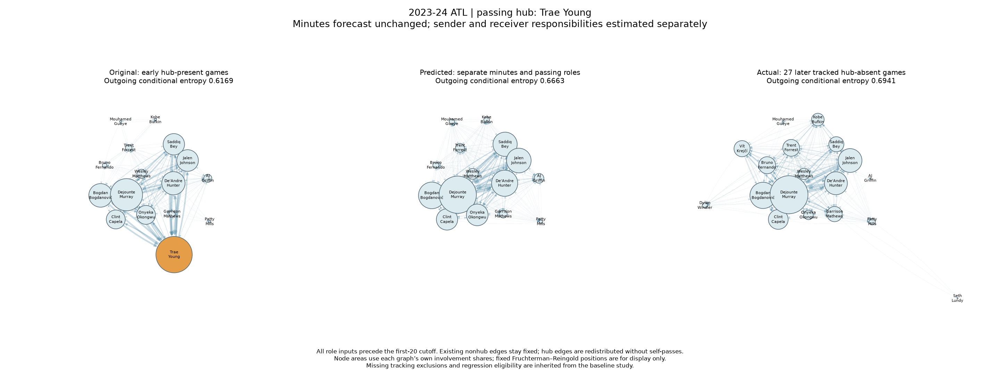

[Original matrix](ATL/original_hub_present.csv) | [Predicted matrix](ATL/predicted_hub_absent.csv) | [Actual matrix](ATL/actual_hub_absent.csv)

## BKN

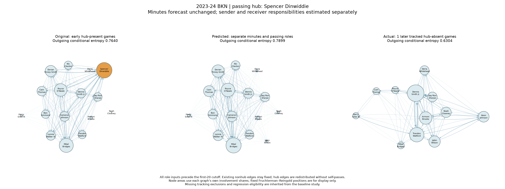

[Original matrix](BKN/original_hub_present.csv) | [Predicted matrix](BKN/predicted_hub_absent.csv) | [Actual matrix](BKN/actual_hub_absent.csv)

## BOS

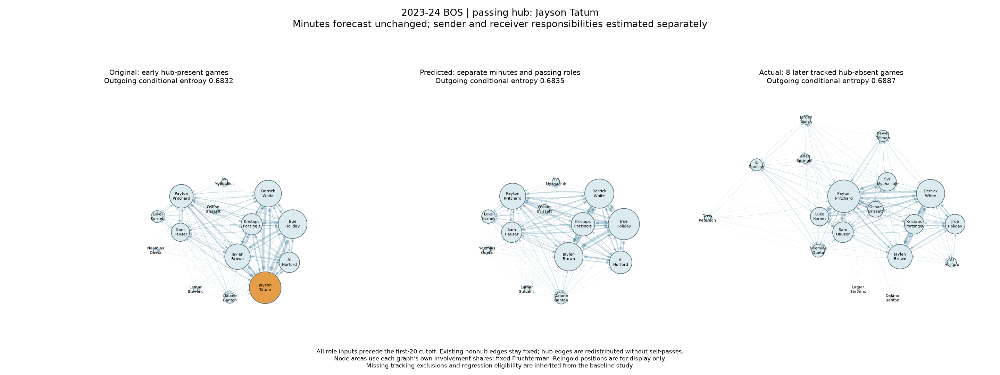

[Original matrix](BOS/original_hub_present.csv) | [Predicted matrix](BOS/predicted_hub_absent.csv) | [Actual matrix](BOS/actual_hub_absent.csv)

## CHA

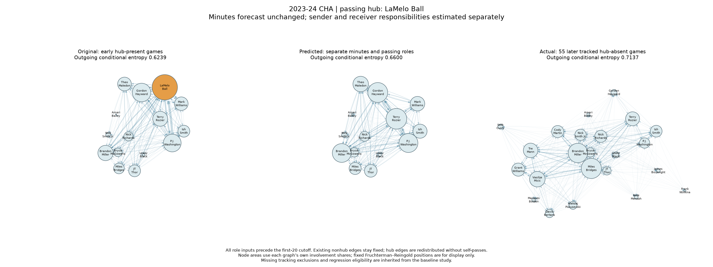

[Original matrix](CHA/original_hub_present.csv) | [Predicted matrix](CHA/predicted_hub_absent.csv) | [Actual matrix](CHA/actual_hub_absent.csv)

## CHI

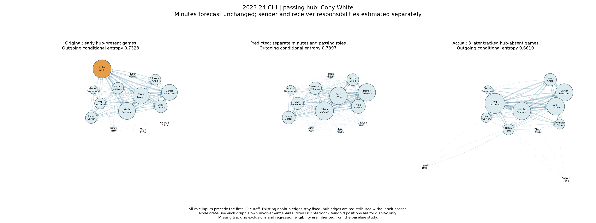

[Original matrix](CHI/original_hub_present.csv) | [Predicted matrix](CHI/predicted_hub_absent.csv) | [Actual matrix](CHI/actual_hub_absent.csv)

## CLE

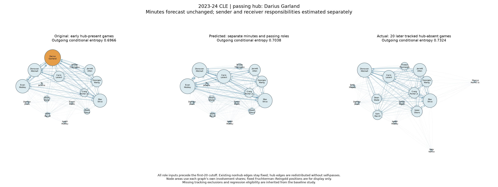

[Original matrix](CLE/original_hub_present.csv) | [Predicted matrix](CLE/predicted_hub_absent.csv) | [Actual matrix](CLE/actual_hub_absent.csv)

## DAL

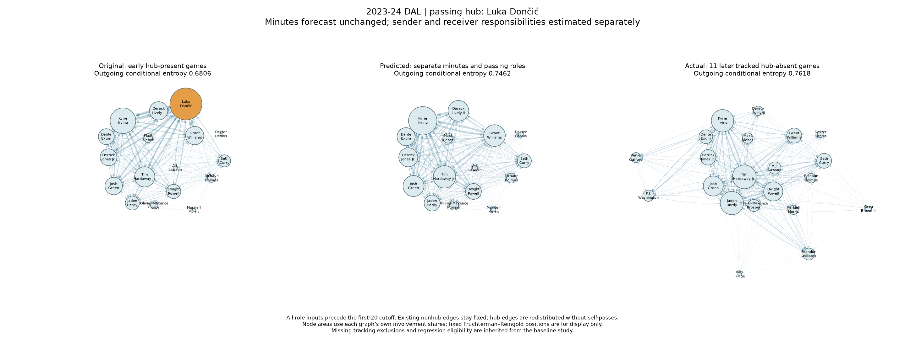

[Original matrix](DAL/original_hub_present.csv) | [Predicted matrix](DAL/predicted_hub_absent.csv) | [Actual matrix](DAL/actual_hub_absent.csv)

## DEN

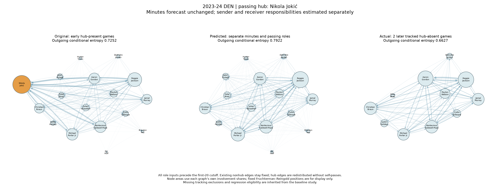

[Original matrix](DEN/original_hub_present.csv) | [Predicted matrix](DEN/predicted_hub_absent.csv) | [Actual matrix](DEN/actual_hub_absent.csv)

## DET

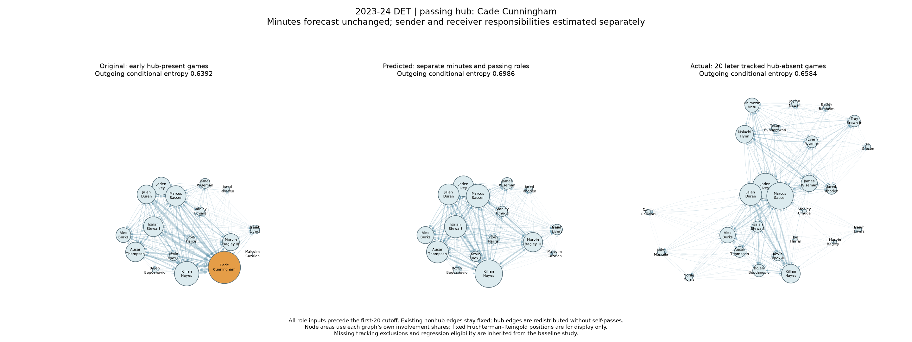

[Original matrix](DET/original_hub_present.csv) | [Predicted matrix](DET/predicted_hub_absent.csv) | [Actual matrix](DET/actual_hub_absent.csv)

## GSW

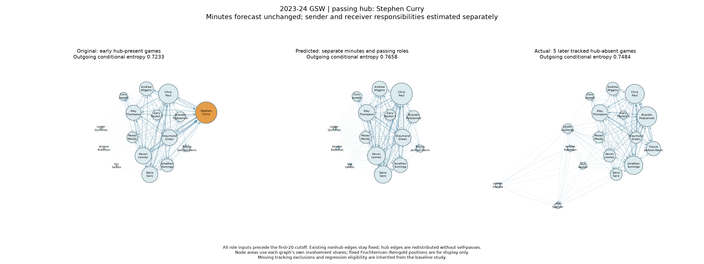

[Original matrix](GSW/original_hub_present.csv) | [Predicted matrix](GSW/predicted_hub_absent.csv) | [Actual matrix](GSW/actual_hub_absent.csv)

## HOU

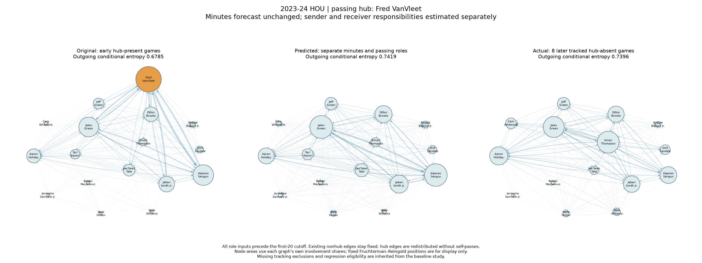

[Original matrix](HOU/original_hub_present.csv) | [Predicted matrix](HOU/predicted_hub_absent.csv) | [Actual matrix](HOU/actual_hub_absent.csv)

## IND

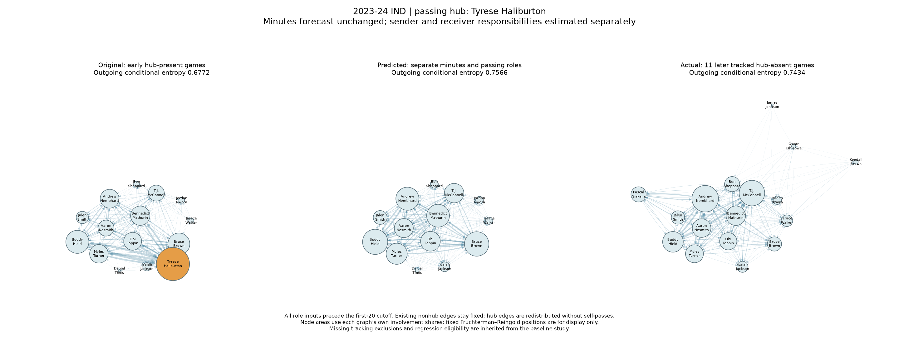

[Original matrix](IND/original_hub_present.csv) | [Predicted matrix](IND/predicted_hub_absent.csv) | [Actual matrix](IND/actual_hub_absent.csv)

## LAC

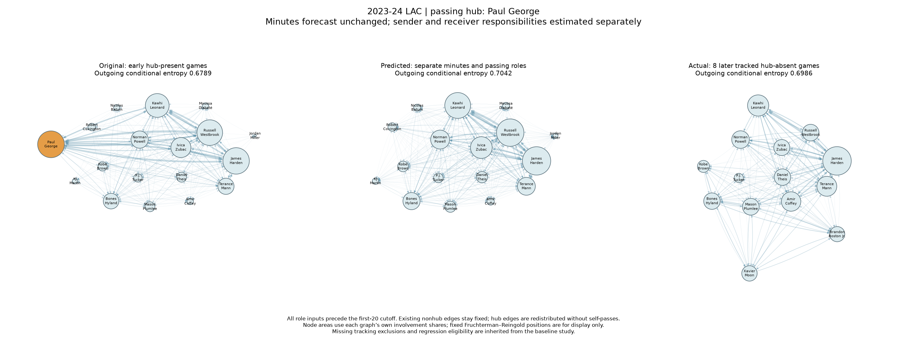

[Original matrix](LAC/original_hub_present.csv) | [Predicted matrix](LAC/predicted_hub_absent.csv) | [Actual matrix](LAC/actual_hub_absent.csv)

## LAL

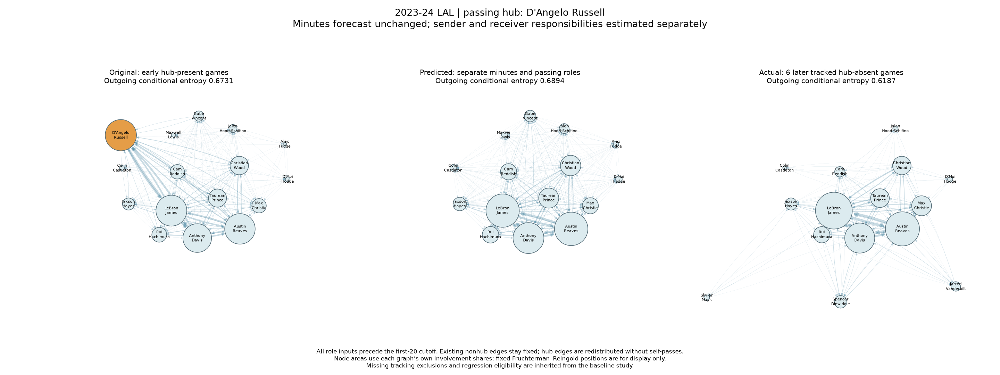

[Original matrix](LAL/original_hub_present.csv) | [Predicted matrix](LAL/predicted_hub_absent.csv) | [Actual matrix](LAL/actual_hub_absent.csv)

## MEM

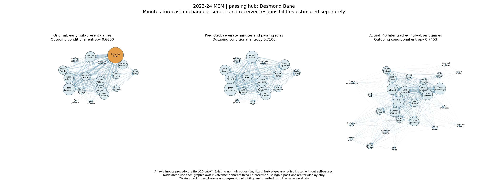

[Original matrix](MEM/original_hub_present.csv) | [Predicted matrix](MEM/predicted_hub_absent.csv) | [Actual matrix](MEM/actual_hub_absent.csv)

## MIA

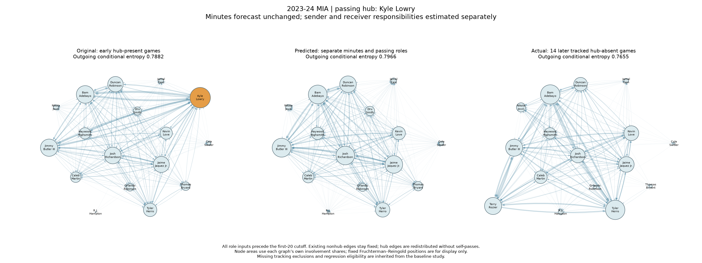

[Original matrix](MIA/original_hub_present.csv) | [Predicted matrix](MIA/predicted_hub_absent.csv) | [Actual matrix](MIA/actual_hub_absent.csv)

## MIL

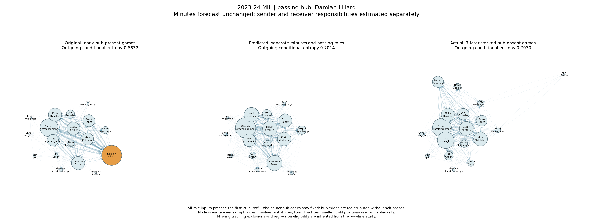

[Original matrix](MIL/original_hub_present.csv) | [Predicted matrix](MIL/predicted_hub_absent.csv) | [Actual matrix](MIL/actual_hub_absent.csv)

## MIN

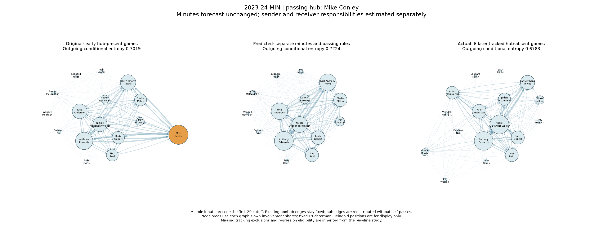

[Original matrix](MIN/original_hub_present.csv) | [Predicted matrix](MIN/predicted_hub_absent.csv) | [Actual matrix](MIN/actual_hub_absent.csv)

## NOP

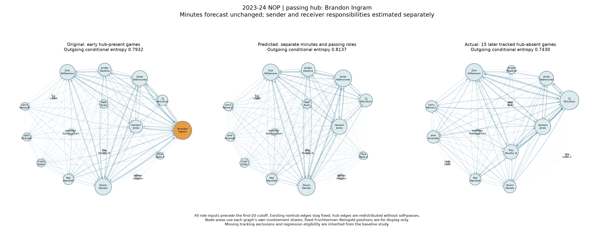

[Original matrix](NOP/original_hub_present.csv) | [Predicted matrix](NOP/predicted_hub_absent.csv) | [Actual matrix](NOP/actual_hub_absent.csv)

## NYK

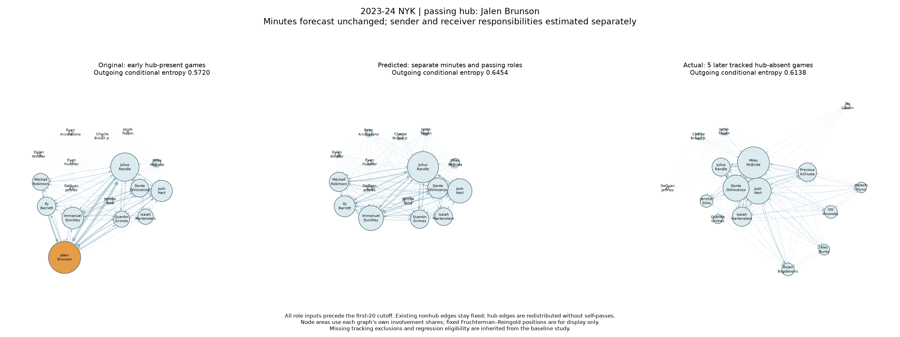

[Original matrix](NYK/original_hub_present.csv) | [Predicted matrix](NYK/predicted_hub_absent.csv) | [Actual matrix](NYK/actual_hub_absent.csv)

## OKC

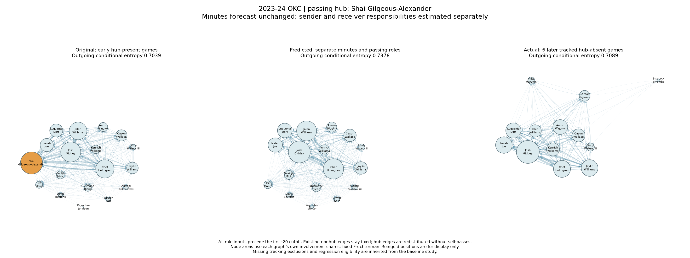

[Original matrix](OKC/original_hub_present.csv) | [Predicted matrix](OKC/predicted_hub_absent.csv) | [Actual matrix](OKC/actual_hub_absent.csv)

## ORL

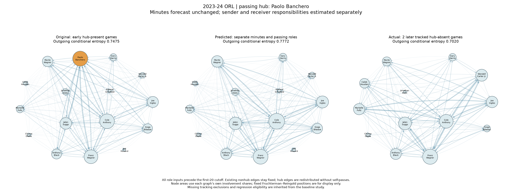

[Original matrix](ORL/original_hub_present.csv) | [Predicted matrix](ORL/predicted_hub_absent.csv) | [Actual matrix](ORL/actual_hub_absent.csv)

## PHI

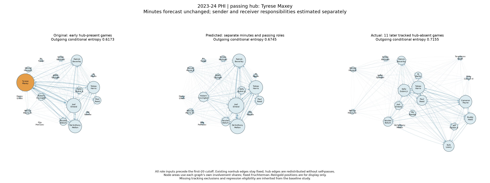

[Original matrix](PHI/original_hub_present.csv) | [Predicted matrix](PHI/predicted_hub_absent.csv) | [Actual matrix](PHI/actual_hub_absent.csv)

## PHX

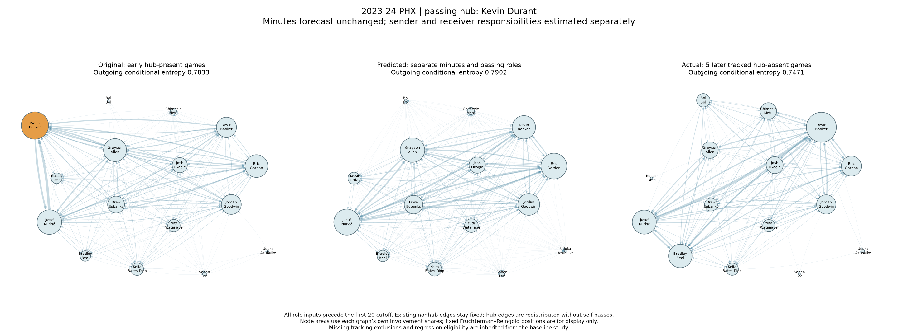

[Original matrix](PHX/original_hub_present.csv) | [Predicted matrix](PHX/predicted_hub_absent.csv) | [Actual matrix](PHX/actual_hub_absent.csv)

## POR

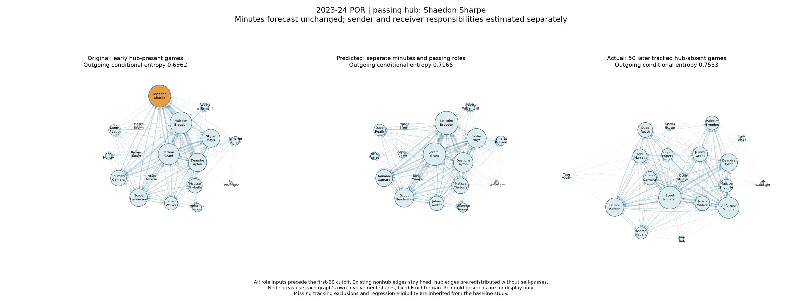

[Original matrix](POR/original_hub_present.csv) | [Predicted matrix](POR/predicted_hub_absent.csv) | [Actual matrix](POR/actual_hub_absent.csv)

## SAC

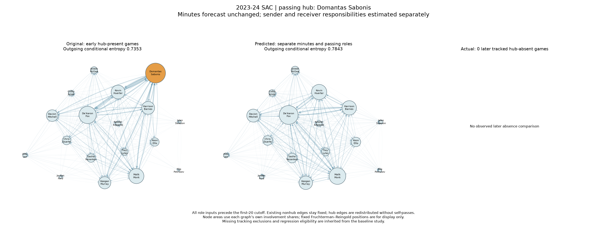

[Original matrix](SAC/original_hub_present.csv) | [Predicted matrix](SAC/predicted_hub_absent.csv) | [Actual matrix](SAC/actual_hub_absent.csv)

## SAS

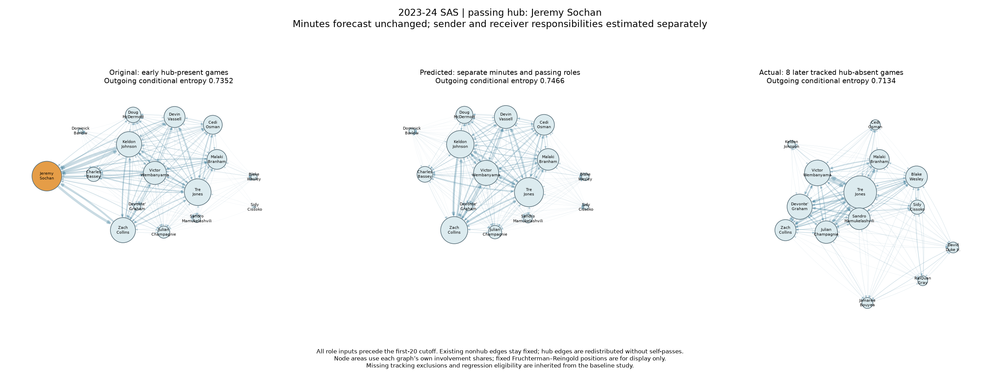

[Original matrix](SAS/original_hub_present.csv) | [Predicted matrix](SAS/predicted_hub_absent.csv) | [Actual matrix](SAS/actual_hub_absent.csv)

## TOR

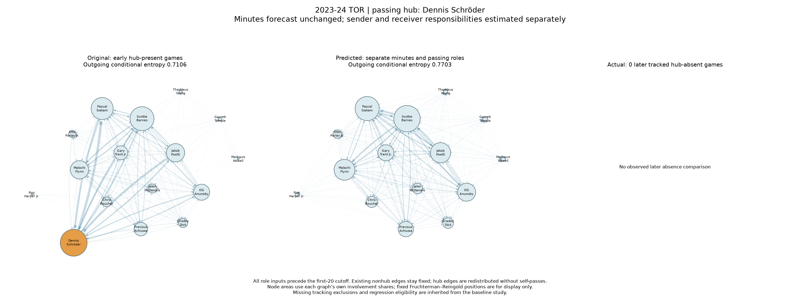

[Original matrix](TOR/original_hub_present.csv) | [Predicted matrix](TOR/predicted_hub_absent.csv) | [Actual matrix](TOR/actual_hub_absent.csv)

## UTA

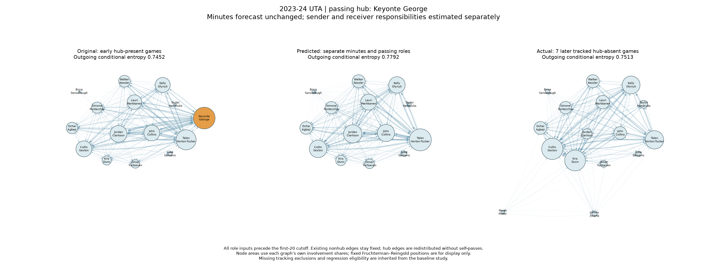

[Original matrix](UTA/original_hub_present.csv) | [Predicted matrix](UTA/predicted_hub_absent.csv) | [Actual matrix](UTA/actual_hub_absent.csv)

## WAS

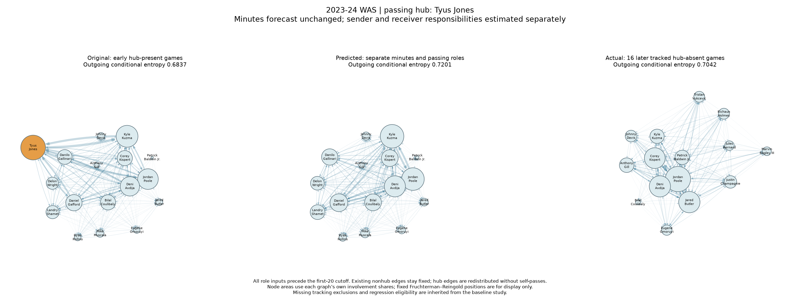

[Original matrix](WAS/original_hub_present.csv) | [Predicted matrix](WAS/predicted_hub_absent.csv) | [Actual matrix](WAS/actual_hub_absent.csv)
