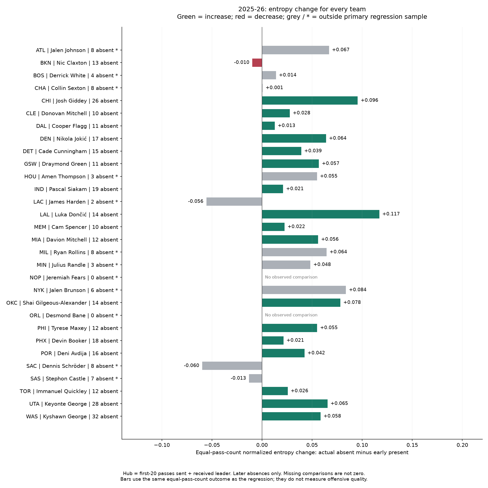

# Passing hub centrality and entropy changes

Latest analysis across 2020-21 through 2025-26, grouped here for easy access.

- [Regression report: eight graph pages](pass_strength_entropy_regressions/pass_strength_entropy_regressions.pdf)
- [All 30 teams: 36-page entropy report](pass_strength_team_changes/all_30_teams_entropy_changes.pdf)
- [Analysis and interpretation](pass_strength_team_changes/ANALYSIS.md)
- [Regression methodology and results](pass_strength_entropy_regressions/METHOD_AND_RESULTS.md)
- [Team entropy data](pass_strength_team_changes/all_team_entropy_changes.csv)
- [Pooled regression statistics](pass_strength_entropy_regressions/pooled_regressions.csv)
- [All graphs, data and plotting code ZIP](team_entropy_changes_graphs_and_data.zip)
- [Complete regression code ZIP](pass_strength_regressions_full_code.zip)

## Main result

Across 96 eligible team-seasons, greater first-20 hub pass involvement is associated with a larger later hub-absent entropy increase: season-adjusted r=0.383, R2=14.6%, corrected pooled p=0.0007. The later hub-present comparison gives r=0.368. This is exploratory and does not establish causal player impact or better offense.

## Graphs

The `pass_strength_entropy_regressions` folder contains scatterplots and regression tables. The `pass_strength_team_changes` folder contains six league-wide change charts and a six-season entropy comparison for every franchise. Grey bars are outside the primary regression sample; missing comparisons are not zero.

## Code

The downloadable packages include the code. Working modules remain in [the parent SportsAnalysis folder](../) so their imports and existing command-line paths remain available. This folder reorganizes the published deliverables; underlying calculations and local output paths are unchanged. The full historical local data folder is not part of this upload.
