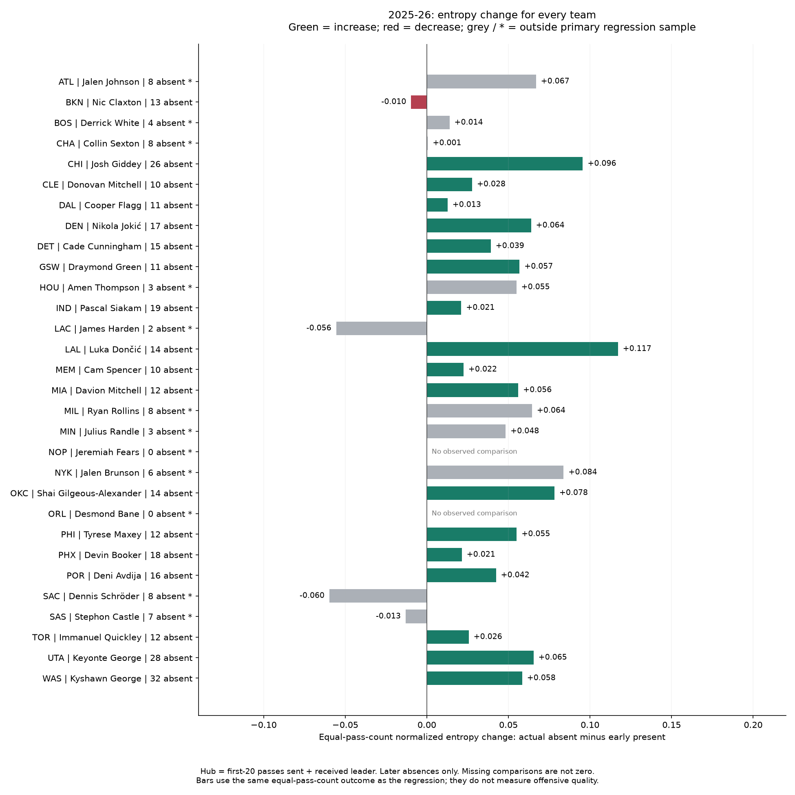

# SportsAnalysis: NBA passing networks

This folder contains the Python code, downloaded NBA data, network matrices, figures, reports, and historical analysis packages from the SportsAnalysis project.

## Latest results

- [Passing involvement centrality regressions](nba_passing_output/pass_strength_entropy_regressions/METHOD_AND_RESULTS.md)
- [Regression figures (8-page PDF)](nba_passing_output/pass_strength_entropy_regressions/pass_strength_entropy_regressions.pdf)
- [Team-by-team analysis](nba_passing_output/pass_strength_team_changes/ANALYSIS.md)
- [All 30 teams across six seasons (36-page PDF)](nba_passing_output/pass_strength_team_changes/all_30_teams_entropy_changes.pdf)
- [All team entropy data](nba_passing_output/pass_strength_team_changes/all_team_entropy_changes.csv)
- [Graphs, data and plotting-code download](team_entropy_changes_graphs_and_data.zip)
- [Complete regression code package](pass_strength_regressions_full_code.zip)

## Current study

The passing hub is selected by the largest passes sent plus received in each team's first 20 games. The centrality predictor is the proportion of recorded team passes involving that hub. Later hub-absent entropy is compared with hub-present entropy. The primary 96-team-season regression uses equal-pass-count subsampling, season adjustment and franchise-clustered inference. The pooled association is r=0.383, R2=14.6%, corrected p=0.0007; the later-present reference gives r=0.368. These are exploratory associations, not causal effects or evidence of improved offense.

The team report displays all 180 team-seasons from 2020-21 through 2025-26, marking observations outside the primary regression sample. The latest predicted networks use separate minutes and passing-role redistribution; original and actual networks are unchanged. Three-scenario entropy dots show full-network entropy levels, while regression changes use equal-pass-count estimates. Missing comparisons are not zero.

## Code and reproducibility

`teamgraphs.py` retains the existing command-line options. For the latest regression, run `python teamgraphs.py --pass-strength-entropy-regressions --help`. Supporting modules and source data are included here. Some historical helpers and plotting scripts contain paths from the original machine; adjust those paths when running elsewhere. Requirements for the six-season work are in `ALL_SEASON_HUB_REQUIREMENTS.txt`.

Older alternative hub definitions and exploratory studies remain archived alongside the current study. Their outputs should not be combined as if they used the same methodology. Source data are NBA tracking aggregates; the upload does not constitute independent validation of those source records.

## Archive notes

This update publishes the latest passing-strength regressions and team entropy changes, their complete code packages, and the current Python modules and supporting documentation. The full local historical-data folder was not synchronized. Existing repository data and unrelated files are preserved. Operating-system metadata and Python bytecode are omitted.
