# 2020-21: all30 team illustrations; evaluation includes only10+ later absences

Panels: original early hub present; final previous-season-only prediction; actual later hub absent. Open an image for full resolution. Node sizes use each panel's own passing involvement.

## ATL | Trae Young

8 later absent games.

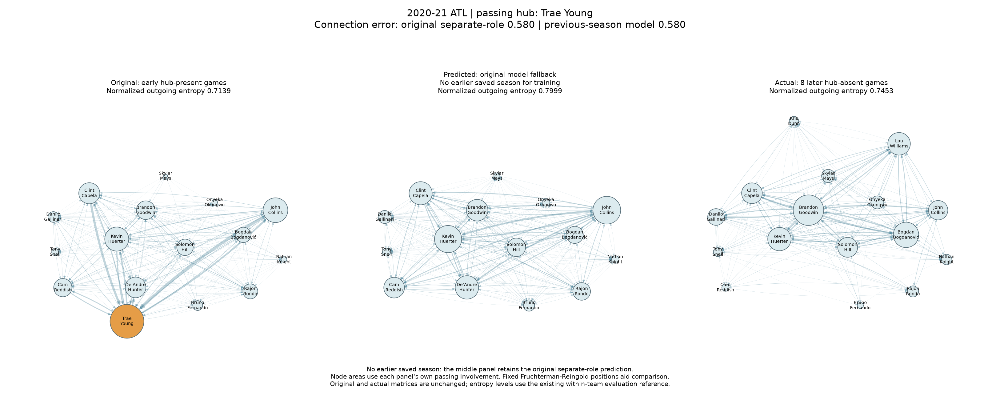

[Original matrix](../../data/nba_passing_output/all_season_hub_redistribution/2020-21/ATL/original_evaluation.csv) | [Predicted matrix](../../prediction_model/2020-21/ATL/predicted_evaluation.csv) | [Actual matrix](../../data/nba_passing_output/all_season_hub_redistribution/2020-21/ATL/actual_evaluation.csv)

## BKN | Kevin Durant

32 later absent games.

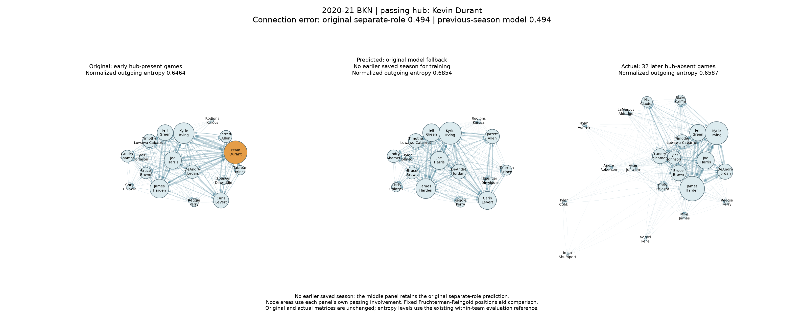

[Original matrix](../../data/nba_passing_output/all_season_hub_redistribution/2020-21/BKN/original_evaluation.csv) | [Predicted matrix](../../prediction_model/2020-21/BKN/predicted_evaluation.csv) | [Actual matrix](../../data/nba_passing_output/all_season_hub_redistribution/2020-21/BKN/actual_evaluation.csv)

## BOS | Marcus Smart

21 later absent games.

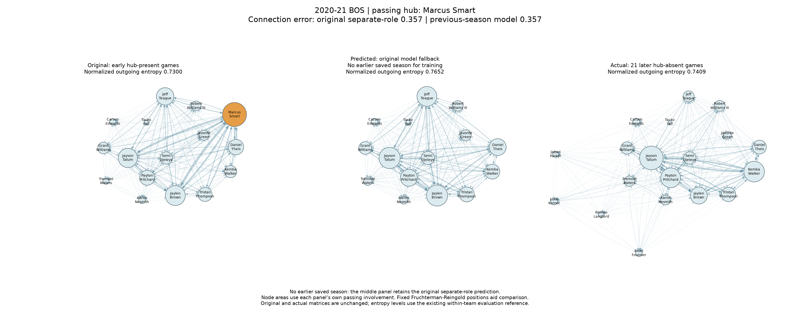

[Original matrix](../../data/nba_passing_output/all_season_hub_redistribution/2020-21/BOS/original_evaluation.csv) | [Predicted matrix](../../prediction_model/2020-21/BOS/predicted_evaluation.csv) | [Actual matrix](../../data/nba_passing_output/all_season_hub_redistribution/2020-21/BOS/actual_evaluation.csv)

## CHA | Devonte' Graham

17 later absent games.

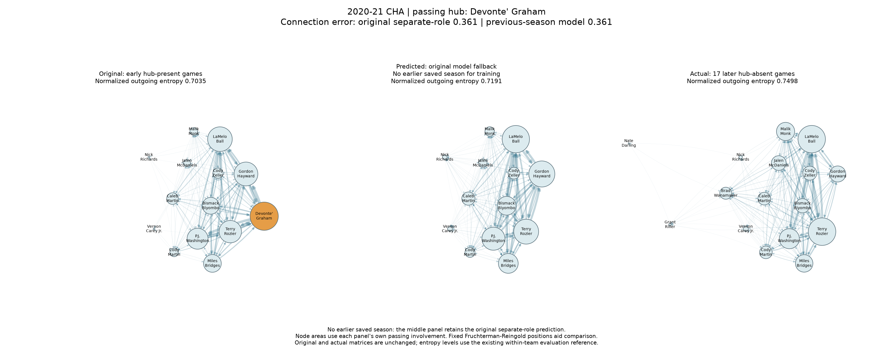

[Original matrix](../../data/nba_passing_output/all_season_hub_redistribution/2020-21/CHA/original_evaluation.csv) | [Predicted matrix](../../prediction_model/2020-21/CHA/predicted_evaluation.csv) | [Actual matrix](../../data/nba_passing_output/all_season_hub_redistribution/2020-21/CHA/actual_evaluation.csv)

## CHI | Coby White

3 later absent games.

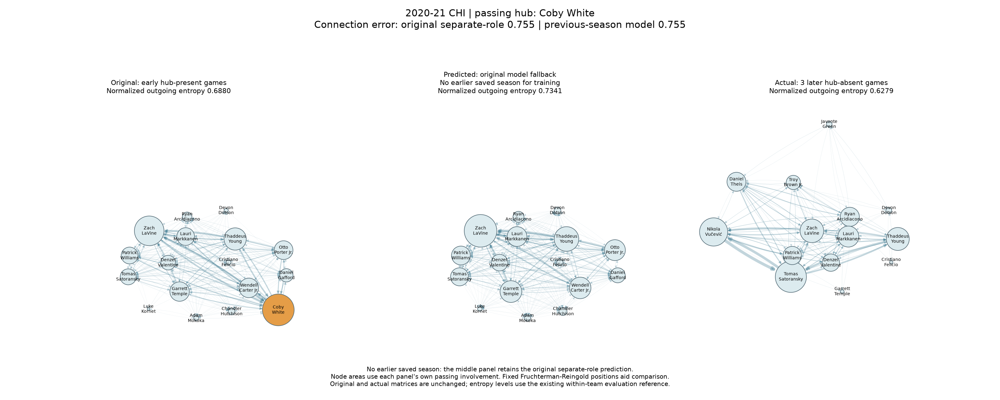

[Original matrix](../../data/nba_passing_output/all_season_hub_redistribution/2020-21/CHI/original_evaluation.csv) | [Predicted matrix](../../prediction_model/2020-21/CHI/predicted_evaluation.csv) | [Actual matrix](../../data/nba_passing_output/all_season_hub_redistribution/2020-21/CHI/actual_evaluation.csv)

## CLE | Collin Sexton

7 later absent games.

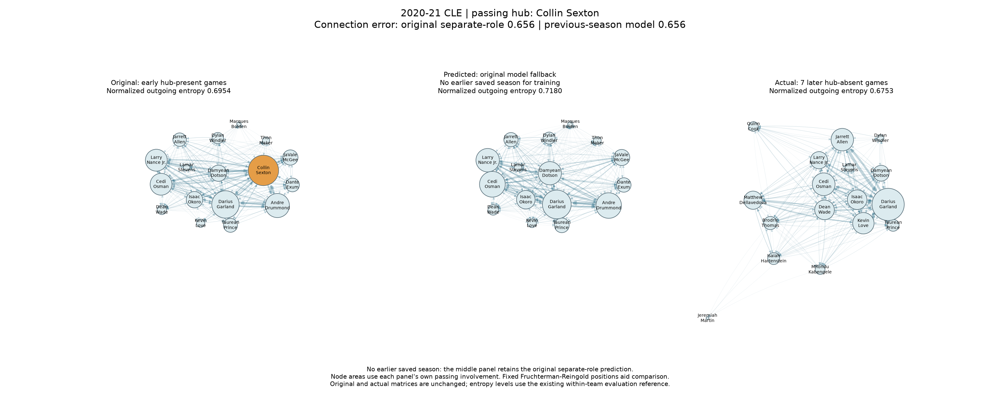

[Original matrix](../../data/nba_passing_output/all_season_hub_redistribution/2020-21/CLE/original_evaluation.csv) | [Predicted matrix](../../prediction_model/2020-21/CLE/predicted_evaluation.csv) | [Actual matrix](../../data/nba_passing_output/all_season_hub_redistribution/2020-21/CLE/actual_evaluation.csv)

## DAL | Luka Dončić

5 later absent games.

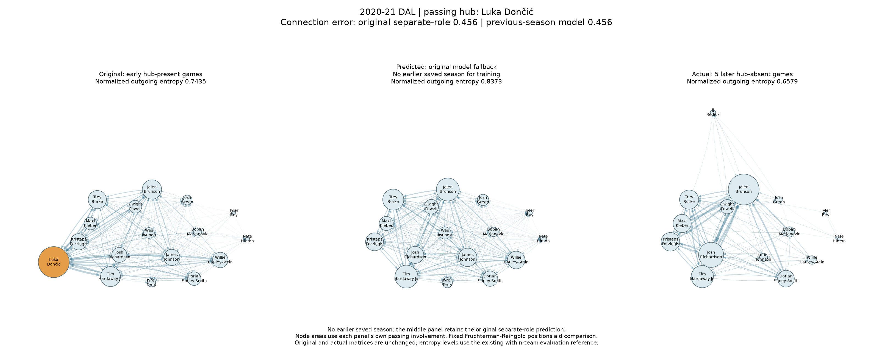

[Original matrix](../../data/nba_passing_output/all_season_hub_redistribution/2020-21/DAL/original_evaluation.csv) | [Predicted matrix](../../prediction_model/2020-21/DAL/predicted_evaluation.csv) | [Actual matrix](../../data/nba_passing_output/all_season_hub_redistribution/2020-21/DAL/actual_evaluation.csv)

## DEN | Nikola Jokić

0 later absent games.

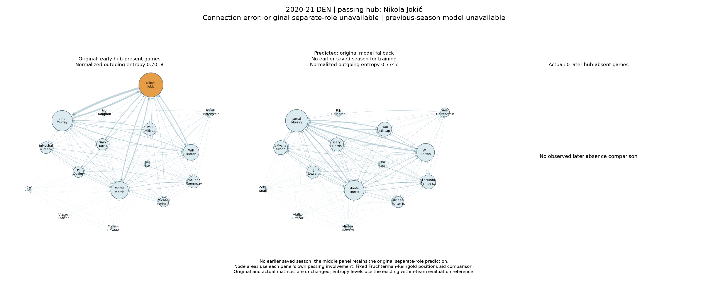

[Original matrix](../../data/nba_passing_output/all_season_hub_redistribution/2020-21/DEN/original_evaluation.csv) | [Predicted matrix](../../prediction_model/2020-21/DEN/predicted_evaluation.csv) | [Actual matrix](../../data/nba_passing_output/all_season_hub_redistribution/2020-21/DEN/actual_evaluation.csv)

## DET | Delon Wright

7 later absent games.

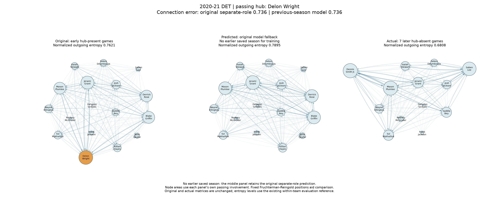

[Original matrix](../../data/nba_passing_output/all_season_hub_redistribution/2020-21/DET/original_evaluation.csv) | [Predicted matrix](../../prediction_model/2020-21/DET/predicted_evaluation.csv) | [Actual matrix](../../data/nba_passing_output/all_season_hub_redistribution/2020-21/DET/actual_evaluation.csv)

## GSW | Stephen Curry

9 later absent games.

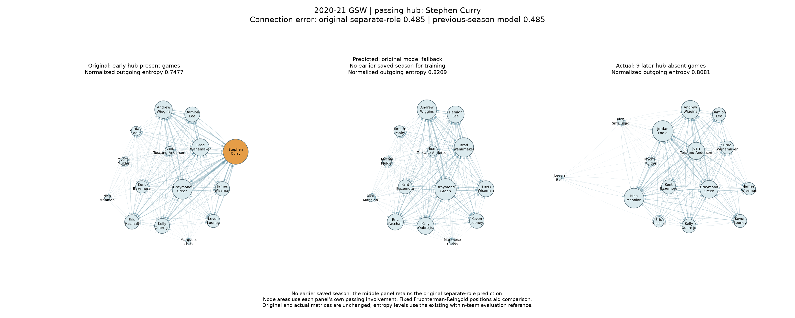

[Original matrix](../../data/nba_passing_output/all_season_hub_redistribution/2020-21/GSW/original_evaluation.csv) | [Predicted matrix](../../prediction_model/2020-21/GSW/predicted_evaluation.csv) | [Actual matrix](../../data/nba_passing_output/all_season_hub_redistribution/2020-21/GSW/actual_evaluation.csv)

## HOU | Christian Wood

27 later absent games.

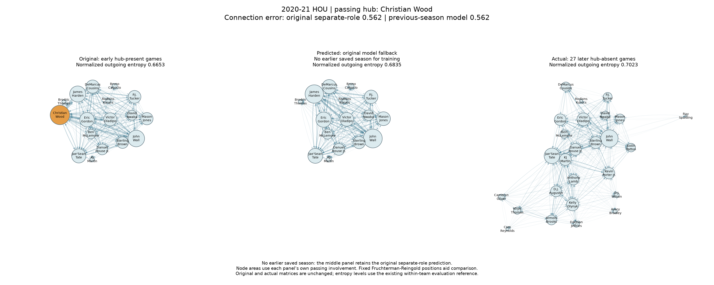

[Original matrix](../../data/nba_passing_output/all_season_hub_redistribution/2020-21/HOU/original_evaluation.csv) | [Predicted matrix](../../prediction_model/2020-21/HOU/predicted_evaluation.csv) | [Actual matrix](../../data/nba_passing_output/all_season_hub_redistribution/2020-21/HOU/actual_evaluation.csv)

## IND | Malcolm Brogdon

16 later absent games.

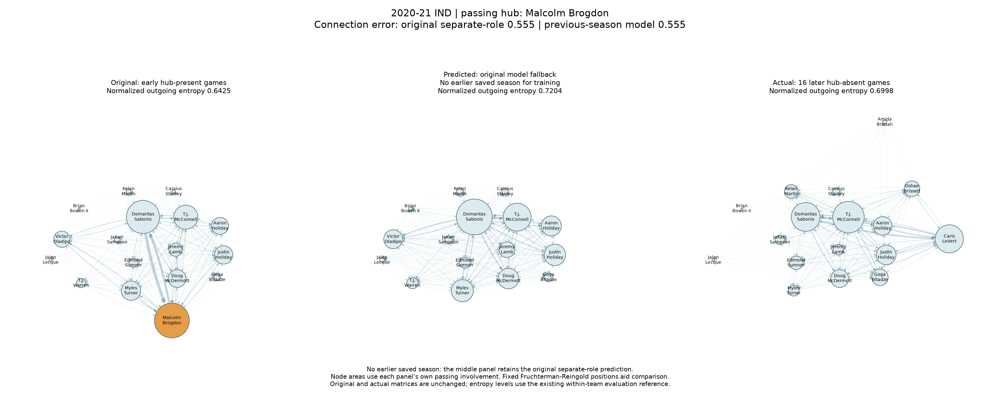

[Original matrix](../../data/nba_passing_output/all_season_hub_redistribution/2020-21/IND/original_evaluation.csv) | [Predicted matrix](../../prediction_model/2020-21/IND/predicted_evaluation.csv) | [Actual matrix](../../data/nba_passing_output/all_season_hub_redistribution/2020-21/IND/actual_evaluation.csv)

## LAC | Paul George

15 later absent games.

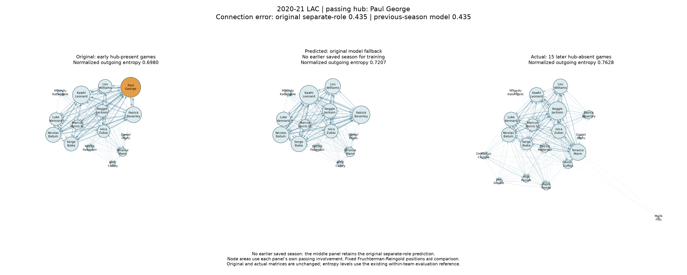

[Original matrix](../../data/nba_passing_output/all_season_hub_redistribution/2020-21/LAC/original_evaluation.csv) | [Predicted matrix](../../prediction_model/2020-21/LAC/predicted_evaluation.csv) | [Actual matrix](../../data/nba_passing_output/all_season_hub_redistribution/2020-21/LAC/actual_evaluation.csv)

## LAL | LeBron James

27 later absent games.

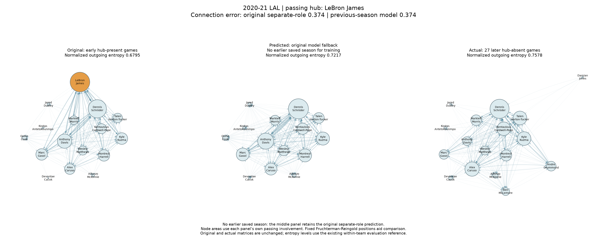

[Original matrix](../../data/nba_passing_output/all_season_hub_redistribution/2020-21/LAL/original_evaluation.csv) | [Predicted matrix](../../prediction_model/2020-21/LAL/predicted_evaluation.csv) | [Actual matrix](../../data/nba_passing_output/all_season_hub_redistribution/2020-21/LAL/actual_evaluation.csv)

## MEM | Tyus Jones

2 later absent games.

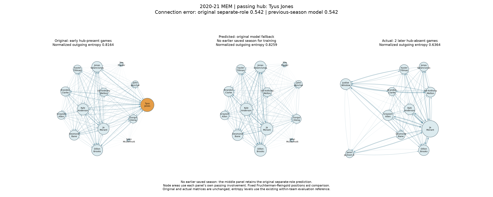

[Original matrix](../../data/nba_passing_output/all_season_hub_redistribution/2020-21/MEM/original_evaluation.csv) | [Predicted matrix](../../prediction_model/2020-21/MEM/predicted_evaluation.csv) | [Actual matrix](../../data/nba_passing_output/all_season_hub_redistribution/2020-21/MEM/actual_evaluation.csv)

## MIA | Bam Adebayo

6 later absent games.

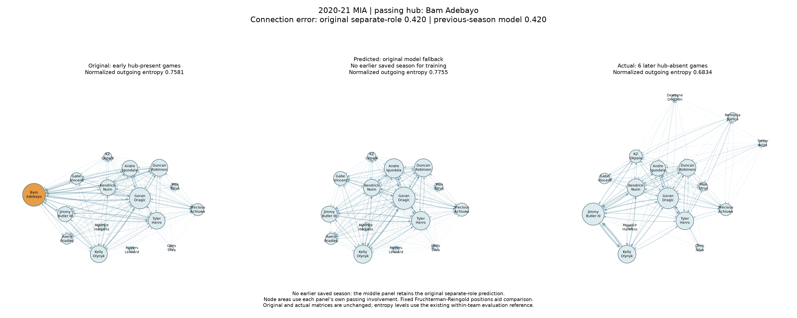

[Original matrix](../../data/nba_passing_output/all_season_hub_redistribution/2020-21/MIA/original_evaluation.csv) | [Predicted matrix](../../prediction_model/2020-21/MIA/predicted_evaluation.csv) | [Actual matrix](../../data/nba_passing_output/all_season_hub_redistribution/2020-21/MIA/actual_evaluation.csv)

## MIL | Khris Middleton

4 later absent games.

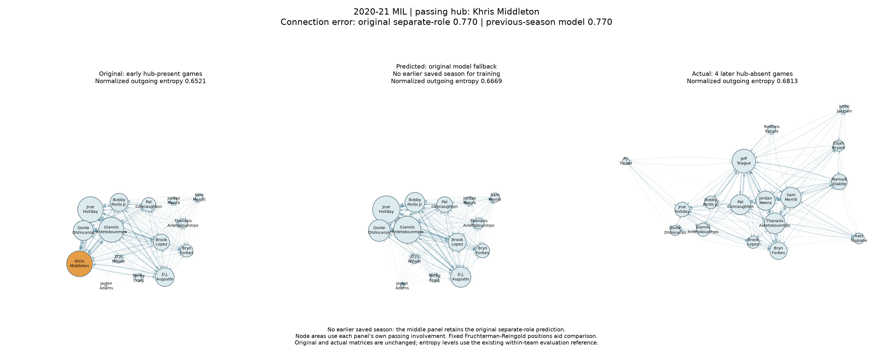

[Original matrix](../../data/nba_passing_output/all_season_hub_redistribution/2020-21/MIL/original_evaluation.csv) | [Predicted matrix](../../prediction_model/2020-21/MIL/predicted_evaluation.csv) | [Actual matrix](../../data/nba_passing_output/all_season_hub_redistribution/2020-21/MIL/actual_evaluation.csv)

## MIN | D'Angelo Russell

27 later absent games.

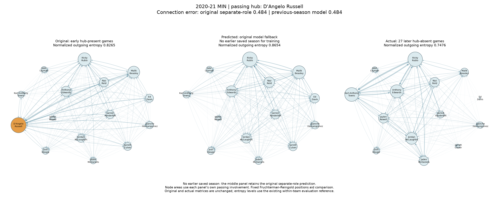

[Original matrix](../../data/nba_passing_output/all_season_hub_redistribution/2020-21/MIN/original_evaluation.csv) | [Predicted matrix](../../prediction_model/2020-21/MIN/predicted_evaluation.csv) | [Actual matrix](../../data/nba_passing_output/all_season_hub_redistribution/2020-21/MIN/actual_evaluation.csv)

## NOP | Lonzo Ball

14 later absent games.

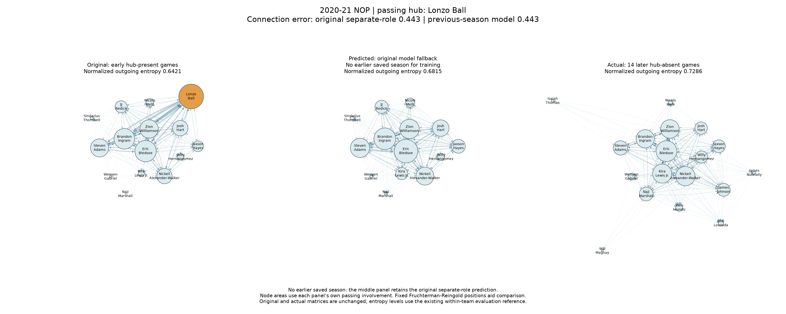

[Original matrix](../../data/nba_passing_output/all_season_hub_redistribution/2020-21/NOP/original_evaluation.csv) | [Predicted matrix](../../prediction_model/2020-21/NOP/predicted_evaluation.csv) | [Actual matrix](../../data/nba_passing_output/all_season_hub_redistribution/2020-21/NOP/actual_evaluation.csv)

## NYK | Julius Randle

1 later absent games.

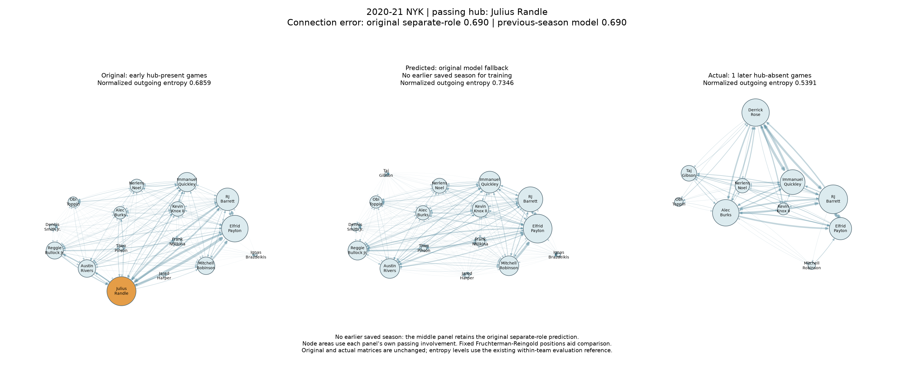

[Original matrix](../../data/nba_passing_output/all_season_hub_redistribution/2020-21/NYK/original_evaluation.csv) | [Predicted matrix](../../prediction_model/2020-21/NYK/predicted_evaluation.csv) | [Actual matrix](../../data/nba_passing_output/all_season_hub_redistribution/2020-21/NYK/actual_evaluation.csv)

## OKC | Shai Gilgeous-Alexander

36 later absent games.

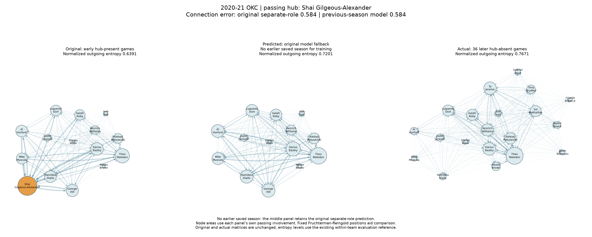

[Original matrix](../../data/nba_passing_output/all_season_hub_redistribution/2020-21/OKC/original_evaluation.csv) | [Predicted matrix](../../prediction_model/2020-21/OKC/predicted_evaluation.csv) | [Actual matrix](../../data/nba_passing_output/all_season_hub_redistribution/2020-21/OKC/actual_evaluation.csv)

## ORL | Nikola Vučević

0 later absent games.

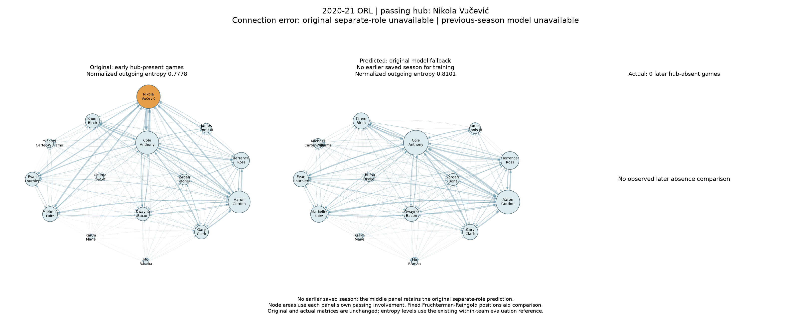

[Original matrix](../../data/nba_passing_output/all_season_hub_redistribution/2020-21/ORL/original_evaluation.csv) | [Predicted matrix](../../prediction_model/2020-21/ORL/predicted_evaluation.csv) | [Actual matrix](../../data/nba_passing_output/all_season_hub_redistribution/2020-21/ORL/actual_evaluation.csv)

## PHI | Ben Simmons

12 later absent games.

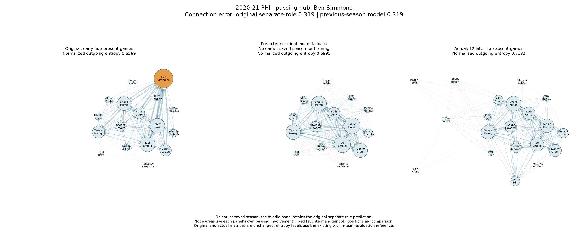

[Original matrix](../../data/nba_passing_output/all_season_hub_redistribution/2020-21/PHI/original_evaluation.csv) | [Predicted matrix](../../prediction_model/2020-21/PHI/predicted_evaluation.csv) | [Actual matrix](../../data/nba_passing_output/all_season_hub_redistribution/2020-21/PHI/actual_evaluation.csv)

## PHX | Chris Paul

2 later absent games.

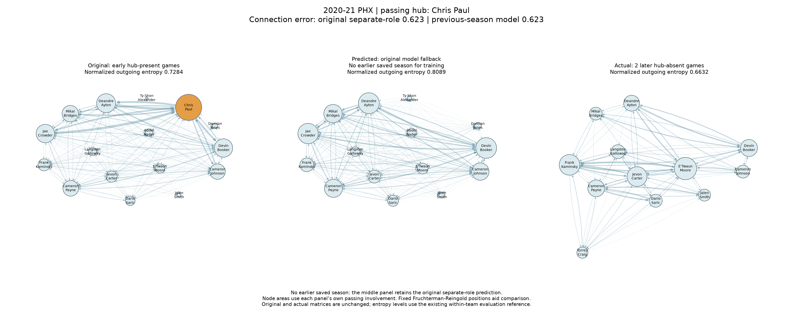

[Original matrix](../../data/nba_passing_output/all_season_hub_redistribution/2020-21/PHX/original_evaluation.csv) | [Predicted matrix](../../prediction_model/2020-21/PHX/predicted_evaluation.csv) | [Actual matrix](../../data/nba_passing_output/all_season_hub_redistribution/2020-21/PHX/actual_evaluation.csv)

## POR | Damian Lillard

5 later absent games.

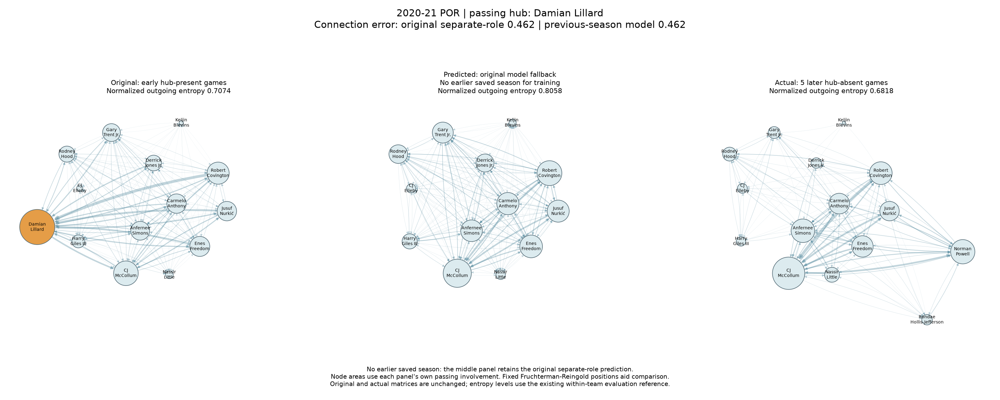

[Original matrix](../../data/nba_passing_output/all_season_hub_redistribution/2020-21/POR/original_evaluation.csv) | [Predicted matrix](../../prediction_model/2020-21/POR/predicted_evaluation.csv) | [Actual matrix](../../data/nba_passing_output/all_season_hub_redistribution/2020-21/POR/actual_evaluation.csv)

## SAC | De'Aaron Fox

14 later absent games.

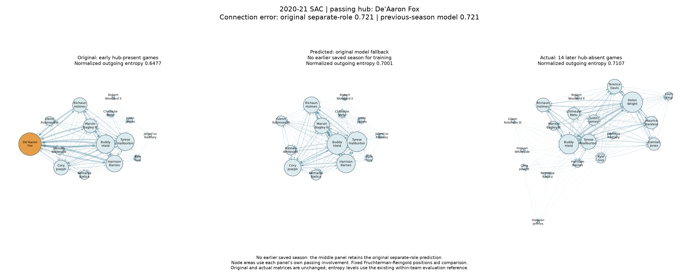

[Original matrix](../../data/nba_passing_output/all_season_hub_redistribution/2020-21/SAC/original_evaluation.csv) | [Predicted matrix](../../prediction_model/2020-21/SAC/predicted_evaluation.csv) | [Actual matrix](../../data/nba_passing_output/all_season_hub_redistribution/2020-21/SAC/actual_evaluation.csv)

## SAS | Dejounte Murray

5 later absent games.

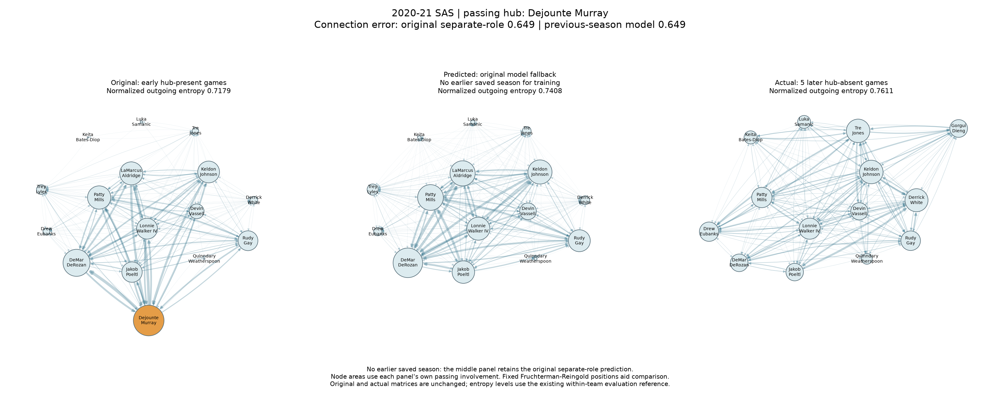

[Original matrix](../../data/nba_passing_output/all_season_hub_redistribution/2020-21/SAS/original_evaluation.csv) | [Predicted matrix](../../prediction_model/2020-21/SAS/predicted_evaluation.csv) | [Actual matrix](../../data/nba_passing_output/all_season_hub_redistribution/2020-21/SAS/actual_evaluation.csv)

## TOR | Fred VanVleet

20 later absent games.

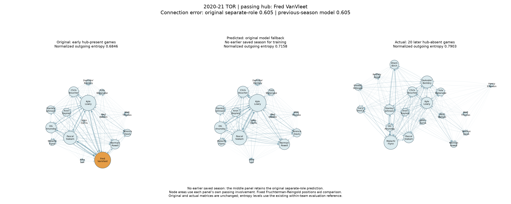

[Original matrix](../../data/nba_passing_output/all_season_hub_redistribution/2020-21/TOR/original_evaluation.csv) | [Predicted matrix](../../prediction_model/2020-21/TOR/predicted_evaluation.csv) | [Actual matrix](../../data/nba_passing_output/all_season_hub_redistribution/2020-21/TOR/actual_evaluation.csv)

## UTA | Mike Conley

21 later absent games.

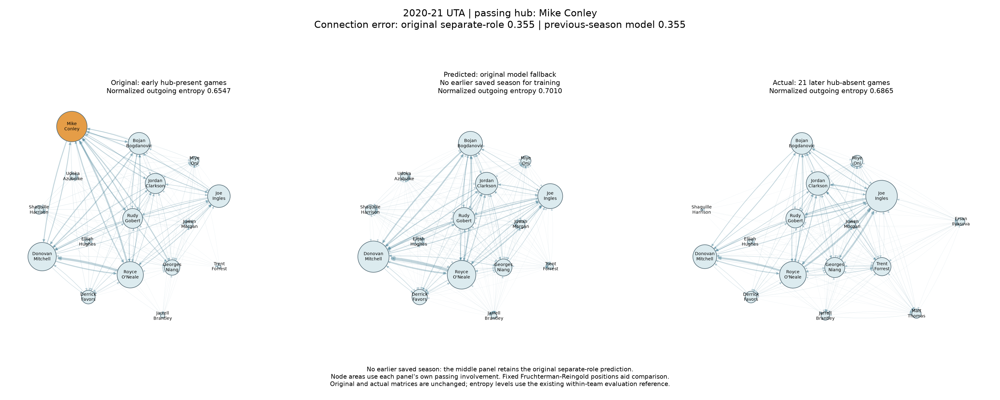

[Original matrix](../../data/nba_passing_output/all_season_hub_redistribution/2020-21/UTA/original_evaluation.csv) | [Predicted matrix](../../prediction_model/2020-21/UTA/predicted_evaluation.csv) | [Actual matrix](../../data/nba_passing_output/all_season_hub_redistribution/2020-21/UTA/actual_evaluation.csv)

## WAS | Bradley Beal

11 later absent games.

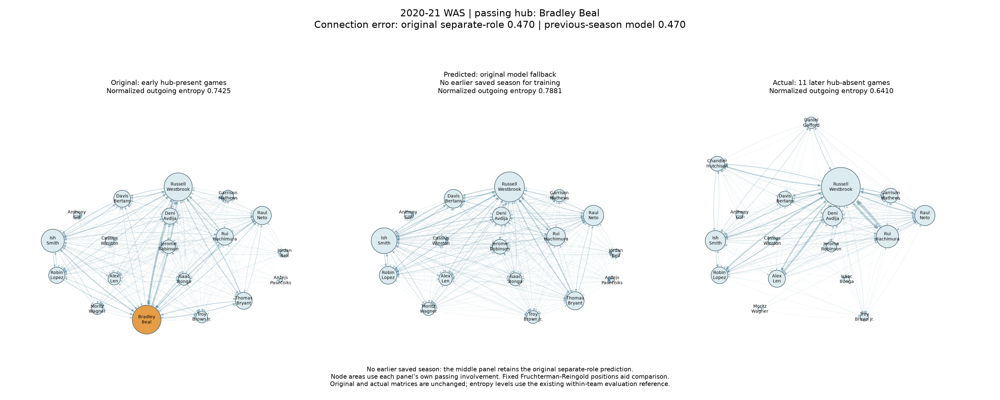

[Original matrix](../../data/nba_passing_output/all_season_hub_redistribution/2020-21/WAS/original_evaluation.csv) | [Predicted matrix](../../prediction_model/2020-21/WAS/predicted_evaluation.csv) | [Actual matrix](../../data/nba_passing_output/all_season_hub_redistribution/2020-21/WAS/actual_evaluation.csv)