# 2021-22: all30 team illustrations; evaluation includes only10+ later absences

Panels: original early hub present; final previous-season-only prediction; actual later hub absent. Open an image for full resolution. Node sizes use each panel's own passing involvement.

## ATL | Trae Young

6 later absent games.

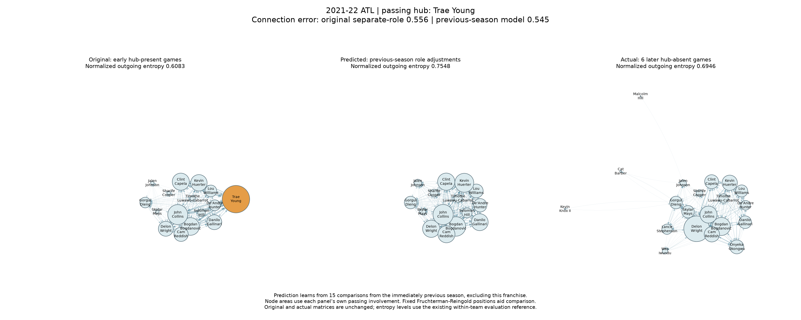

[Original matrix](../../data/nba_passing_output/all_season_hub_redistribution/2021-22/ATL/original_evaluation.csv) | [Predicted matrix](../../prediction_model/2021-22/ATL/predicted_evaluation.csv) | [Actual matrix](../../data/nba_passing_output/all_season_hub_redistribution/2021-22/ATL/actual_evaluation.csv)

## BKN | James Harden

11 later absent games.

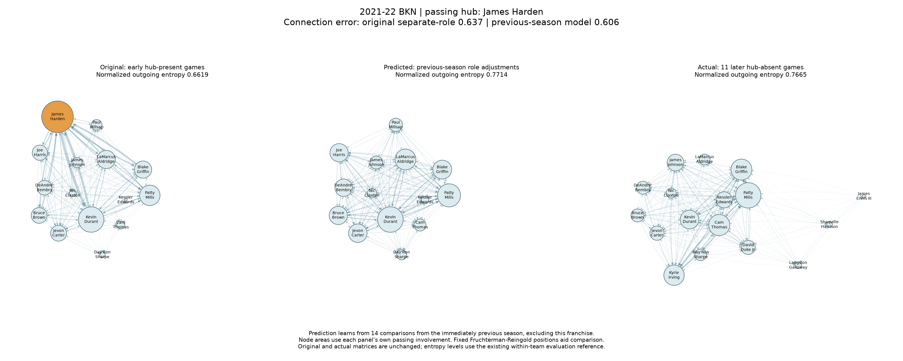

[Original matrix](../../data/nba_passing_output/all_season_hub_redistribution/2021-22/BKN/original_evaluation.csv) | [Predicted matrix](../../prediction_model/2021-22/BKN/predicted_evaluation.csv) | [Actual matrix](../../data/nba_passing_output/all_season_hub_redistribution/2021-22/BKN/actual_evaluation.csv)

## BOS | Dennis Schröder

7 later absent games.

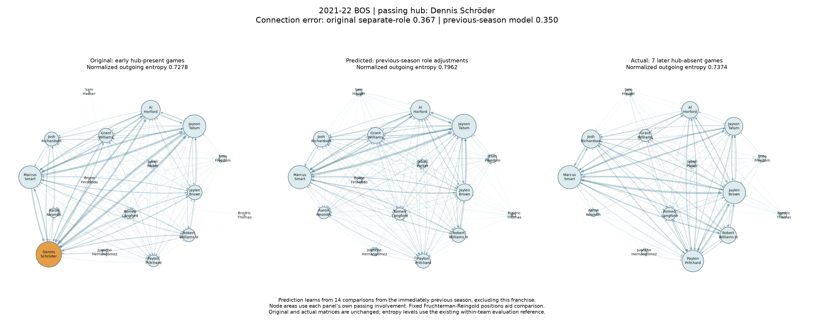

[Original matrix](../../data/nba_passing_output/all_season_hub_redistribution/2021-22/BOS/original_evaluation.csv) | [Predicted matrix](../../prediction_model/2021-22/BOS/predicted_evaluation.csv) | [Actual matrix](../../data/nba_passing_output/all_season_hub_redistribution/2021-22/BOS/actual_evaluation.csv)

## CHA | LaMelo Ball

7 later absent games.

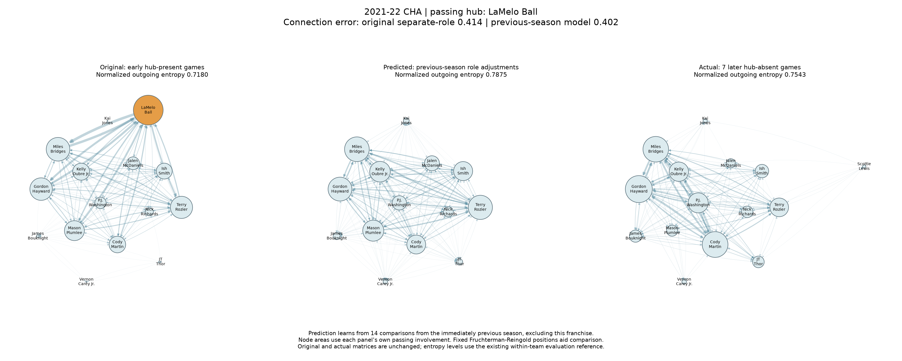

[Original matrix](../../data/nba_passing_output/all_season_hub_redistribution/2021-22/CHA/original_evaluation.csv) | [Predicted matrix](../../prediction_model/2021-22/CHA/predicted_evaluation.csv) | [Actual matrix](../../data/nba_passing_output/all_season_hub_redistribution/2021-22/CHA/actual_evaluation.csv)

## CHI | Lonzo Ball

47 later absent games.

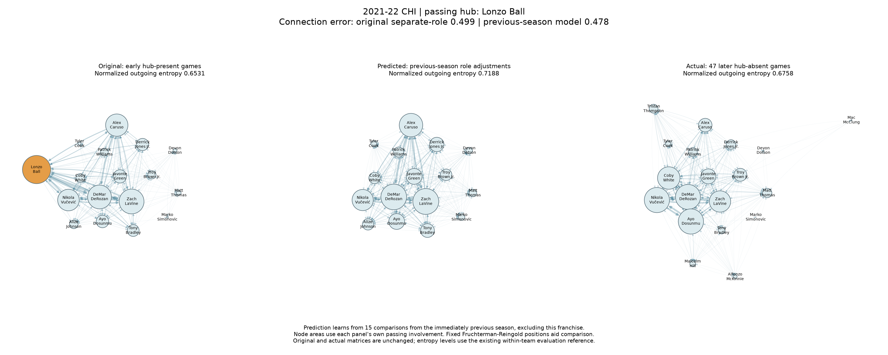

[Original matrix](../../data/nba_passing_output/all_season_hub_redistribution/2021-22/CHI/original_evaluation.csv) | [Predicted matrix](../../prediction_model/2021-22/CHI/predicted_evaluation.csv) | [Actual matrix](../../data/nba_passing_output/all_season_hub_redistribution/2021-22/CHI/actual_evaluation.csv)

## CLE | Ricky Rubio

48 later absent games.

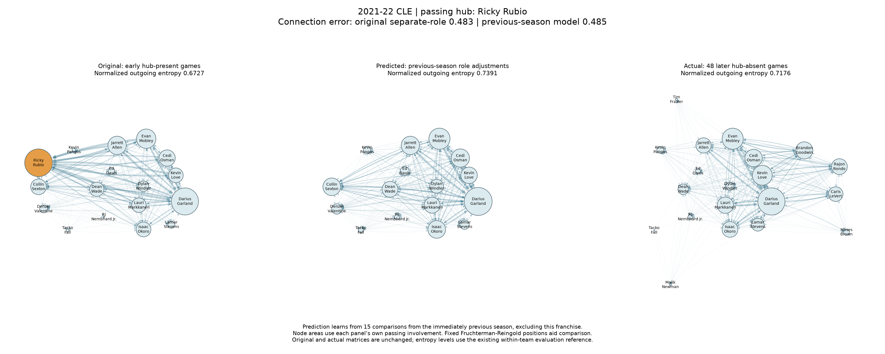

[Original matrix](../../data/nba_passing_output/all_season_hub_redistribution/2021-22/CLE/original_evaluation.csv) | [Predicted matrix](../../prediction_model/2021-22/CLE/predicted_evaluation.csv) | [Actual matrix](../../data/nba_passing_output/all_season_hub_redistribution/2021-22/CLE/actual_evaluation.csv)

## DAL | Luka Dončić

14 later absent games.

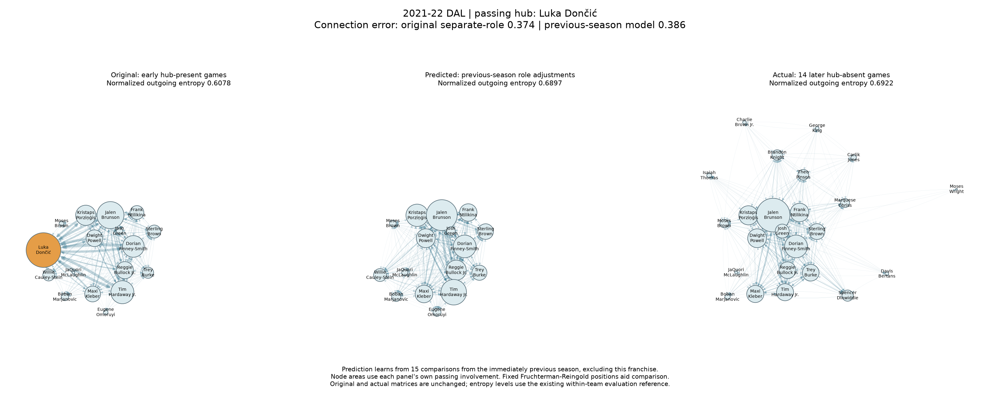

[Original matrix](../../data/nba_passing_output/all_season_hub_redistribution/2021-22/DAL/original_evaluation.csv) | [Predicted matrix](../../prediction_model/2021-22/DAL/predicted_evaluation.csv) | [Actual matrix](../../data/nba_passing_output/all_season_hub_redistribution/2021-22/DAL/actual_evaluation.csv)

## DEN | Monte Morris

7 later absent games.

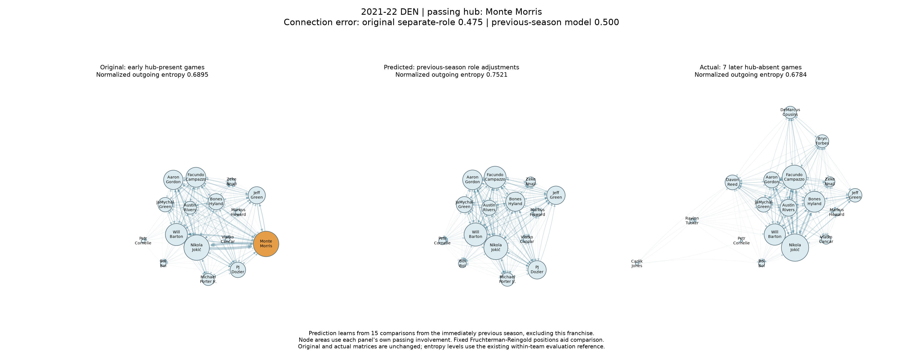

[Original matrix](../../data/nba_passing_output/all_season_hub_redistribution/2021-22/DEN/original_evaluation.csv) | [Predicted matrix](../../prediction_model/2021-22/DEN/predicted_evaluation.csv) | [Actual matrix](../../data/nba_passing_output/all_season_hub_redistribution/2021-22/DEN/actual_evaluation.csv)

## DET | Jerami Grant

34 later absent games.

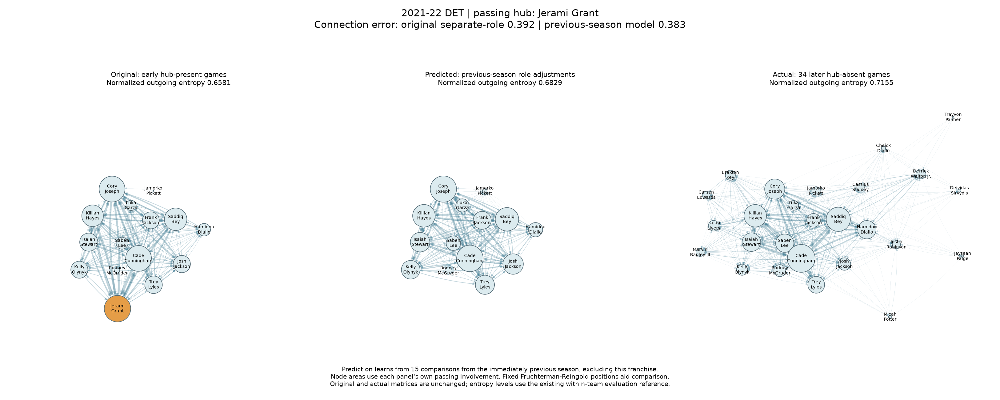

[Original matrix](../../data/nba_passing_output/all_season_hub_redistribution/2021-22/DET/original_evaluation.csv) | [Predicted matrix](../../prediction_model/2021-22/DET/predicted_evaluation.csv) | [Actual matrix](../../data/nba_passing_output/all_season_hub_redistribution/2021-22/DET/actual_evaluation.csv)

## GSW | Stephen Curry

16 later absent games.

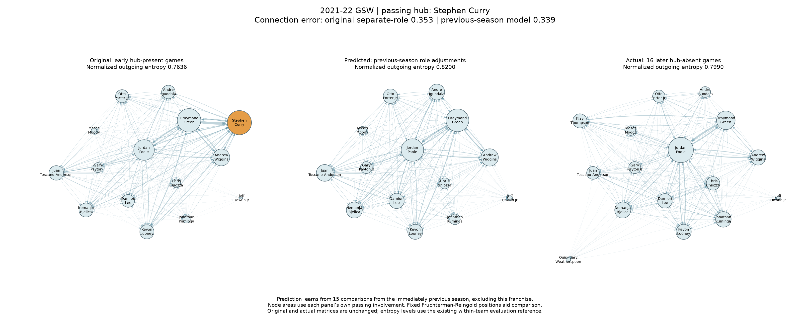

[Original matrix](../../data/nba_passing_output/all_season_hub_redistribution/2021-22/GSW/original_evaluation.csv) | [Predicted matrix](../../prediction_model/2021-22/GSW/predicted_evaluation.csv) | [Actual matrix](../../data/nba_passing_output/all_season_hub_redistribution/2021-22/GSW/actual_evaluation.csv)

## HOU | Kevin Porter Jr.

18 later absent games.

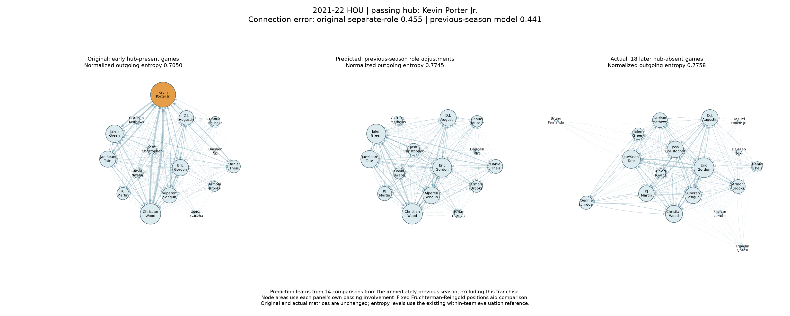

[Original matrix](../../data/nba_passing_output/all_season_hub_redistribution/2021-22/HOU/original_evaluation.csv) | [Predicted matrix](../../prediction_model/2021-22/HOU/predicted_evaluation.csv) | [Actual matrix](../../data/nba_passing_output/all_season_hub_redistribution/2021-22/HOU/actual_evaluation.csv)

## IND | T.J. McConnell

55 later absent games.

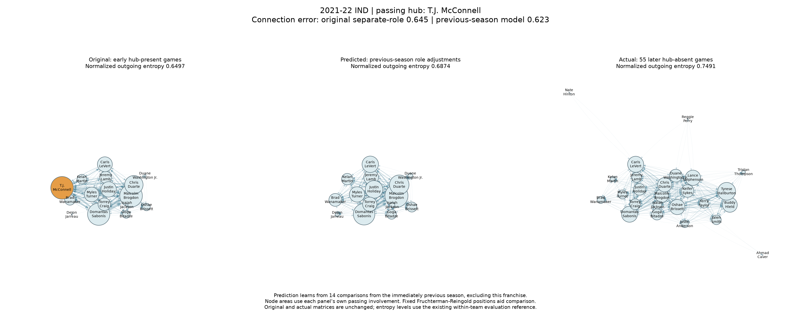

[Original matrix](../../data/nba_passing_output/all_season_hub_redistribution/2021-22/IND/original_evaluation.csv) | [Predicted matrix](../../prediction_model/2021-22/IND/predicted_evaluation.csv) | [Actual matrix](../../data/nba_passing_output/all_season_hub_redistribution/2021-22/IND/actual_evaluation.csv)

## LAC | Paul George

51 later absent games.

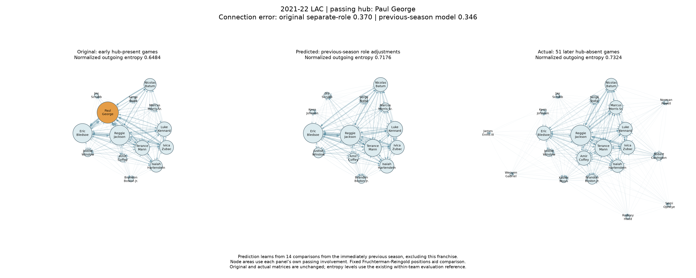

[Original matrix](../../data/nba_passing_output/all_season_hub_redistribution/2021-22/LAC/original_evaluation.csv) | [Predicted matrix](../../prediction_model/2021-22/LAC/predicted_evaluation.csv) | [Actual matrix](../../data/nba_passing_output/all_season_hub_redistribution/2021-22/LAC/actual_evaluation.csv)

## LAL | Russell Westbrook

4 later absent games.

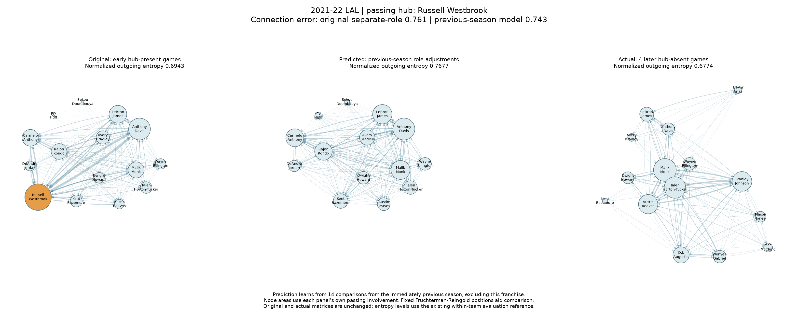

[Original matrix](../../data/nba_passing_output/all_season_hub_redistribution/2021-22/LAL/original_evaluation.csv) | [Predicted matrix](../../prediction_model/2021-22/LAL/predicted_evaluation.csv) | [Actual matrix](../../data/nba_passing_output/all_season_hub_redistribution/2021-22/LAL/actual_evaluation.csv)

## MEM | Ja Morant

24 later absent games.

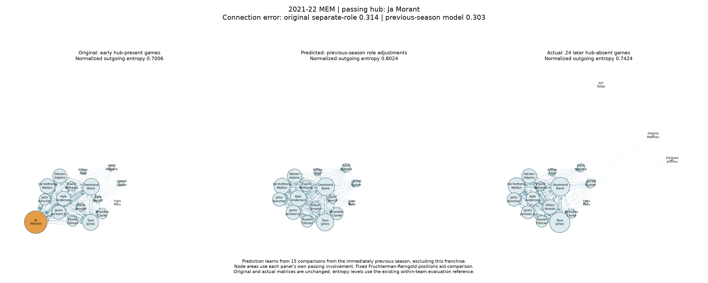

[Original matrix](../../data/nba_passing_output/all_season_hub_redistribution/2021-22/MEM/original_evaluation.csv) | [Predicted matrix](../../prediction_model/2021-22/MEM/predicted_evaluation.csv) | [Actual matrix](../../data/nba_passing_output/all_season_hub_redistribution/2021-22/MEM/actual_evaluation.csv)

## MIA | Kyle Lowry

17 later absent games.

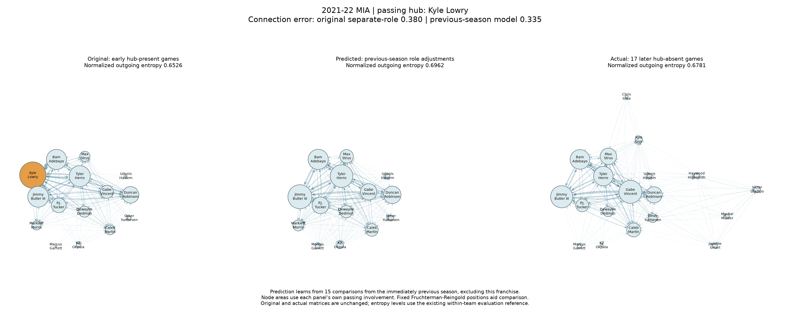

[Original matrix](../../data/nba_passing_output/all_season_hub_redistribution/2021-22/MIA/original_evaluation.csv) | [Predicted matrix](../../prediction_model/2021-22/MIA/predicted_evaluation.csv) | [Actual matrix](../../data/nba_passing_output/all_season_hub_redistribution/2021-22/MIA/actual_evaluation.csv)

## MIL | Giannis Antetokounmpo

14 later absent games.

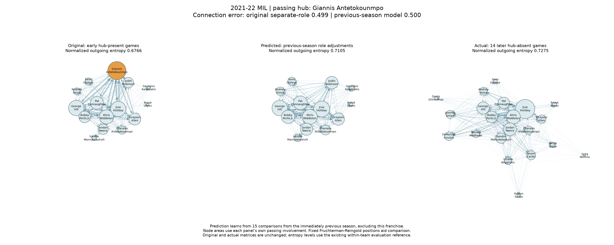

[Original matrix](../../data/nba_passing_output/all_season_hub_redistribution/2021-22/MIL/original_evaluation.csv) | [Predicted matrix](../../prediction_model/2021-22/MIL/predicted_evaluation.csv) | [Actual matrix](../../data/nba_passing_output/all_season_hub_redistribution/2021-22/MIL/actual_evaluation.csv)

## MIN | D'Angelo Russell

15 later absent games.

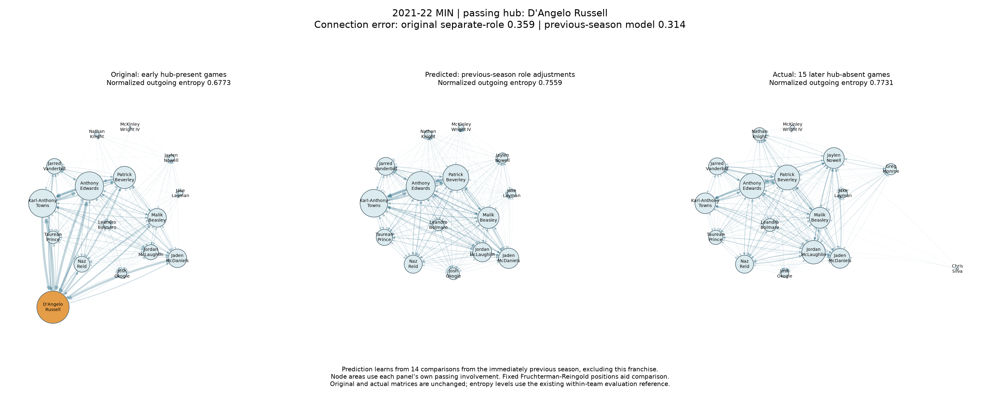

[Original matrix](../../data/nba_passing_output/all_season_hub_redistribution/2021-22/MIN/original_evaluation.csv) | [Predicted matrix](../../prediction_model/2021-22/MIN/predicted_evaluation.csv) | [Actual matrix](../../data/nba_passing_output/all_season_hub_redistribution/2021-22/MIN/actual_evaluation.csv)

## NOP | Jonas Valanciunas

8 later absent games.

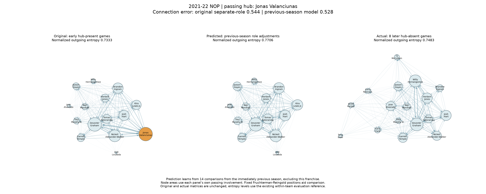

[Original matrix](../../data/nba_passing_output/all_season_hub_redistribution/2021-22/NOP/original_evaluation.csv) | [Predicted matrix](../../prediction_model/2021-22/NOP/predicted_evaluation.csv) | [Actual matrix](../../data/nba_passing_output/all_season_hub_redistribution/2021-22/NOP/actual_evaluation.csv)

## NYK | Julius Randle

10 later absent games.

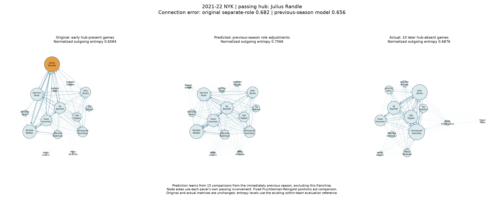

[Original matrix](../../data/nba_passing_output/all_season_hub_redistribution/2021-22/NYK/original_evaluation.csv) | [Predicted matrix](../../prediction_model/2021-22/NYK/predicted_evaluation.csv) | [Actual matrix](../../data/nba_passing_output/all_season_hub_redistribution/2021-22/NYK/actual_evaluation.csv)

## OKC | Shai Gilgeous-Alexander

24 later absent games.

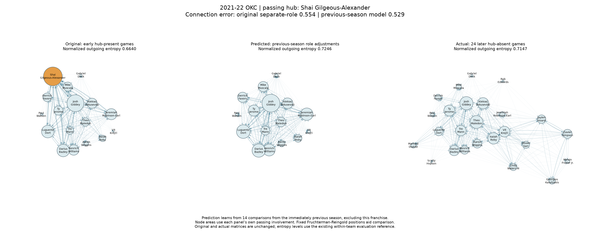

[Original matrix](../../data/nba_passing_output/all_season_hub_redistribution/2021-22/OKC/original_evaluation.csv) | [Predicted matrix](../../prediction_model/2021-22/OKC/predicted_evaluation.csv) | [Actual matrix](../../data/nba_passing_output/all_season_hub_redistribution/2021-22/OKC/actual_evaluation.csv)

## ORL | Cole Anthony

13 later absent games.

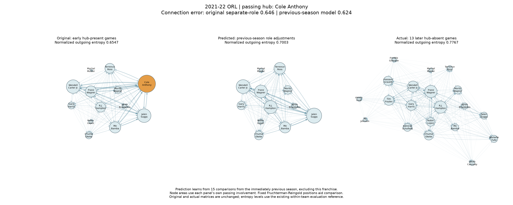

[Original matrix](../../data/nba_passing_output/all_season_hub_redistribution/2021-22/ORL/original_evaluation.csv) | [Predicted matrix](../../prediction_model/2021-22/ORL/predicted_evaluation.csv) | [Actual matrix](../../data/nba_passing_output/all_season_hub_redistribution/2021-22/ORL/actual_evaluation.csv)

## PHI | Tyrese Maxey

7 later absent games.

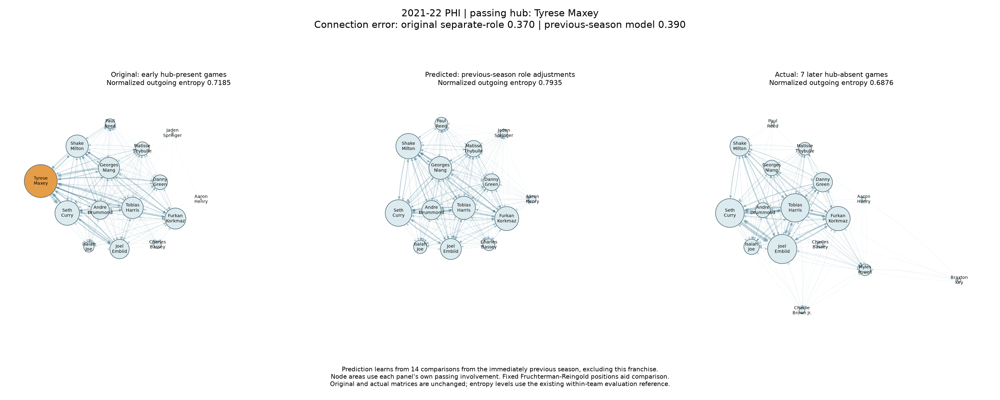

[Original matrix](../../data/nba_passing_output/all_season_hub_redistribution/2021-22/PHI/original_evaluation.csv) | [Predicted matrix](../../prediction_model/2021-22/PHI/predicted_evaluation.csv) | [Actual matrix](../../data/nba_passing_output/all_season_hub_redistribution/2021-22/PHI/actual_evaluation.csv)

## PHX | Chris Paul

17 later absent games.

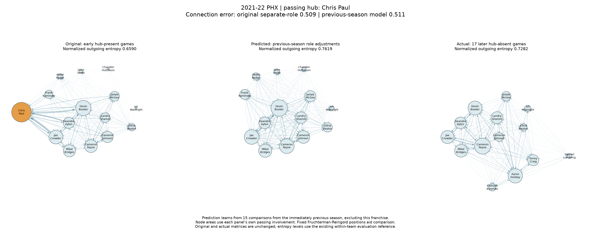

[Original matrix](../../data/nba_passing_output/all_season_hub_redistribution/2021-22/PHX/original_evaluation.csv) | [Predicted matrix](../../prediction_model/2021-22/PHX/predicted_evaluation.csv) | [Actual matrix](../../data/nba_passing_output/all_season_hub_redistribution/2021-22/PHX/actual_evaluation.csv)

## POR | Damian Lillard

52 later absent games.

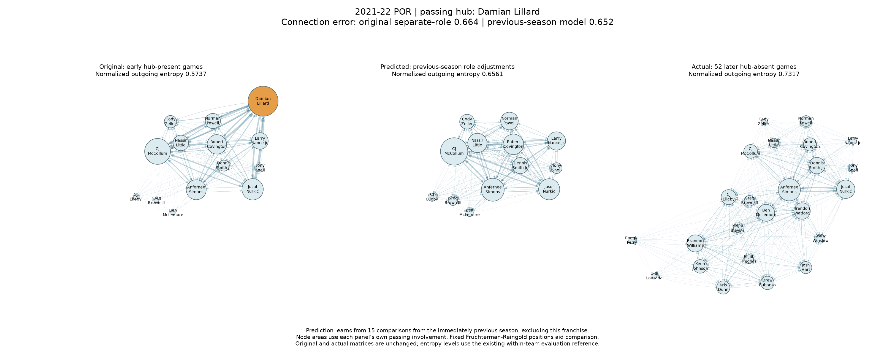

[Original matrix](../../data/nba_passing_output/all_season_hub_redistribution/2021-22/POR/original_evaluation.csv) | [Predicted matrix](../../prediction_model/2021-22/POR/predicted_evaluation.csv) | [Actual matrix](../../data/nba_passing_output/all_season_hub_redistribution/2021-22/POR/actual_evaluation.csv)

## SAC | De'Aaron Fox

23 later absent games.

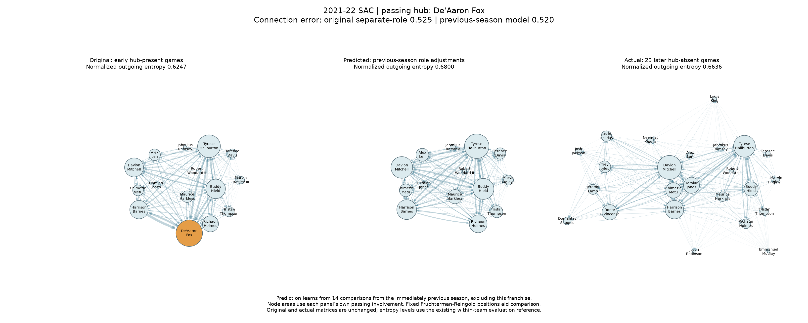

[Original matrix](../../data/nba_passing_output/all_season_hub_redistribution/2021-22/SAC/original_evaluation.csv) | [Predicted matrix](../../prediction_model/2021-22/SAC/predicted_evaluation.csv) | [Actual matrix](../../data/nba_passing_output/all_season_hub_redistribution/2021-22/SAC/actual_evaluation.csv)

## SAS | Dejounte Murray

14 later absent games.

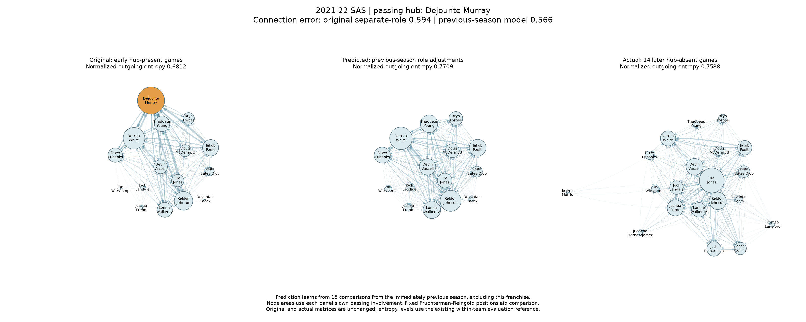

[Original matrix](../../data/nba_passing_output/all_season_hub_redistribution/2021-22/SAS/original_evaluation.csv) | [Predicted matrix](../../prediction_model/2021-22/SAS/predicted_evaluation.csv) | [Actual matrix](../../data/nba_passing_output/all_season_hub_redistribution/2021-22/SAS/actual_evaluation.csv)

## TOR | Fred VanVleet

16 later absent games.

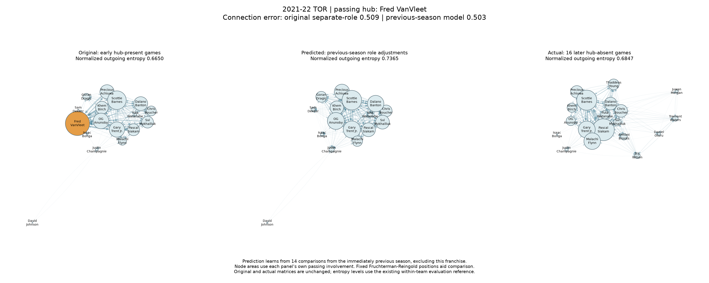

[Original matrix](../../data/nba_passing_output/all_season_hub_redistribution/2021-22/TOR/original_evaluation.csv) | [Predicted matrix](../../prediction_model/2021-22/TOR/predicted_evaluation.csv) | [Actual matrix](../../data/nba_passing_output/all_season_hub_redistribution/2021-22/TOR/actual_evaluation.csv)

## UTA | Donovan Mitchell

14 later absent games.

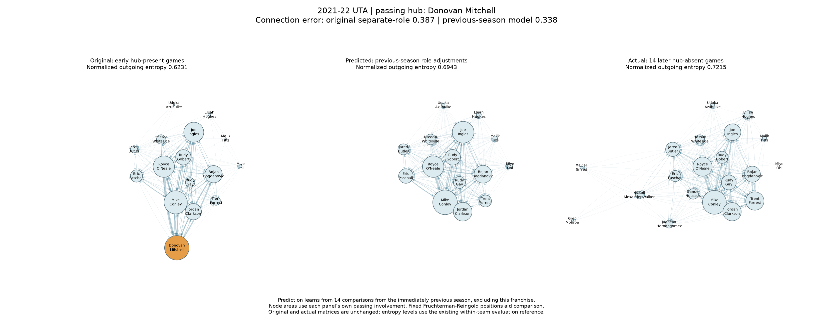

[Original matrix](../../data/nba_passing_output/all_season_hub_redistribution/2021-22/UTA/original_evaluation.csv) | [Predicted matrix](../../prediction_model/2021-22/UTA/predicted_evaluation.csv) | [Actual matrix](../../data/nba_passing_output/all_season_hub_redistribution/2021-22/UTA/actual_evaluation.csv)

## WAS | Spencer Dinwiddie

6 later absent games.

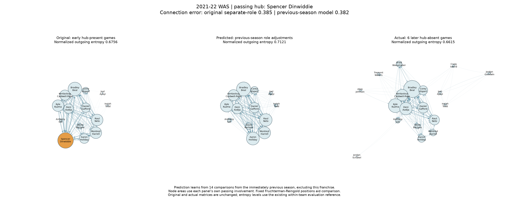

[Original matrix](../../data/nba_passing_output/all_season_hub_redistribution/2021-22/WAS/original_evaluation.csv) | [Predicted matrix](../../prediction_model/2021-22/WAS/predicted_evaluation.csv) | [Actual matrix](../../data/nba_passing_output/all_season_hub_redistribution/2021-22/WAS/actual_evaluation.csv)