# 2022-23: all30 team illustrations; evaluation includes only10+ later absences

Panels: original early hub present; final previous-season-only prediction; actual later hub absent. Open an image for full resolution. Node sizes use each panel's own passing involvement.

## ATL | Trae Young

8 later absent games.

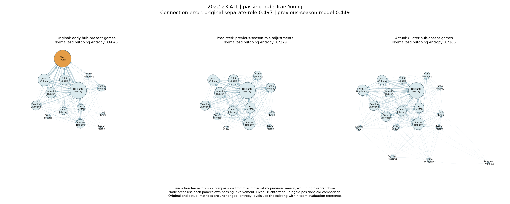

[Original matrix](../../data/nba_passing_output/all_season_hub_redistribution/2022-23/ATL/original_evaluation.csv) | [Predicted matrix](../../prediction_model/2022-23/ATL/predicted_evaluation.csv) | [Actual matrix](../../data/nba_passing_output/all_season_hub_redistribution/2022-23/ATL/actual_evaluation.csv)

## BKN | Kevin Durant

18 later absent games.

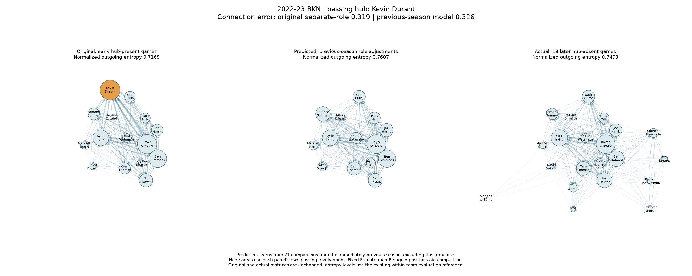

[Original matrix](../../data/nba_passing_output/all_season_hub_redistribution/2022-23/BKN/original_evaluation.csv) | [Predicted matrix](../../prediction_model/2022-23/BKN/predicted_evaluation.csv) | [Actual matrix](../../data/nba_passing_output/all_season_hub_redistribution/2022-23/BKN/actual_evaluation.csv)

## BOS | Jayson Tatum

7 later absent games.

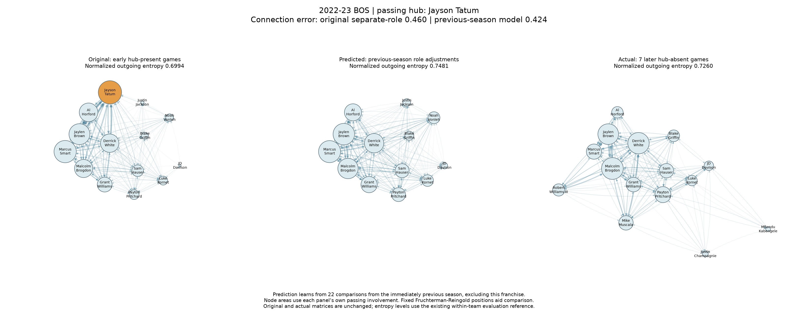

[Original matrix](../../data/nba_passing_output/all_season_hub_redistribution/2022-23/BOS/original_evaluation.csv) | [Predicted matrix](../../prediction_model/2022-23/BOS/predicted_evaluation.csv) | [Actual matrix](../../data/nba_passing_output/all_season_hub_redistribution/2022-23/BOS/actual_evaluation.csv)

## CHA | Terry Rozier

12 later absent games.

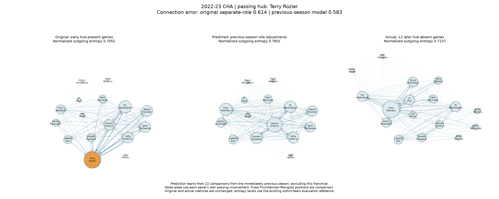

[Original matrix](../../data/nba_passing_output/all_season_hub_redistribution/2022-23/CHA/original_evaluation.csv) | [Predicted matrix](../../prediction_model/2022-23/CHA/predicted_evaluation.csv) | [Actual matrix](../../data/nba_passing_output/all_season_hub_redistribution/2022-23/CHA/actual_evaluation.csv)

## CHI | DeMar DeRozan

8 later absent games.

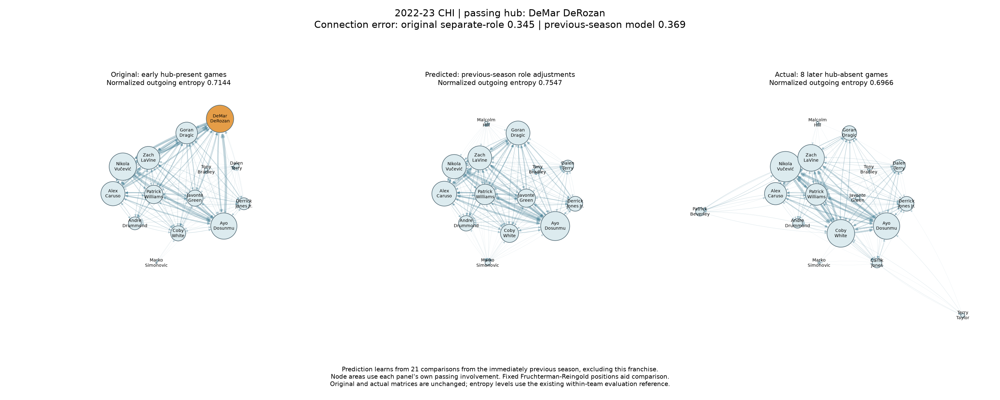

[Original matrix](../../data/nba_passing_output/all_season_hub_redistribution/2022-23/CHI/original_evaluation.csv) | [Predicted matrix](../../prediction_model/2022-23/CHI/predicted_evaluation.csv) | [Actual matrix](../../data/nba_passing_output/all_season_hub_redistribution/2022-23/CHI/actual_evaluation.csv)

## CLE | Donovan Mitchell

12 later absent games.

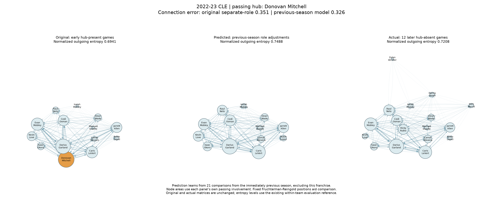

[Original matrix](../../data/nba_passing_output/all_season_hub_redistribution/2022-23/CLE/original_evaluation.csv) | [Predicted matrix](../../prediction_model/2022-23/CLE/predicted_evaluation.csv) | [Actual matrix](../../data/nba_passing_output/all_season_hub_redistribution/2022-23/CLE/actual_evaluation.csv)

## DAL | Luka Dončić

15 later absent games.

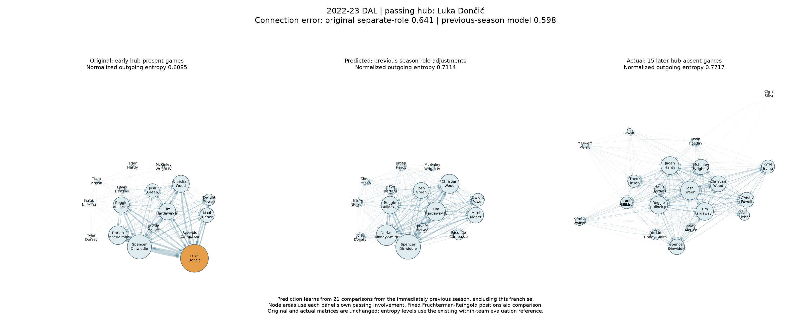

[Original matrix](../../data/nba_passing_output/all_season_hub_redistribution/2022-23/DAL/original_evaluation.csv) | [Predicted matrix](../../prediction_model/2022-23/DAL/predicted_evaluation.csv) | [Actual matrix](../../data/nba_passing_output/all_season_hub_redistribution/2022-23/DAL/actual_evaluation.csv)

## DEN | Nikola Jokić

10 later absent games.

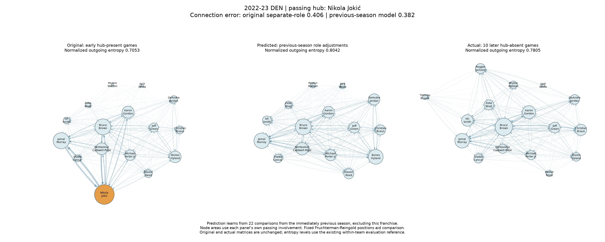

[Original matrix](../../data/nba_passing_output/all_season_hub_redistribution/2022-23/DEN/original_evaluation.csv) | [Predicted matrix](../../prediction_model/2022-23/DEN/predicted_evaluation.csv) | [Actual matrix](../../data/nba_passing_output/all_season_hub_redistribution/2022-23/DEN/actual_evaluation.csv)

## DET | Cade Cunningham

62 later absent games.

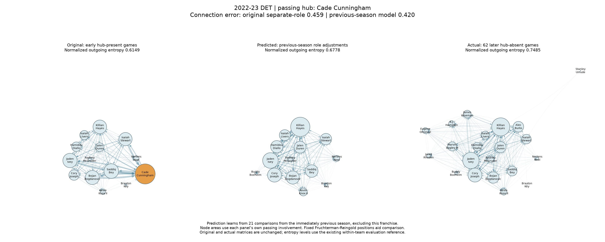

[Original matrix](../../data/nba_passing_output/all_season_hub_redistribution/2022-23/DET/original_evaluation.csv) | [Predicted matrix](../../prediction_model/2022-23/DET/predicted_evaluation.csv) | [Actual matrix](../../data/nba_passing_output/all_season_hub_redistribution/2022-23/DET/actual_evaluation.csv)

## GSW | Stephen Curry

24 later absent games.

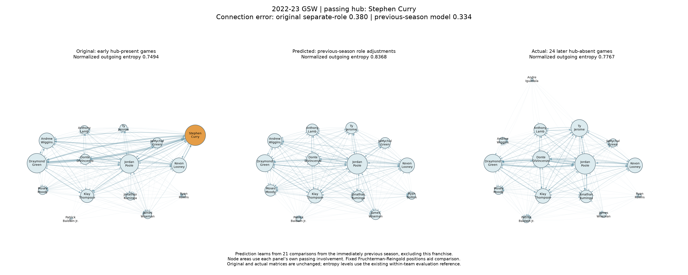

[Original matrix](../../data/nba_passing_output/all_season_hub_redistribution/2022-23/GSW/original_evaluation.csv) | [Predicted matrix](../../prediction_model/2022-23/GSW/predicted_evaluation.csv) | [Actual matrix](../../data/nba_passing_output/all_season_hub_redistribution/2022-23/GSW/actual_evaluation.csv)

## HOU | Kevin Porter Jr.

22 later absent games.

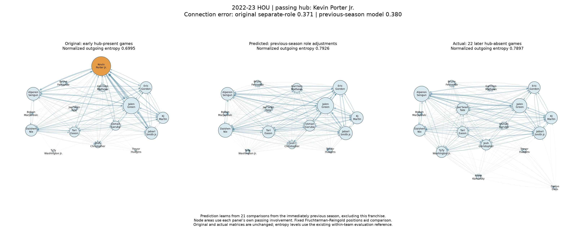

[Original matrix](../../data/nba_passing_output/all_season_hub_redistribution/2022-23/HOU/original_evaluation.csv) | [Predicted matrix](../../prediction_model/2022-23/HOU/predicted_evaluation.csv) | [Actual matrix](../../data/nba_passing_output/all_season_hub_redistribution/2022-23/HOU/actual_evaluation.csv)

## IND | Tyrese Haliburton

26 later absent games.

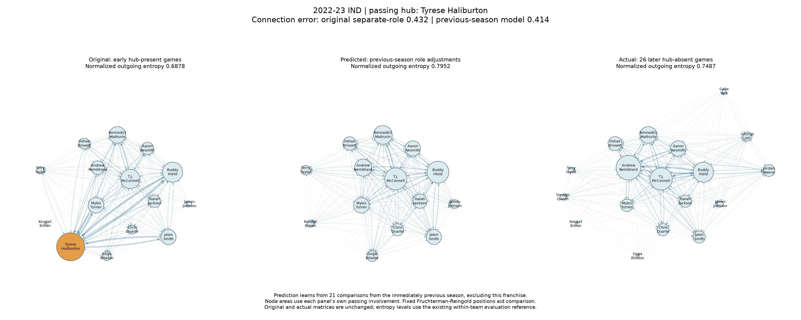

[Original matrix](../../data/nba_passing_output/all_season_hub_redistribution/2022-23/IND/original_evaluation.csv) | [Predicted matrix](../../prediction_model/2022-23/IND/predicted_evaluation.csv) | [Actual matrix](../../data/nba_passing_output/all_season_hub_redistribution/2022-23/IND/actual_evaluation.csv)

## LAC | Reggie Jackson

6 later absent games.

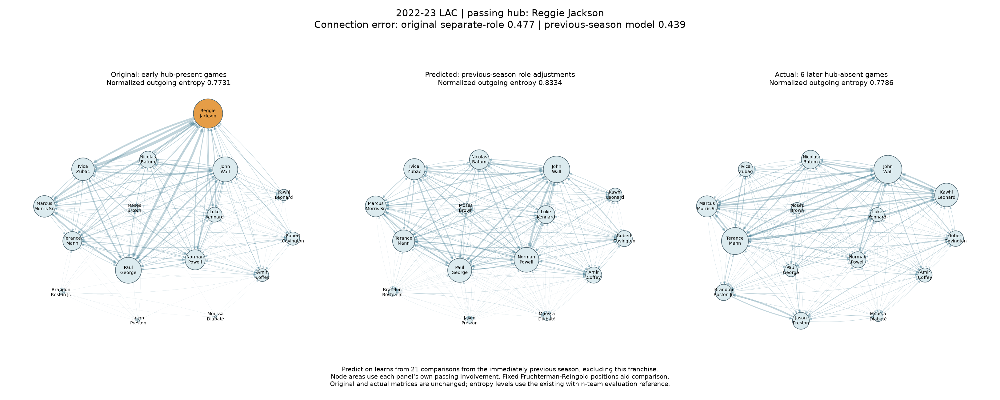

[Original matrix](../../data/nba_passing_output/all_season_hub_redistribution/2022-23/LAC/original_evaluation.csv) | [Predicted matrix](../../prediction_model/2022-23/LAC/predicted_evaluation.csv) | [Actual matrix](../../data/nba_passing_output/all_season_hub_redistribution/2022-23/LAC/actual_evaluation.csv)

## LAL | Russell Westbrook

3 later absent games.

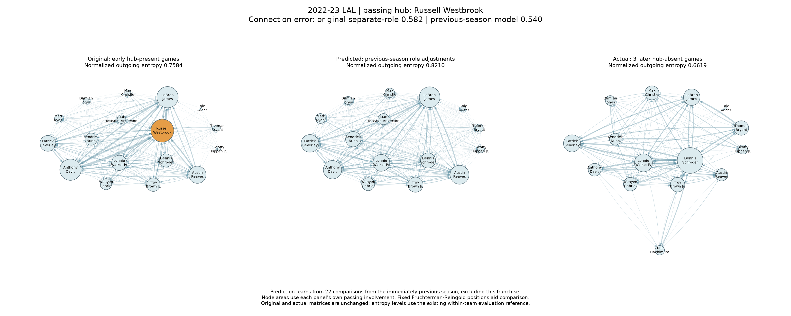

[Original matrix](../../data/nba_passing_output/all_season_hub_redistribution/2022-23/LAL/original_evaluation.csv) | [Predicted matrix](../../prediction_model/2022-23/LAL/predicted_evaluation.csv) | [Actual matrix](../../data/nba_passing_output/all_season_hub_redistribution/2022-23/LAL/actual_evaluation.csv)

## MEM | Ja Morant

18 later absent games.

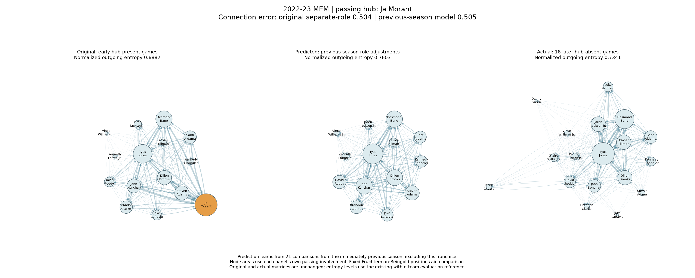

[Original matrix](../../data/nba_passing_output/all_season_hub_redistribution/2022-23/MEM/original_evaluation.csv) | [Predicted matrix](../../prediction_model/2022-23/MEM/predicted_evaluation.csv) | [Actual matrix](../../data/nba_passing_output/all_season_hub_redistribution/2022-23/MEM/actual_evaluation.csv)

## MIA | Kyle Lowry

27 later absent games.

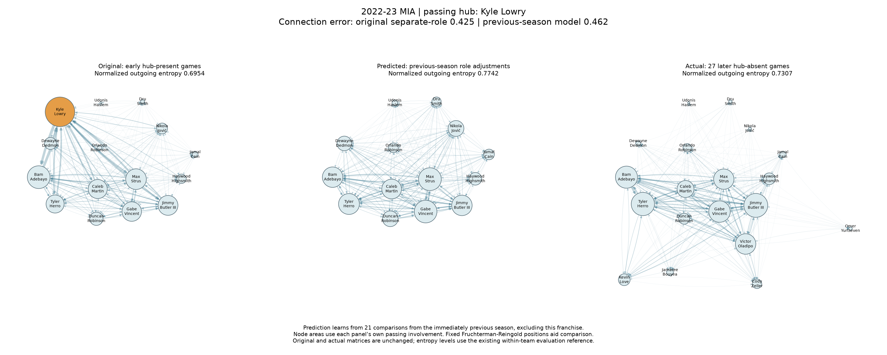

[Original matrix](../../data/nba_passing_output/all_season_hub_redistribution/2022-23/MIA/original_evaluation.csv) | [Predicted matrix](../../prediction_model/2022-23/MIA/predicted_evaluation.csv) | [Actual matrix](../../data/nba_passing_output/all_season_hub_redistribution/2022-23/MIA/actual_evaluation.csv)

## MIL | Giannis Antetokounmpo

16 later absent games.

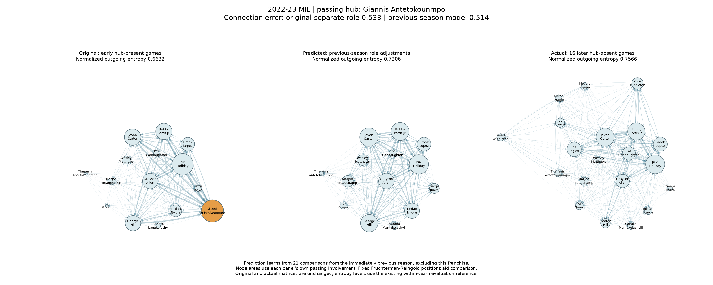

[Original matrix](../../data/nba_passing_output/all_season_hub_redistribution/2022-23/MIL/original_evaluation.csv) | [Predicted matrix](../../prediction_model/2022-23/MIL/predicted_evaluation.csv) | [Actual matrix](../../data/nba_passing_output/all_season_hub_redistribution/2022-23/MIL/actual_evaluation.csv)

## MIN | D'Angelo Russell

3 later absent games.

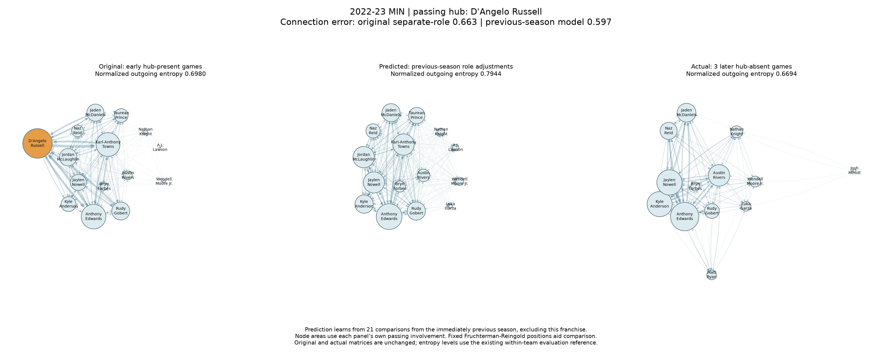

[Original matrix](../../data/nba_passing_output/all_season_hub_redistribution/2022-23/MIN/original_evaluation.csv) | [Predicted matrix](../../prediction_model/2022-23/MIN/predicted_evaluation.csv) | [Actual matrix](../../data/nba_passing_output/all_season_hub_redistribution/2022-23/MIN/actual_evaluation.csv)

## NOP | CJ McCollum

4 later absent games.

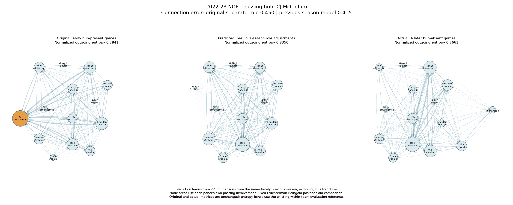

[Original matrix](../../data/nba_passing_output/all_season_hub_redistribution/2022-23/NOP/original_evaluation.csv) | [Predicted matrix](../../prediction_model/2022-23/NOP/predicted_evaluation.csv) | [Actual matrix](../../data/nba_passing_output/all_season_hub_redistribution/2022-23/NOP/actual_evaluation.csv)

## NYK | Jalen Brunson

14 later absent games.

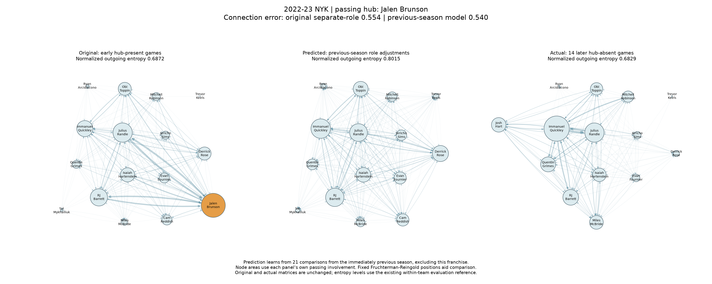

[Original matrix](../../data/nba_passing_output/all_season_hub_redistribution/2022-23/NYK/original_evaluation.csv) | [Predicted matrix](../../prediction_model/2022-23/NYK/predicted_evaluation.csv) | [Actual matrix](../../data/nba_passing_output/all_season_hub_redistribution/2022-23/NYK/actual_evaluation.csv)

## OKC | Shai Gilgeous-Alexander

13 later absent games.

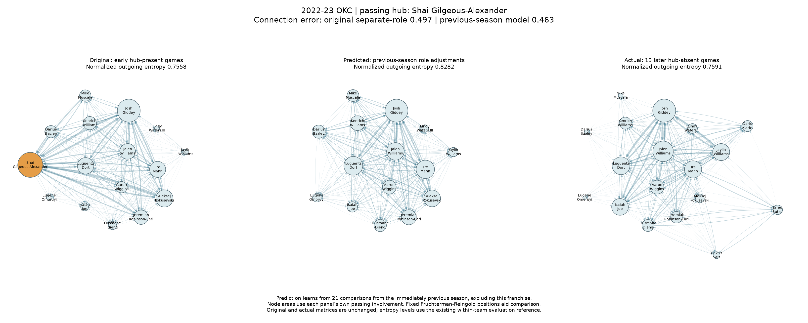

[Original matrix](../../data/nba_passing_output/all_season_hub_redistribution/2022-23/OKC/original_evaluation.csv) | [Predicted matrix](../../prediction_model/2022-23/OKC/predicted_evaluation.csv) | [Actual matrix](../../data/nba_passing_output/all_season_hub_redistribution/2022-23/OKC/actual_evaluation.csv)

## ORL | Franz Wagner

2 later absent games.

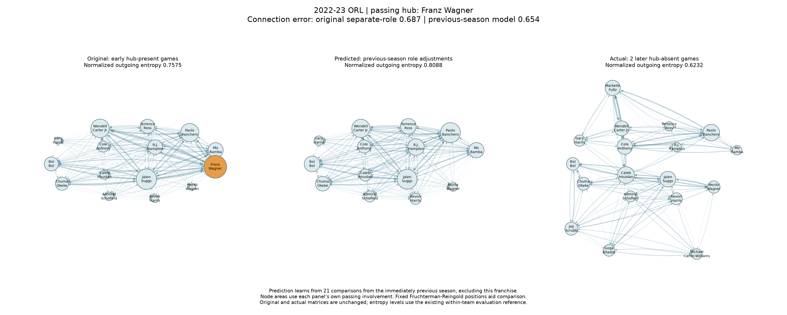

[Original matrix](../../data/nba_passing_output/all_season_hub_redistribution/2022-23/ORL/original_evaluation.csv) | [Predicted matrix](../../prediction_model/2022-23/ORL/predicted_evaluation.csv) | [Actual matrix](../../data/nba_passing_output/all_season_hub_redistribution/2022-23/ORL/actual_evaluation.csv)

## PHI | Tyrese Maxey

17 later absent games.

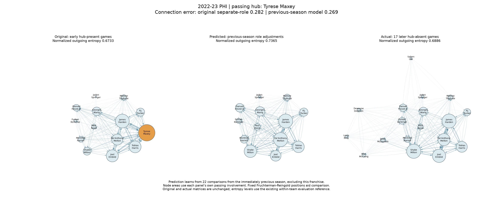

[Original matrix](../../data/nba_passing_output/all_season_hub_redistribution/2022-23/PHI/original_evaluation.csv) | [Predicted matrix](../../prediction_model/2022-23/PHI/predicted_evaluation.csv) | [Actual matrix](../../data/nba_passing_output/all_season_hub_redistribution/2022-23/PHI/actual_evaluation.csv)

## PHX | Devin Booker

29 later absent games.

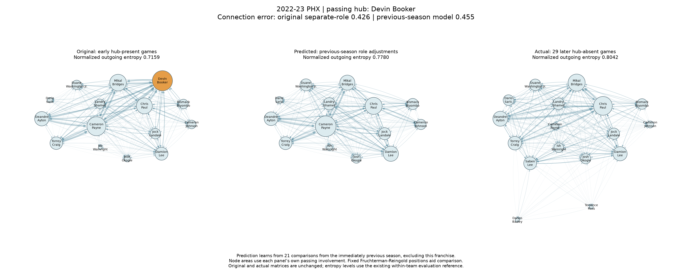

[Original matrix](../../data/nba_passing_output/all_season_hub_redistribution/2022-23/PHX/original_evaluation.csv) | [Predicted matrix](../../prediction_model/2022-23/PHX/predicted_evaluation.csv) | [Actual matrix](../../data/nba_passing_output/all_season_hub_redistribution/2022-23/PHX/actual_evaluation.csv)

## POR | Anfernee Simons

18 later absent games.

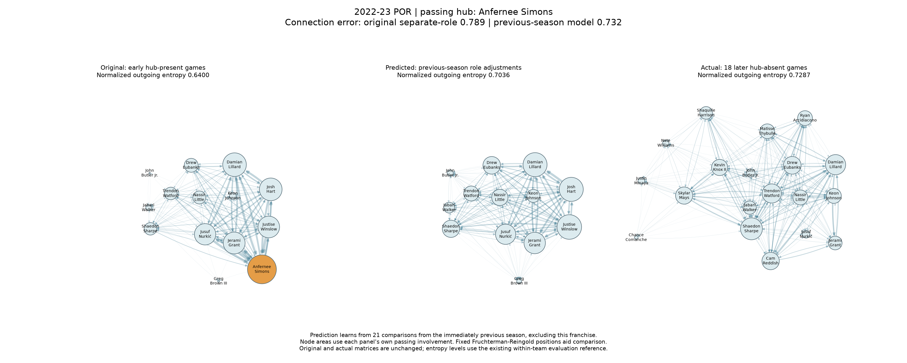

[Original matrix](../../data/nba_passing_output/all_season_hub_redistribution/2022-23/POR/original_evaluation.csv) | [Predicted matrix](../../prediction_model/2022-23/POR/predicted_evaluation.csv) | [Actual matrix](../../data/nba_passing_output/all_season_hub_redistribution/2022-23/POR/actual_evaluation.csv)

## SAC | De'Aaron Fox

8 later absent games.

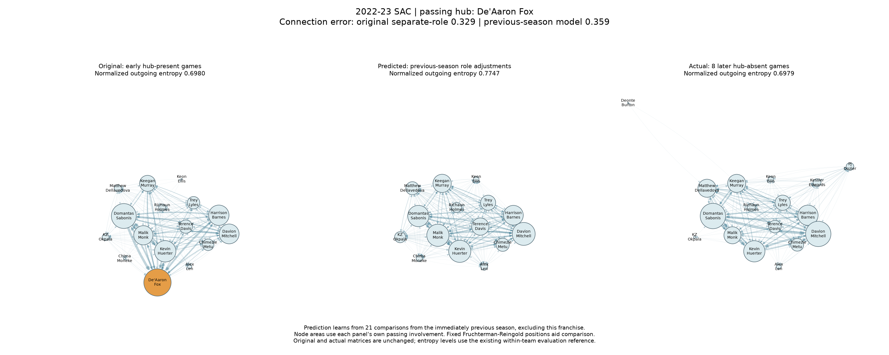

[Original matrix](../../data/nba_passing_output/all_season_hub_redistribution/2022-23/SAC/original_evaluation.csv) | [Predicted matrix](../../prediction_model/2022-23/SAC/predicted_evaluation.csv) | [Actual matrix](../../data/nba_passing_output/all_season_hub_redistribution/2022-23/SAC/actual_evaluation.csv)

## SAS | Tre Jones

13 later absent games.

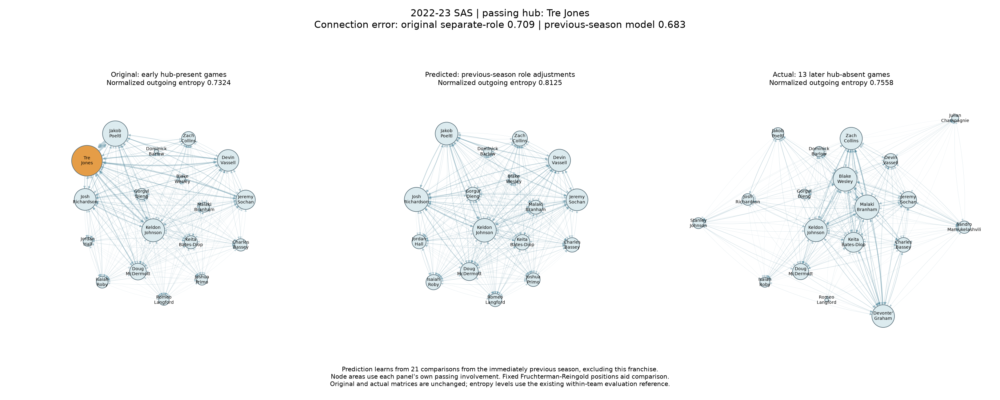

[Original matrix](../../data/nba_passing_output/all_season_hub_redistribution/2022-23/SAS/original_evaluation.csv) | [Predicted matrix](../../prediction_model/2022-23/SAS/predicted_evaluation.csv) | [Actual matrix](../../data/nba_passing_output/all_season_hub_redistribution/2022-23/SAS/actual_evaluation.csv)

## TOR | Scottie Barnes

2 later absent games.

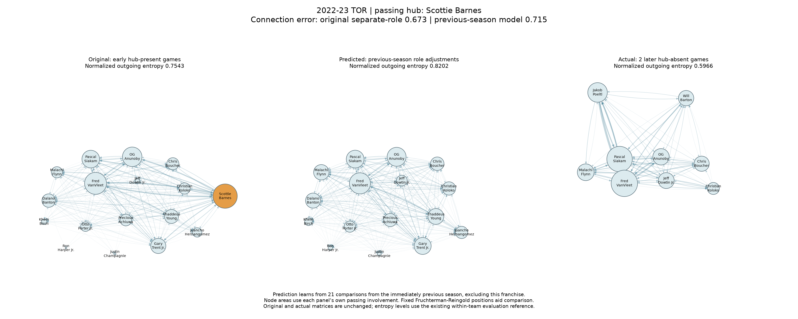

[Original matrix](../../data/nba_passing_output/all_season_hub_redistribution/2022-23/TOR/original_evaluation.csv) | [Predicted matrix](../../prediction_model/2022-23/TOR/predicted_evaluation.csv) | [Actual matrix](../../data/nba_passing_output/all_season_hub_redistribution/2022-23/TOR/actual_evaluation.csv)

## UTA | Mike Conley

9 later absent games.

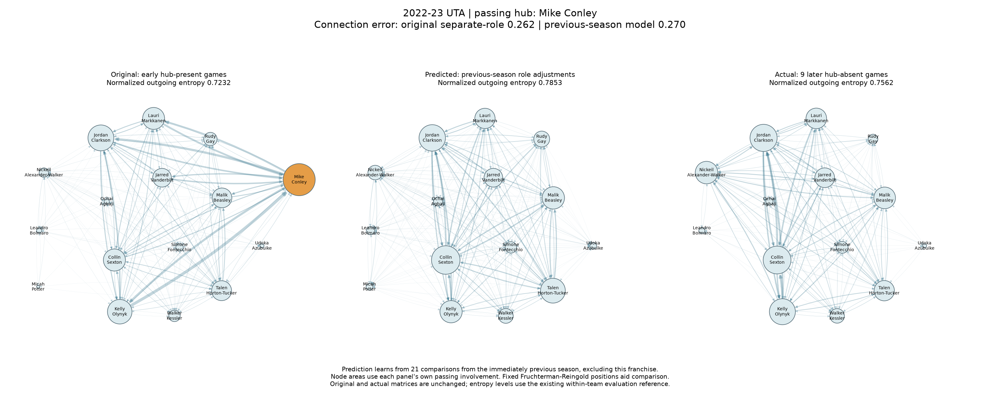

[Original matrix](../../data/nba_passing_output/all_season_hub_redistribution/2022-23/UTA/original_evaluation.csv) | [Predicted matrix](../../prediction_model/2022-23/UTA/predicted_evaluation.csv) | [Actual matrix](../../data/nba_passing_output/all_season_hub_redistribution/2022-23/UTA/actual_evaluation.csv)

## WAS | Bradley Beal

26 later absent games.

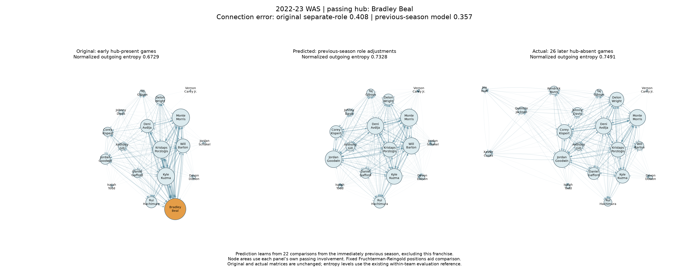

[Original matrix](../../data/nba_passing_output/all_season_hub_redistribution/2022-23/WAS/original_evaluation.csv) | [Predicted matrix](../../prediction_model/2022-23/WAS/predicted_evaluation.csv) | [Actual matrix](../../data/nba_passing_output/all_season_hub_redistribution/2022-23/WAS/actual_evaluation.csv)