# 2023-24: 12 teams with10+ later absences

Panels: original early hub present; final previous-season-only prediction; actual later hub absent. Open an image for full resolution. Node sizes use each panel's own passing involvement.

## ATL | Trae Young

27 later absent games.

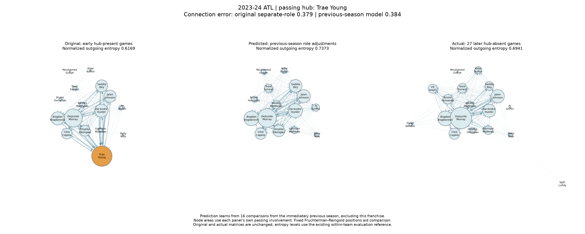

[Original matrix](../../data/nba_passing_output/all_season_hub_redistribution/2023-24/ATL/original_evaluation.csv) | [Predicted matrix](../../prediction_model/2023-24/ATL/predicted_evaluation.csv) | [Actual matrix](../../data/nba_passing_output/all_season_hub_redistribution/2023-24/ATL/actual_evaluation.csv)

## CHA | LaMelo Ball

55 later absent games.

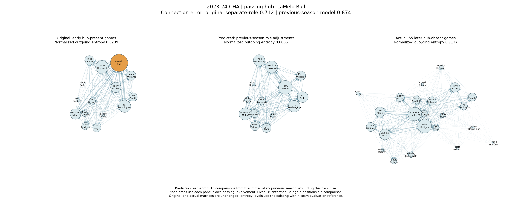

[Original matrix](../../data/nba_passing_output/all_season_hub_redistribution/2023-24/CHA/original_evaluation.csv) | [Predicted matrix](../../prediction_model/2023-24/CHA/predicted_evaluation.csv) | [Actual matrix](../../data/nba_passing_output/all_season_hub_redistribution/2023-24/CHA/actual_evaluation.csv)

## CLE | Darius Garland

20 later absent games.

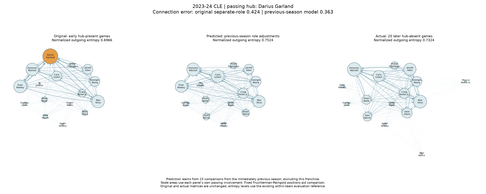

[Original matrix](../../data/nba_passing_output/all_season_hub_redistribution/2023-24/CLE/original_evaluation.csv) | [Predicted matrix](../../prediction_model/2023-24/CLE/predicted_evaluation.csv) | [Actual matrix](../../data/nba_passing_output/all_season_hub_redistribution/2023-24/CLE/actual_evaluation.csv)

## DAL | Luka Dončić

11 later absent games.

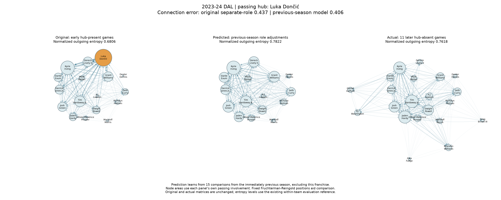

[Original matrix](../../data/nba_passing_output/all_season_hub_redistribution/2023-24/DAL/original_evaluation.csv) | [Predicted matrix](../../prediction_model/2023-24/DAL/predicted_evaluation.csv) | [Actual matrix](../../data/nba_passing_output/all_season_hub_redistribution/2023-24/DAL/actual_evaluation.csv)

## DET | Cade Cunningham

20 later absent games.

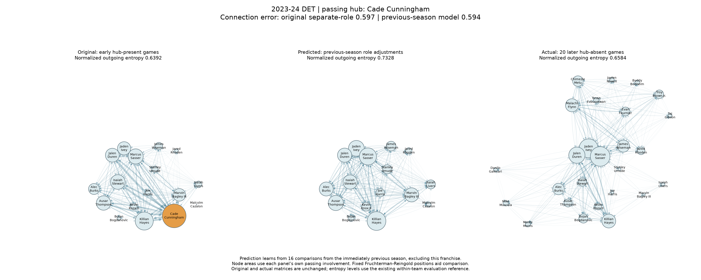

[Original matrix](../../data/nba_passing_output/all_season_hub_redistribution/2023-24/DET/original_evaluation.csv) | [Predicted matrix](../../prediction_model/2023-24/DET/predicted_evaluation.csv) | [Actual matrix](../../data/nba_passing_output/all_season_hub_redistribution/2023-24/DET/actual_evaluation.csv)

## IND | Tyrese Haliburton

11 later absent games.

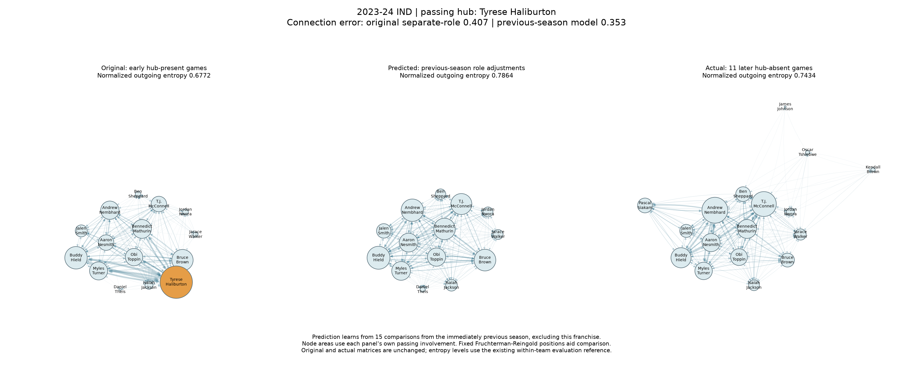

[Original matrix](../../data/nba_passing_output/all_season_hub_redistribution/2023-24/IND/original_evaluation.csv) | [Predicted matrix](../../prediction_model/2023-24/IND/predicted_evaluation.csv) | [Actual matrix](../../data/nba_passing_output/all_season_hub_redistribution/2023-24/IND/actual_evaluation.csv)

## MEM | Desmond Bane

40 later absent games.

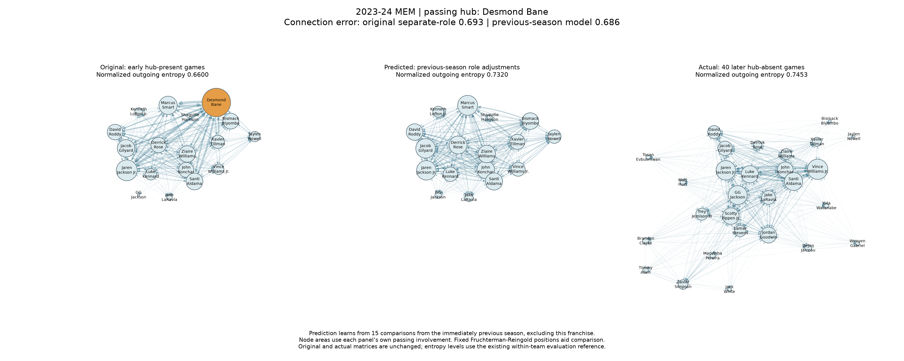

[Original matrix](../../data/nba_passing_output/all_season_hub_redistribution/2023-24/MEM/original_evaluation.csv) | [Predicted matrix](../../prediction_model/2023-24/MEM/predicted_evaluation.csv) | [Actual matrix](../../data/nba_passing_output/all_season_hub_redistribution/2023-24/MEM/actual_evaluation.csv)

## MIA | Kyle Lowry

14 later absent games.

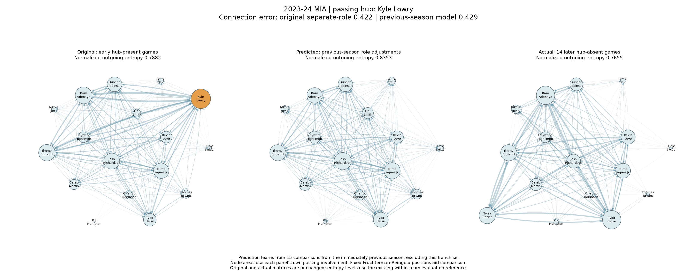

[Original matrix](../../data/nba_passing_output/all_season_hub_redistribution/2023-24/MIA/original_evaluation.csv) | [Predicted matrix](../../prediction_model/2023-24/MIA/predicted_evaluation.csv) | [Actual matrix](../../data/nba_passing_output/all_season_hub_redistribution/2023-24/MIA/actual_evaluation.csv)

## NOP | Brandon Ingram

15 later absent games.

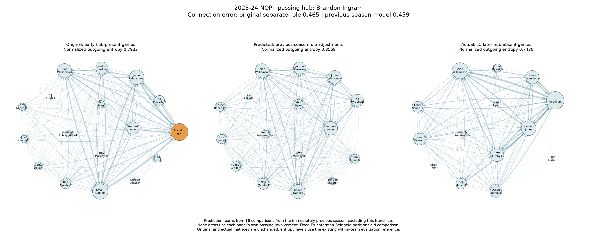

[Original matrix](../../data/nba_passing_output/all_season_hub_redistribution/2023-24/NOP/original_evaluation.csv) | [Predicted matrix](../../prediction_model/2023-24/NOP/predicted_evaluation.csv) | [Actual matrix](../../data/nba_passing_output/all_season_hub_redistribution/2023-24/NOP/actual_evaluation.csv)

## PHI | Tyrese Maxey

11 later absent games.

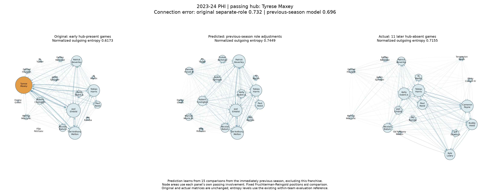

[Original matrix](../../data/nba_passing_output/all_season_hub_redistribution/2023-24/PHI/original_evaluation.csv) | [Predicted matrix](../../prediction_model/2023-24/PHI/predicted_evaluation.csv) | [Actual matrix](../../data/nba_passing_output/all_season_hub_redistribution/2023-24/PHI/actual_evaluation.csv)

## POR | Shaedon Sharpe

50 later absent games.

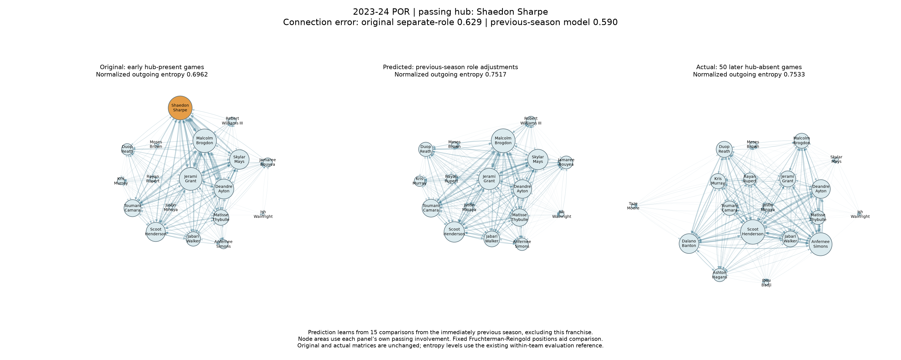

[Original matrix](../../data/nba_passing_output/all_season_hub_redistribution/2023-24/POR/original_evaluation.csv) | [Predicted matrix](../../prediction_model/2023-24/POR/predicted_evaluation.csv) | [Actual matrix](../../data/nba_passing_output/all_season_hub_redistribution/2023-24/POR/actual_evaluation.csv)

## WAS | Tyus Jones

16 later absent games.

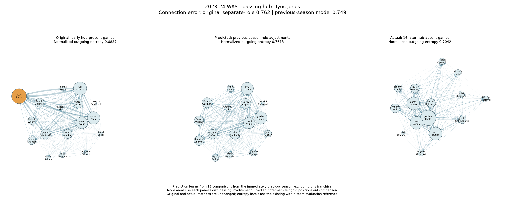

[Original matrix](../../data/nba_passing_output/all_season_hub_redistribution/2023-24/WAS/original_evaluation.csv) | [Predicted matrix](../../prediction_model/2023-24/WAS/predicted_evaluation.csv) | [Actual matrix](../../data/nba_passing_output/all_season_hub_redistribution/2023-24/WAS/actual_evaluation.csv)

[All30 team illustrations](all_teams.md) | [Season PDF](../2023-24_all_30_teams.pdf)