# 2023-24: all30 team illustrations; evaluation includes only10+ later absences

Panels: original early hub present; final previous-season-only prediction; actual later hub absent. Open an image for full resolution. Node sizes use each panel's own passing involvement.

## ATL | Trae Young

27 later absent games.

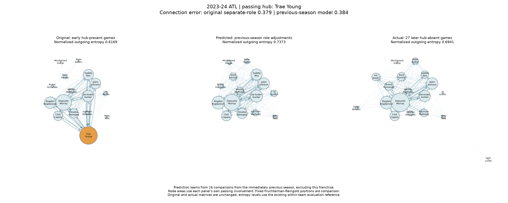

[Original matrix](../../data/nba_passing_output/all_season_hub_redistribution/2023-24/ATL/original_evaluation.csv) | [Predicted matrix](../../prediction_model/2023-24/ATL/predicted_evaluation.csv) | [Actual matrix](../../data/nba_passing_output/all_season_hub_redistribution/2023-24/ATL/actual_evaluation.csv)

## BKN | Spencer Dinwiddie

1 later absent games.

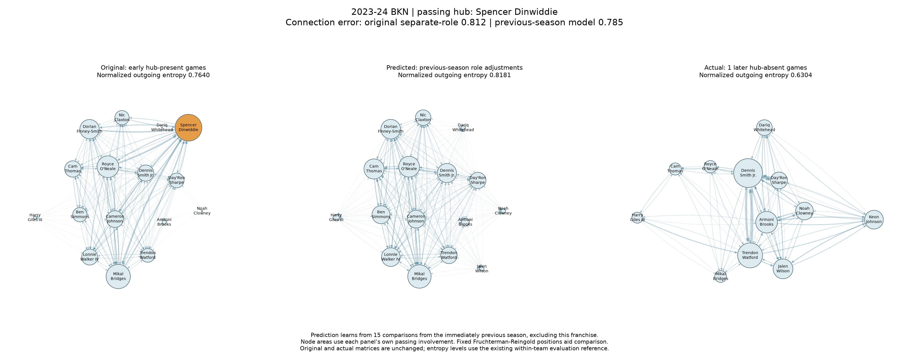

[Original matrix](../../data/nba_passing_output/all_season_hub_redistribution/2023-24/BKN/original_evaluation.csv) | [Predicted matrix](../../prediction_model/2023-24/BKN/predicted_evaluation.csv) | [Actual matrix](../../data/nba_passing_output/all_season_hub_redistribution/2023-24/BKN/actual_evaluation.csv)

## BOS | Jayson Tatum

8 later absent games.

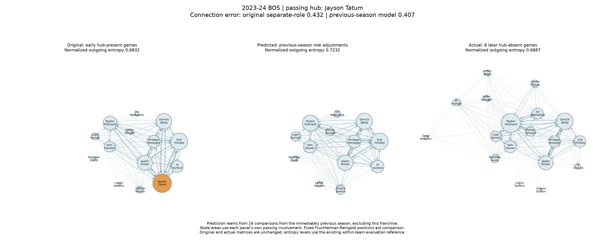

[Original matrix](../../data/nba_passing_output/all_season_hub_redistribution/2023-24/BOS/original_evaluation.csv) | [Predicted matrix](../../prediction_model/2023-24/BOS/predicted_evaluation.csv) | [Actual matrix](../../data/nba_passing_output/all_season_hub_redistribution/2023-24/BOS/actual_evaluation.csv)

## CHA | LaMelo Ball

55 later absent games.

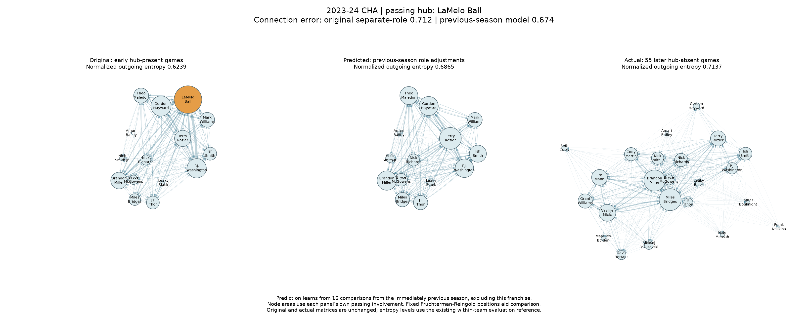

[Original matrix](../../data/nba_passing_output/all_season_hub_redistribution/2023-24/CHA/original_evaluation.csv) | [Predicted matrix](../../prediction_model/2023-24/CHA/predicted_evaluation.csv) | [Actual matrix](../../data/nba_passing_output/all_season_hub_redistribution/2023-24/CHA/actual_evaluation.csv)

## CHI | Coby White

3 later absent games.

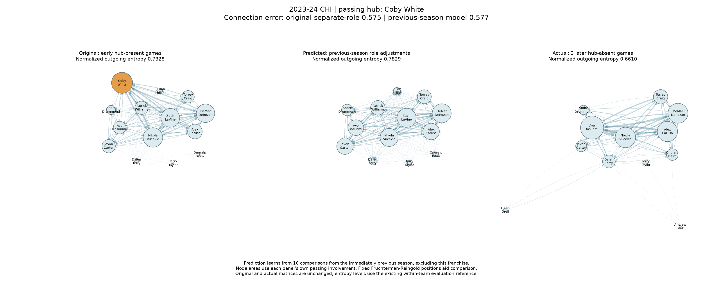

[Original matrix](../../data/nba_passing_output/all_season_hub_redistribution/2023-24/CHI/original_evaluation.csv) | [Predicted matrix](../../prediction_model/2023-24/CHI/predicted_evaluation.csv) | [Actual matrix](../../data/nba_passing_output/all_season_hub_redistribution/2023-24/CHI/actual_evaluation.csv)

## CLE | Darius Garland

20 later absent games.

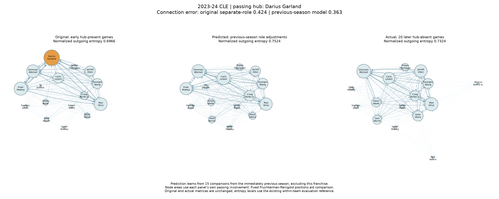

[Original matrix](../../data/nba_passing_output/all_season_hub_redistribution/2023-24/CLE/original_evaluation.csv) | [Predicted matrix](../../prediction_model/2023-24/CLE/predicted_evaluation.csv) | [Actual matrix](../../data/nba_passing_output/all_season_hub_redistribution/2023-24/CLE/actual_evaluation.csv)

## DAL | Luka Dončić

11 later absent games.

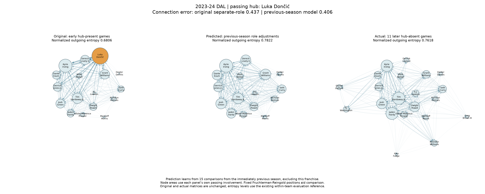

[Original matrix](../../data/nba_passing_output/all_season_hub_redistribution/2023-24/DAL/original_evaluation.csv) | [Predicted matrix](../../prediction_model/2023-24/DAL/predicted_evaluation.csv) | [Actual matrix](../../data/nba_passing_output/all_season_hub_redistribution/2023-24/DAL/actual_evaluation.csv)

## DEN | Nikola Jokić

2 later absent games.

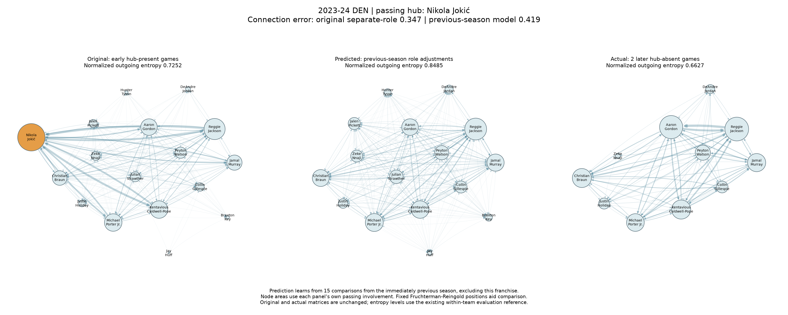

[Original matrix](../../data/nba_passing_output/all_season_hub_redistribution/2023-24/DEN/original_evaluation.csv) | [Predicted matrix](../../prediction_model/2023-24/DEN/predicted_evaluation.csv) | [Actual matrix](../../data/nba_passing_output/all_season_hub_redistribution/2023-24/DEN/actual_evaluation.csv)

## DET | Cade Cunningham

20 later absent games.

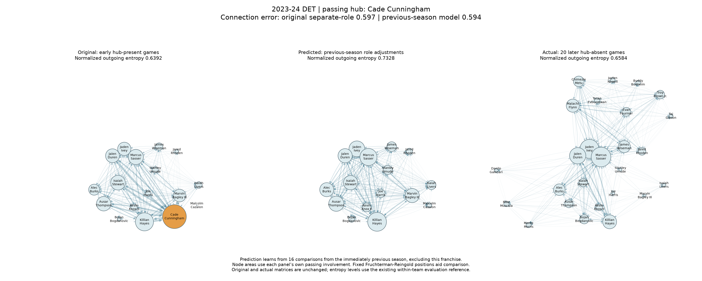

[Original matrix](../../data/nba_passing_output/all_season_hub_redistribution/2023-24/DET/original_evaluation.csv) | [Predicted matrix](../../prediction_model/2023-24/DET/predicted_evaluation.csv) | [Actual matrix](../../data/nba_passing_output/all_season_hub_redistribution/2023-24/DET/actual_evaluation.csv)

## GSW | Stephen Curry

5 later absent games.

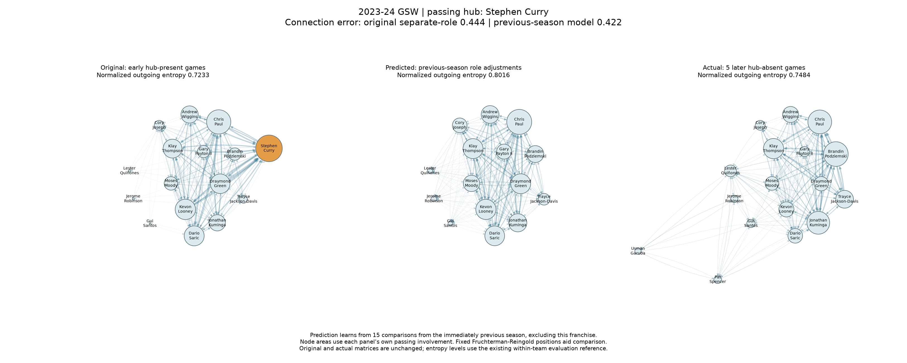

[Original matrix](../../data/nba_passing_output/all_season_hub_redistribution/2023-24/GSW/original_evaluation.csv) | [Predicted matrix](../../prediction_model/2023-24/GSW/predicted_evaluation.csv) | [Actual matrix](../../data/nba_passing_output/all_season_hub_redistribution/2023-24/GSW/actual_evaluation.csv)

## HOU | Fred VanVleet

8 later absent games.

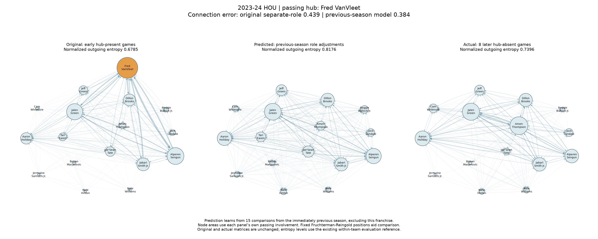

[Original matrix](../../data/nba_passing_output/all_season_hub_redistribution/2023-24/HOU/original_evaluation.csv) | [Predicted matrix](../../prediction_model/2023-24/HOU/predicted_evaluation.csv) | [Actual matrix](../../data/nba_passing_output/all_season_hub_redistribution/2023-24/HOU/actual_evaluation.csv)

## IND | Tyrese Haliburton

11 later absent games.

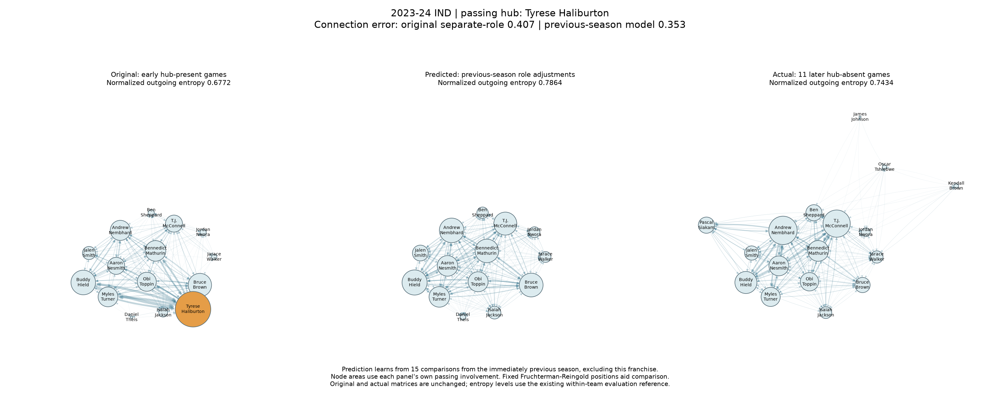

[Original matrix](../../data/nba_passing_output/all_season_hub_redistribution/2023-24/IND/original_evaluation.csv) | [Predicted matrix](../../prediction_model/2023-24/IND/predicted_evaluation.csv) | [Actual matrix](../../data/nba_passing_output/all_season_hub_redistribution/2023-24/IND/actual_evaluation.csv)

## LAC | Paul George

8 later absent games.

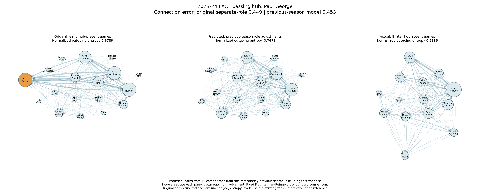

[Original matrix](../../data/nba_passing_output/all_season_hub_redistribution/2023-24/LAC/original_evaluation.csv) | [Predicted matrix](../../prediction_model/2023-24/LAC/predicted_evaluation.csv) | [Actual matrix](../../data/nba_passing_output/all_season_hub_redistribution/2023-24/LAC/actual_evaluation.csv)

## LAL | D'Angelo Russell

6 later absent games.

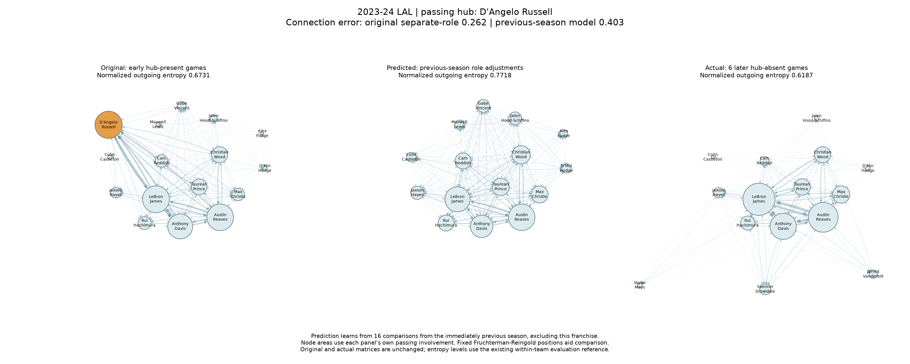

[Original matrix](../../data/nba_passing_output/all_season_hub_redistribution/2023-24/LAL/original_evaluation.csv) | [Predicted matrix](../../prediction_model/2023-24/LAL/predicted_evaluation.csv) | [Actual matrix](../../data/nba_passing_output/all_season_hub_redistribution/2023-24/LAL/actual_evaluation.csv)

## MEM | Desmond Bane

40 later absent games.

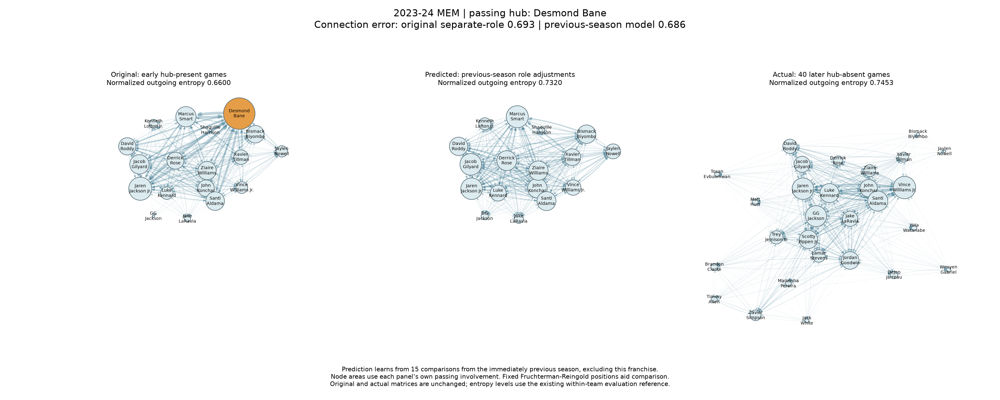

[Original matrix](../../data/nba_passing_output/all_season_hub_redistribution/2023-24/MEM/original_evaluation.csv) | [Predicted matrix](../../prediction_model/2023-24/MEM/predicted_evaluation.csv) | [Actual matrix](../../data/nba_passing_output/all_season_hub_redistribution/2023-24/MEM/actual_evaluation.csv)

## MIA | Kyle Lowry

14 later absent games.

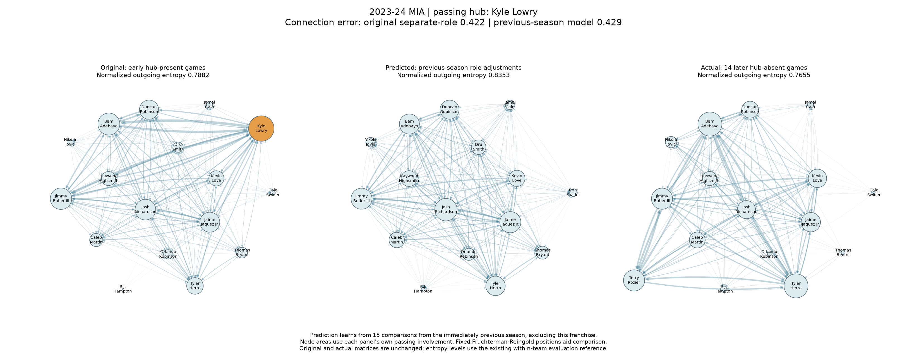

[Original matrix](../../data/nba_passing_output/all_season_hub_redistribution/2023-24/MIA/original_evaluation.csv) | [Predicted matrix](../../prediction_model/2023-24/MIA/predicted_evaluation.csv) | [Actual matrix](../../data/nba_passing_output/all_season_hub_redistribution/2023-24/MIA/actual_evaluation.csv)

## MIL | Damian Lillard

7 later absent games.

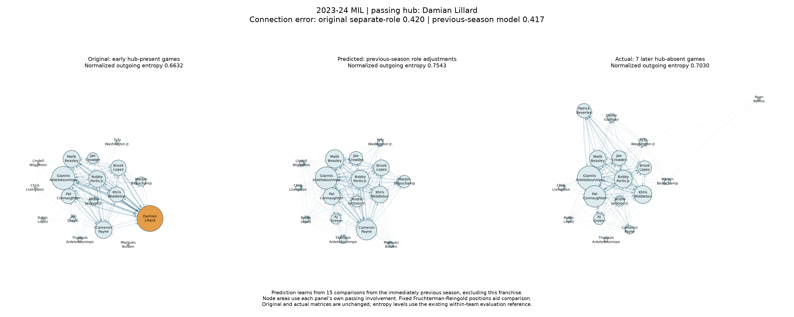

[Original matrix](../../data/nba_passing_output/all_season_hub_redistribution/2023-24/MIL/original_evaluation.csv) | [Predicted matrix](../../prediction_model/2023-24/MIL/predicted_evaluation.csv) | [Actual matrix](../../data/nba_passing_output/all_season_hub_redistribution/2023-24/MIL/actual_evaluation.csv)

## MIN | Mike Conley

6 later absent games.

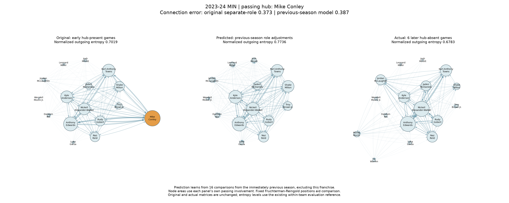

[Original matrix](../../data/nba_passing_output/all_season_hub_redistribution/2023-24/MIN/original_evaluation.csv) | [Predicted matrix](../../prediction_model/2023-24/MIN/predicted_evaluation.csv) | [Actual matrix](../../data/nba_passing_output/all_season_hub_redistribution/2023-24/MIN/actual_evaluation.csv)

## NOP | Brandon Ingram

15 later absent games.

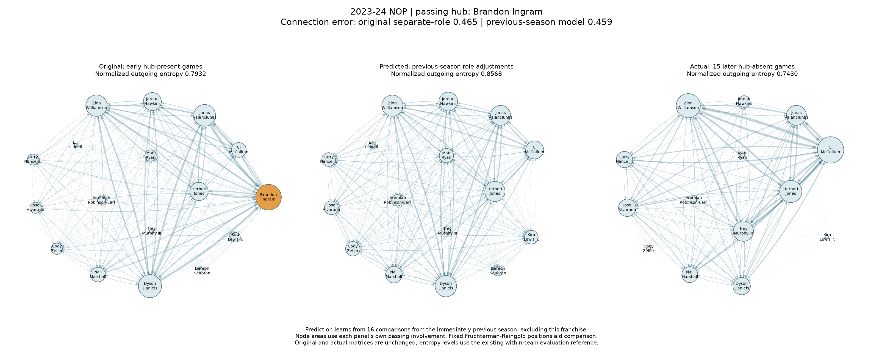

[Original matrix](../../data/nba_passing_output/all_season_hub_redistribution/2023-24/NOP/original_evaluation.csv) | [Predicted matrix](../../prediction_model/2023-24/NOP/predicted_evaluation.csv) | [Actual matrix](../../data/nba_passing_output/all_season_hub_redistribution/2023-24/NOP/actual_evaluation.csv)

## NYK | Jalen Brunson

5 later absent games.

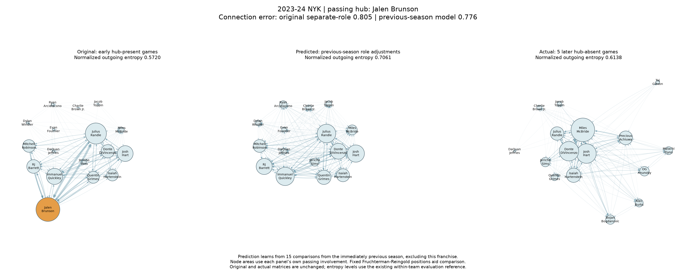

[Original matrix](../../data/nba_passing_output/all_season_hub_redistribution/2023-24/NYK/original_evaluation.csv) | [Predicted matrix](../../prediction_model/2023-24/NYK/predicted_evaluation.csv) | [Actual matrix](../../data/nba_passing_output/all_season_hub_redistribution/2023-24/NYK/actual_evaluation.csv)

## OKC | Shai Gilgeous-Alexander

6 later absent games.

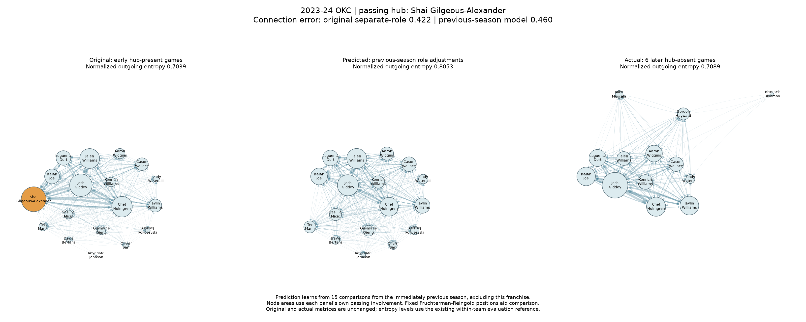

[Original matrix](../../data/nba_passing_output/all_season_hub_redistribution/2023-24/OKC/original_evaluation.csv) | [Predicted matrix](../../prediction_model/2023-24/OKC/predicted_evaluation.csv) | [Actual matrix](../../data/nba_passing_output/all_season_hub_redistribution/2023-24/OKC/actual_evaluation.csv)

## ORL | Paolo Banchero

2 later absent games.

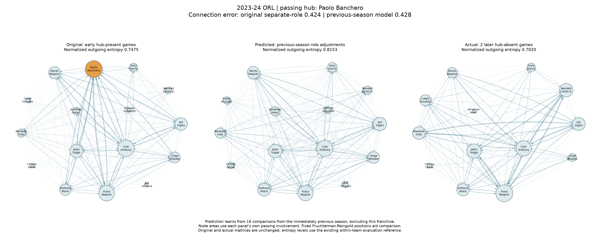

[Original matrix](../../data/nba_passing_output/all_season_hub_redistribution/2023-24/ORL/original_evaluation.csv) | [Predicted matrix](../../prediction_model/2023-24/ORL/predicted_evaluation.csv) | [Actual matrix](../../data/nba_passing_output/all_season_hub_redistribution/2023-24/ORL/actual_evaluation.csv)

## PHI | Tyrese Maxey

11 later absent games.

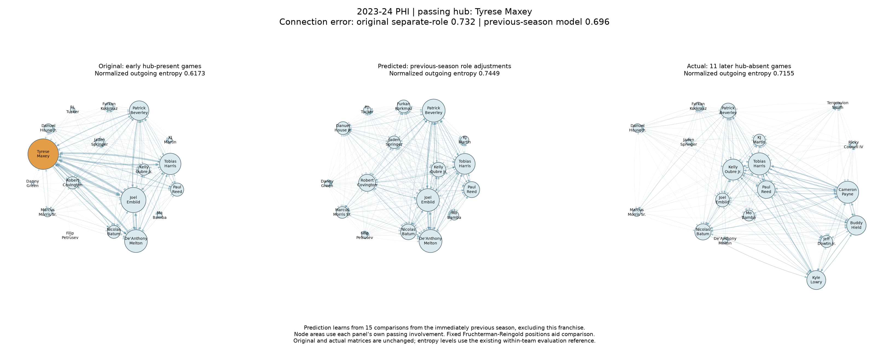

[Original matrix](../../data/nba_passing_output/all_season_hub_redistribution/2023-24/PHI/original_evaluation.csv) | [Predicted matrix](../../prediction_model/2023-24/PHI/predicted_evaluation.csv) | [Actual matrix](../../data/nba_passing_output/all_season_hub_redistribution/2023-24/PHI/actual_evaluation.csv)

## PHX | Kevin Durant

5 later absent games.

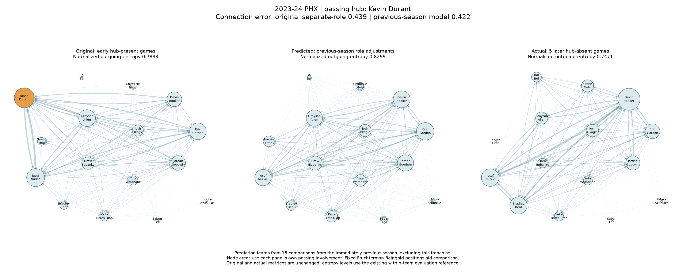

[Original matrix](../../data/nba_passing_output/all_season_hub_redistribution/2023-24/PHX/original_evaluation.csv) | [Predicted matrix](../../prediction_model/2023-24/PHX/predicted_evaluation.csv) | [Actual matrix](../../data/nba_passing_output/all_season_hub_redistribution/2023-24/PHX/actual_evaluation.csv)

## POR | Shaedon Sharpe

50 later absent games.

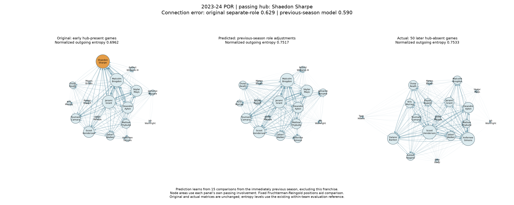

[Original matrix](../../data/nba_passing_output/all_season_hub_redistribution/2023-24/POR/original_evaluation.csv) | [Predicted matrix](../../prediction_model/2023-24/POR/predicted_evaluation.csv) | [Actual matrix](../../data/nba_passing_output/all_season_hub_redistribution/2023-24/POR/actual_evaluation.csv)

## SAC | Domantas Sabonis

0 later absent games.

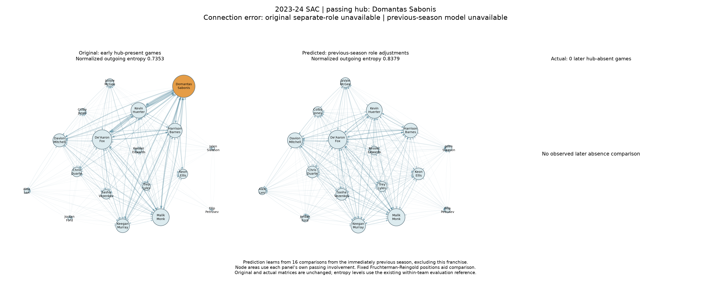

[Original matrix](../../data/nba_passing_output/all_season_hub_redistribution/2023-24/SAC/original_evaluation.csv) | [Predicted matrix](../../prediction_model/2023-24/SAC/predicted_evaluation.csv) | [Actual matrix](../../data/nba_passing_output/all_season_hub_redistribution/2023-24/SAC/actual_evaluation.csv)

## SAS | Jeremy Sochan

8 later absent games.

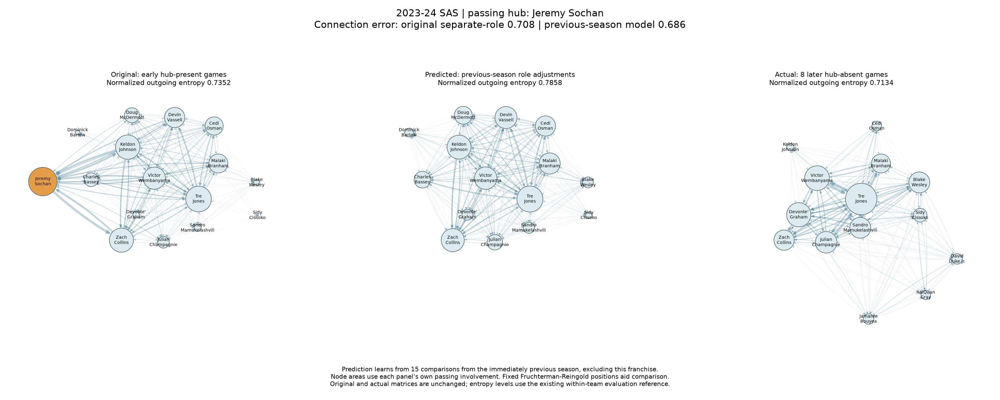

[Original matrix](../../data/nba_passing_output/all_season_hub_redistribution/2023-24/SAS/original_evaluation.csv) | [Predicted matrix](../../prediction_model/2023-24/SAS/predicted_evaluation.csv) | [Actual matrix](../../data/nba_passing_output/all_season_hub_redistribution/2023-24/SAS/actual_evaluation.csv)

## TOR | Dennis Schröder

0 later absent games.

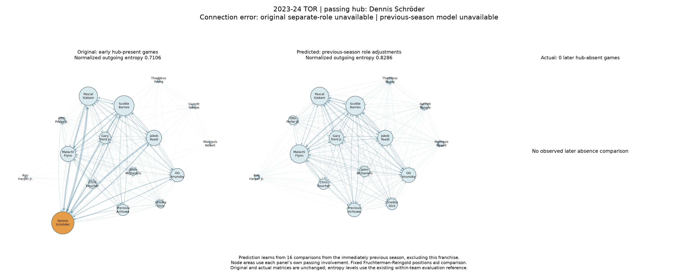

[Original matrix](../../data/nba_passing_output/all_season_hub_redistribution/2023-24/TOR/original_evaluation.csv) | [Predicted matrix](../../prediction_model/2023-24/TOR/predicted_evaluation.csv) | [Actual matrix](../../data/nba_passing_output/all_season_hub_redistribution/2023-24/TOR/actual_evaluation.csv)

## UTA | Keyonte George

7 later absent games.

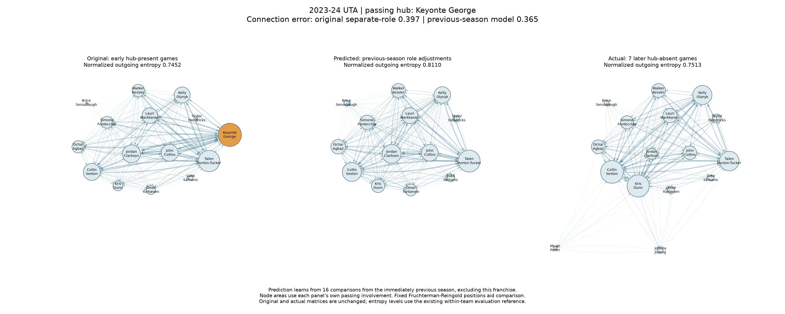

[Original matrix](../../data/nba_passing_output/all_season_hub_redistribution/2023-24/UTA/original_evaluation.csv) | [Predicted matrix](../../prediction_model/2023-24/UTA/predicted_evaluation.csv) | [Actual matrix](../../data/nba_passing_output/all_season_hub_redistribution/2023-24/UTA/actual_evaluation.csv)

## WAS | Tyus Jones

16 later absent games.

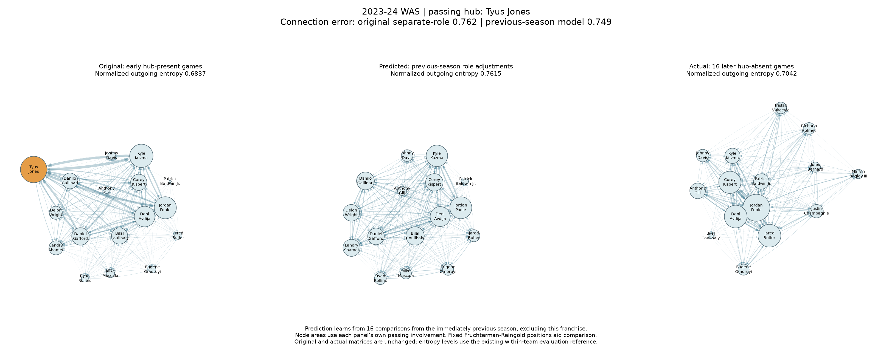

[Original matrix](../../data/nba_passing_output/all_season_hub_redistribution/2023-24/WAS/original_evaluation.csv) | [Predicted matrix](../../prediction_model/2023-24/WAS/predicted_evaluation.csv) | [Actual matrix](../../data/nba_passing_output/all_season_hub_redistribution/2023-24/WAS/actual_evaluation.csv)