# 2024-25: all30 team illustrations; evaluation includes only10+ later absences

Panels: original early hub present; final previous-season-only prediction; actual later hub absent. Open an image for full resolution. Node sizes use each panel's own passing involvement.

## ATL | Trae Young

5 later absent games.

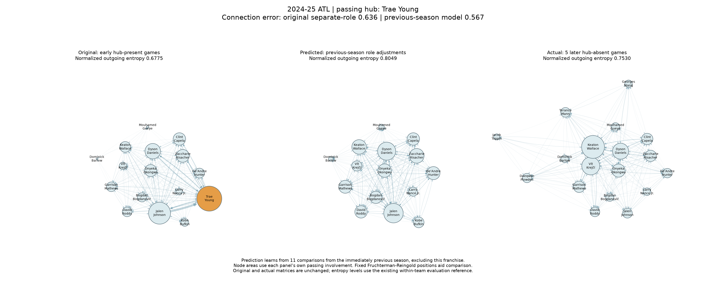

[Original matrix](../../data/nba_passing_output/all_season_hub_redistribution/2024-25/ATL/original_evaluation.csv) | [Predicted matrix](../../prediction_model/2024-25/ATL/predicted_evaluation.csv) | [Actual matrix](../../data/nba_passing_output/all_season_hub_redistribution/2024-25/ATL/actual_evaluation.csv)

## BKN | Dennis Schröder

0 later absent games.

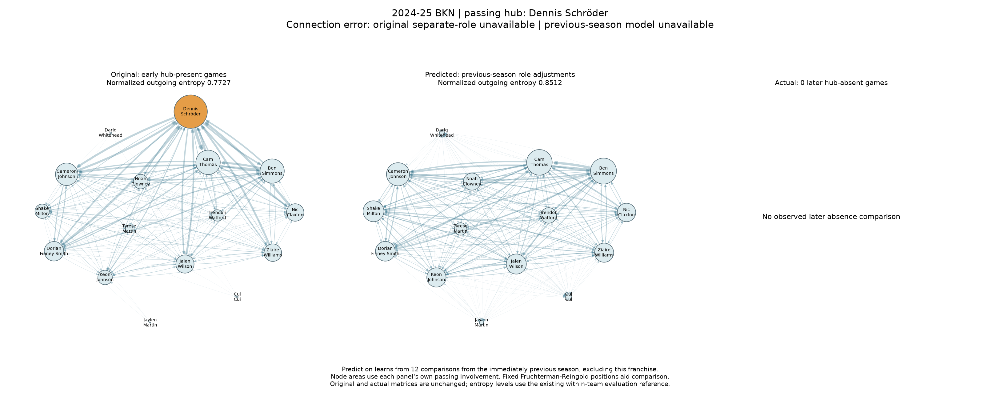

[Original matrix](../../data/nba_passing_output/all_season_hub_redistribution/2024-25/BKN/original_evaluation.csv) | [Predicted matrix](../../prediction_model/2024-25/BKN/predicted_evaluation.csv) | [Actual matrix](../../data/nba_passing_output/all_season_hub_redistribution/2024-25/BKN/actual_evaluation.csv)

## BOS | Jayson Tatum

10 later absent games.

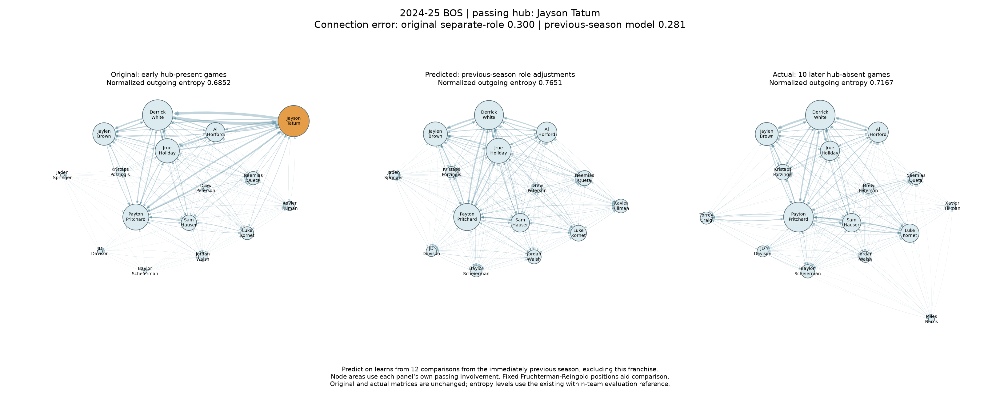

[Original matrix](../../data/nba_passing_output/all_season_hub_redistribution/2024-25/BOS/original_evaluation.csv) | [Predicted matrix](../../prediction_model/2024-25/BOS/predicted_evaluation.csv) | [Actual matrix](../../data/nba_passing_output/all_season_hub_redistribution/2024-25/BOS/actual_evaluation.csv)

## CHA | LaMelo Ball

33 later absent games.

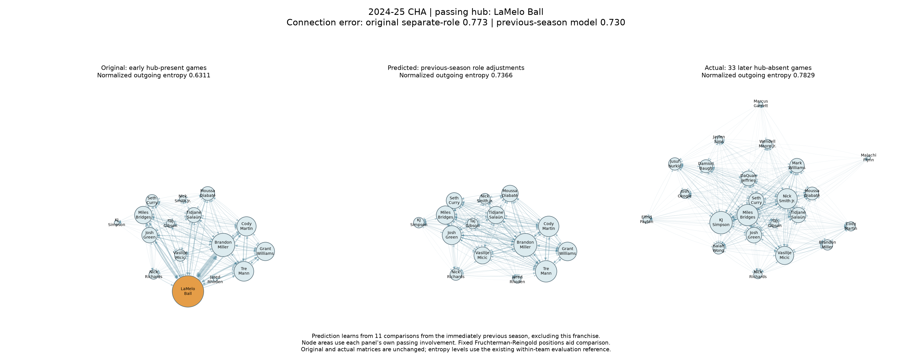

[Original matrix](../../data/nba_passing_output/all_season_hub_redistribution/2024-25/CHA/original_evaluation.csv) | [Predicted matrix](../../prediction_model/2024-25/CHA/predicted_evaluation.csv) | [Actual matrix](../../data/nba_passing_output/all_season_hub_redistribution/2024-25/CHA/actual_evaluation.csv)

## CHI | Josh Giddey

12 later absent games.

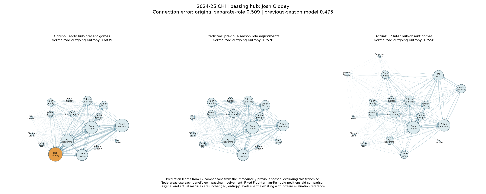

[Original matrix](../../data/nba_passing_output/all_season_hub_redistribution/2024-25/CHI/original_evaluation.csv) | [Predicted matrix](../../prediction_model/2024-25/CHI/predicted_evaluation.csv) | [Actual matrix](../../data/nba_passing_output/all_season_hub_redistribution/2024-25/CHI/actual_evaluation.csv)

## CLE | Darius Garland

6 later absent games.

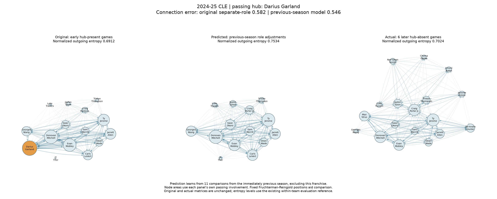

[Original matrix](../../data/nba_passing_output/all_season_hub_redistribution/2024-25/CLE/original_evaluation.csv) | [Predicted matrix](../../prediction_model/2024-25/CLE/predicted_evaluation.csv) | [Actual matrix](../../data/nba_passing_output/all_season_hub_redistribution/2024-25/CLE/actual_evaluation.csv)

## DAL | Kyrie Irving

31 later absent games.

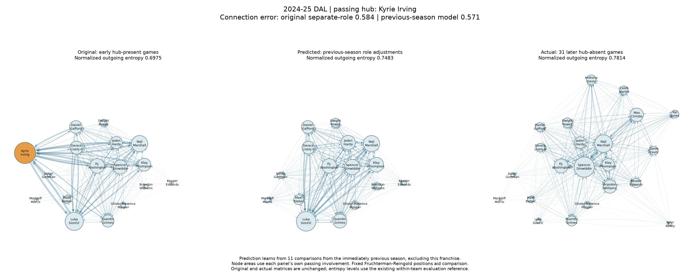

[Original matrix](../../data/nba_passing_output/all_season_hub_redistribution/2024-25/DAL/original_evaluation.csv) | [Predicted matrix](../../prediction_model/2024-25/DAL/predicted_evaluation.csv) | [Actual matrix](../../data/nba_passing_output/all_season_hub_redistribution/2024-25/DAL/actual_evaluation.csv)

## DEN | Nikola Jokić

9 later absent games.

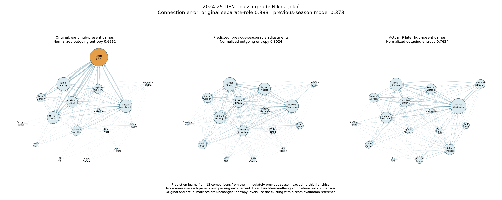

[Original matrix](../../data/nba_passing_output/all_season_hub_redistribution/2024-25/DEN/original_evaluation.csv) | [Predicted matrix](../../prediction_model/2024-25/DEN/predicted_evaluation.csv) | [Actual matrix](../../data/nba_passing_output/all_season_hub_redistribution/2024-25/DEN/actual_evaluation.csv)

## DET | Cade Cunningham

9 later absent games.

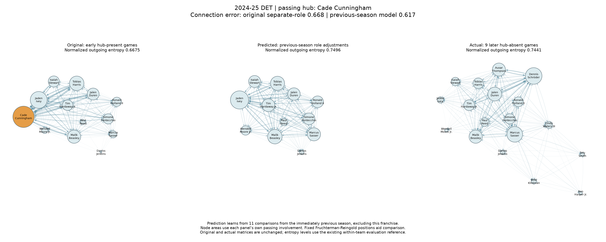

[Original matrix](../../data/nba_passing_output/all_season_hub_redistribution/2024-25/DET/original_evaluation.csv) | [Predicted matrix](../../prediction_model/2024-25/DET/predicted_evaluation.csv) | [Actual matrix](../../data/nba_passing_output/all_season_hub_redistribution/2024-25/DET/actual_evaluation.csv)

## GSW | Draymond Green

13 later absent games.

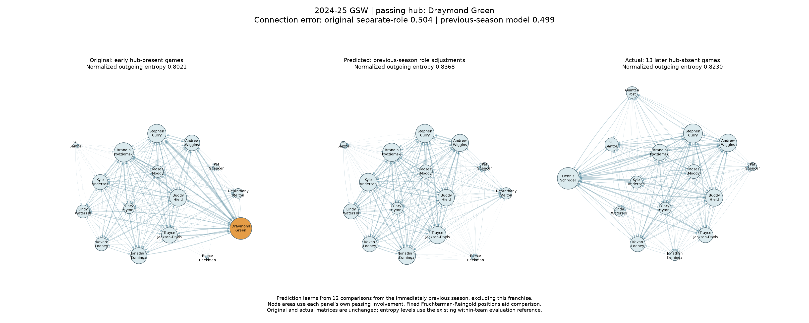

[Original matrix](../../data/nba_passing_output/all_season_hub_redistribution/2024-25/GSW/original_evaluation.csv) | [Predicted matrix](../../prediction_model/2024-25/GSW/predicted_evaluation.csv) | [Actual matrix](../../data/nba_passing_output/all_season_hub_redistribution/2024-25/GSW/actual_evaluation.csv)

## HOU | Fred VanVleet

21 later absent games.

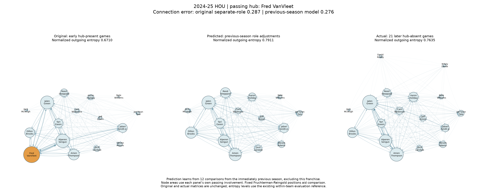

[Original matrix](../../data/nba_passing_output/all_season_hub_redistribution/2024-25/HOU/original_evaluation.csv) | [Predicted matrix](../../prediction_model/2024-25/HOU/predicted_evaluation.csv) | [Actual matrix](../../data/nba_passing_output/all_season_hub_redistribution/2024-25/HOU/actual_evaluation.csv)

## IND | Tyrese Haliburton

9 later absent games.

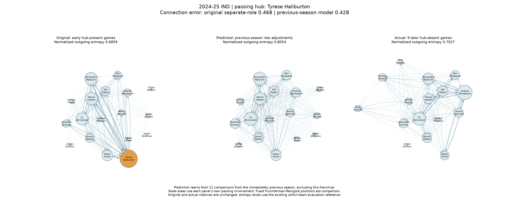

[Original matrix](../../data/nba_passing_output/all_season_hub_redistribution/2024-25/IND/original_evaluation.csv) | [Predicted matrix](../../prediction_model/2024-25/IND/predicted_evaluation.csv) | [Actual matrix](../../data/nba_passing_output/all_season_hub_redistribution/2024-25/IND/actual_evaluation.csv)

## LAC | James Harden

3 later absent games.

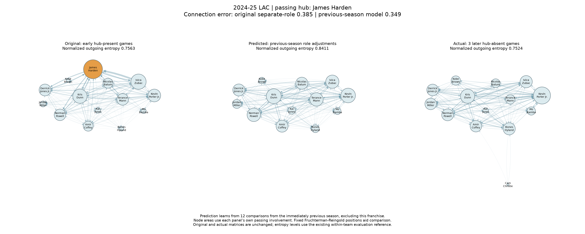

[Original matrix](../../data/nba_passing_output/all_season_hub_redistribution/2024-25/LAC/original_evaluation.csv) | [Predicted matrix](../../prediction_model/2024-25/LAC/predicted_evaluation.csv) | [Actual matrix](../../data/nba_passing_output/all_season_hub_redistribution/2024-25/LAC/actual_evaluation.csv)

## LAL | LeBron James

12 later absent games.

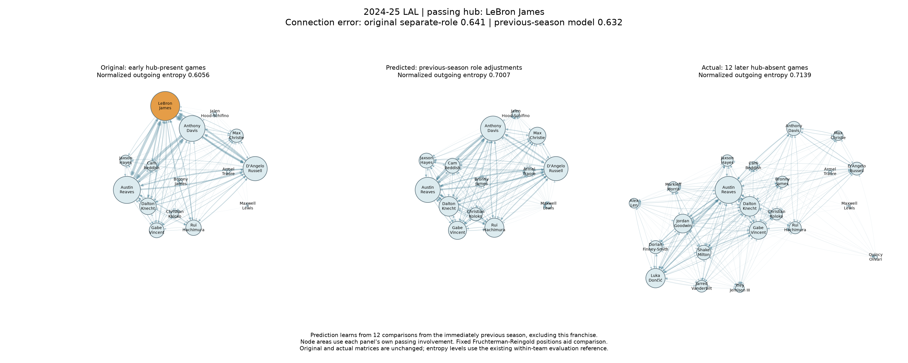

[Original matrix](../../data/nba_passing_output/all_season_hub_redistribution/2024-25/LAL/original_evaluation.csv) | [Predicted matrix](../../prediction_model/2024-25/LAL/predicted_evaluation.csv) | [Actual matrix](../../data/nba_passing_output/all_season_hub_redistribution/2024-25/LAL/actual_evaluation.csv)

## MEM | Scotty Pippen Jr.

3 later absent games.

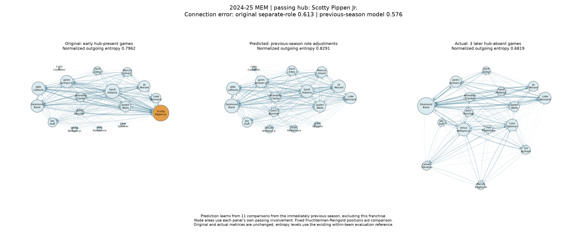

[Original matrix](../../data/nba_passing_output/all_season_hub_redistribution/2024-25/MEM/original_evaluation.csv) | [Predicted matrix](../../prediction_model/2024-25/MEM/predicted_evaluation.csv) | [Actual matrix](../../data/nba_passing_output/all_season_hub_redistribution/2024-25/MEM/actual_evaluation.csv)

## MIA | Tyler Herro

5 later absent games.

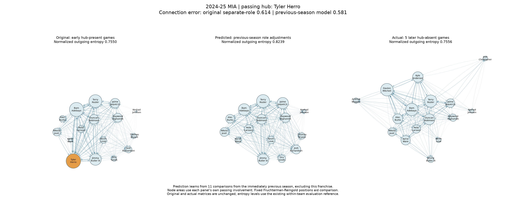

[Original matrix](../../data/nba_passing_output/all_season_hub_redistribution/2024-25/MIA/original_evaluation.csv) | [Predicted matrix](../../prediction_model/2024-25/MIA/predicted_evaluation.csv) | [Actual matrix](../../data/nba_passing_output/all_season_hub_redistribution/2024-25/MIA/actual_evaluation.csv)

## MIL | Damian Lillard

21 later absent games.

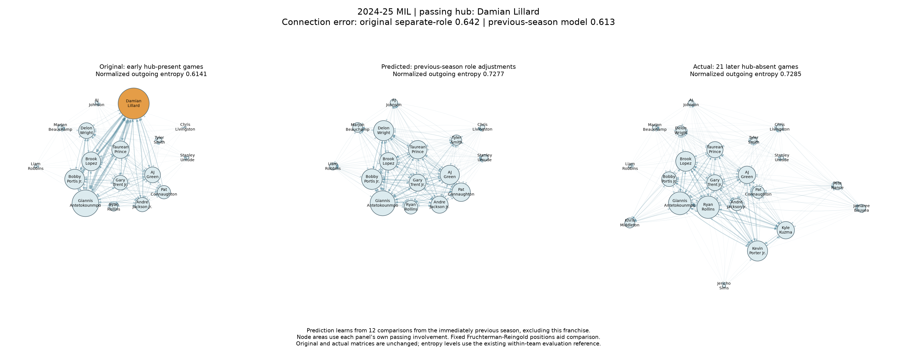

[Original matrix](../../data/nba_passing_output/all_season_hub_redistribution/2024-25/MIL/original_evaluation.csv) | [Predicted matrix](../../prediction_model/2024-25/MIL/predicted_evaluation.csv) | [Actual matrix](../../data/nba_passing_output/all_season_hub_redistribution/2024-25/MIL/actual_evaluation.csv)

## MIN | Anthony Edwards

3 later absent games.

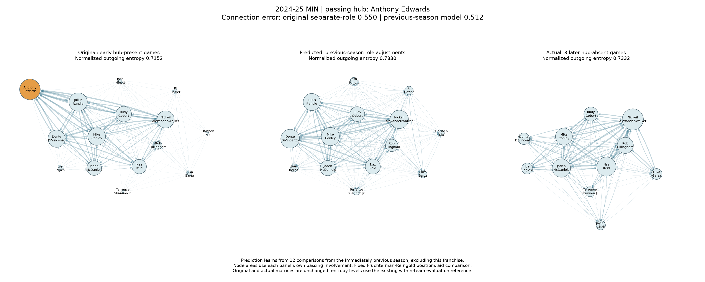

[Original matrix](../../data/nba_passing_output/all_season_hub_redistribution/2024-25/MIN/original_evaluation.csv) | [Predicted matrix](../../prediction_model/2024-25/MIN/predicted_evaluation.csv) | [Actual matrix](../../data/nba_passing_output/all_season_hub_redistribution/2024-25/MIN/actual_evaluation.csv)

## NOP | Brandon Ingram

60 later absent games.

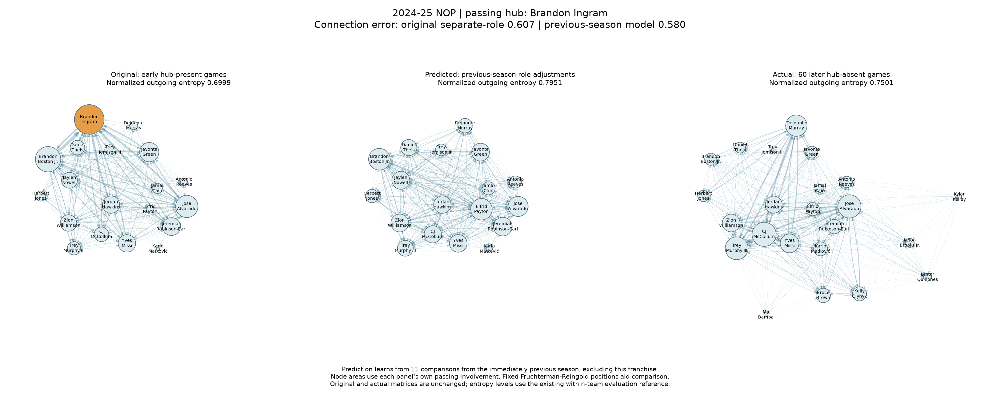

[Original matrix](../../data/nba_passing_output/all_season_hub_redistribution/2024-25/NOP/original_evaluation.csv) | [Predicted matrix](../../prediction_model/2024-25/NOP/predicted_evaluation.csv) | [Actual matrix](../../data/nba_passing_output/all_season_hub_redistribution/2024-25/NOP/actual_evaluation.csv)

## NYK | Jalen Brunson

17 later absent games.

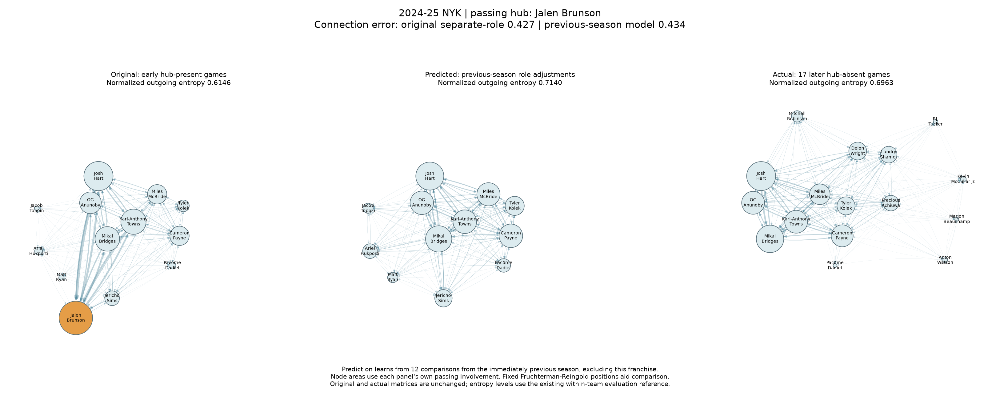

[Original matrix](../../data/nba_passing_output/all_season_hub_redistribution/2024-25/NYK/original_evaluation.csv) | [Predicted matrix](../../prediction_model/2024-25/NYK/predicted_evaluation.csv) | [Actual matrix](../../data/nba_passing_output/all_season_hub_redistribution/2024-25/NYK/actual_evaluation.csv)

## OKC | Jalen Williams

13 later absent games.

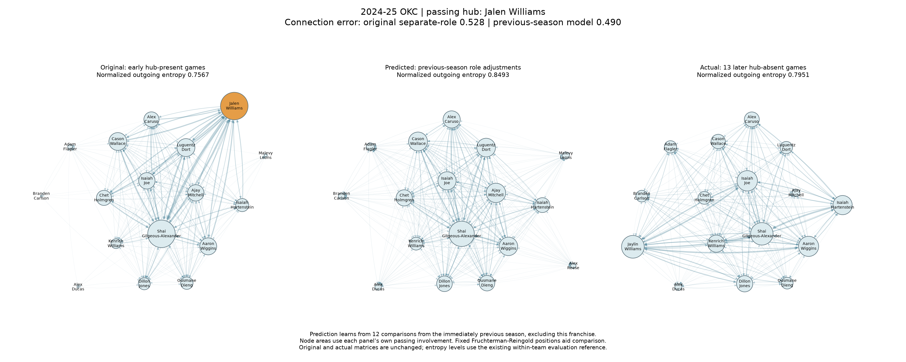

[Original matrix](../../data/nba_passing_output/all_season_hub_redistribution/2024-25/OKC/original_evaluation.csv) | [Predicted matrix](../../prediction_model/2024-25/OKC/predicted_evaluation.csv) | [Actual matrix](../../data/nba_passing_output/all_season_hub_redistribution/2024-25/OKC/actual_evaluation.csv)

## ORL | Jalen Suggs

46 later absent games.

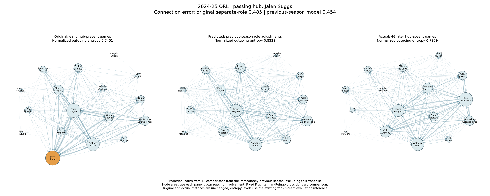

[Original matrix](../../data/nba_passing_output/all_season_hub_redistribution/2024-25/ORL/original_evaluation.csv) | [Predicted matrix](../../prediction_model/2024-25/ORL/predicted_evaluation.csv) | [Actual matrix](../../data/nba_passing_output/all_season_hub_redistribution/2024-25/ORL/actual_evaluation.csv)

## PHI | Tyrese Maxey

24 later absent games.

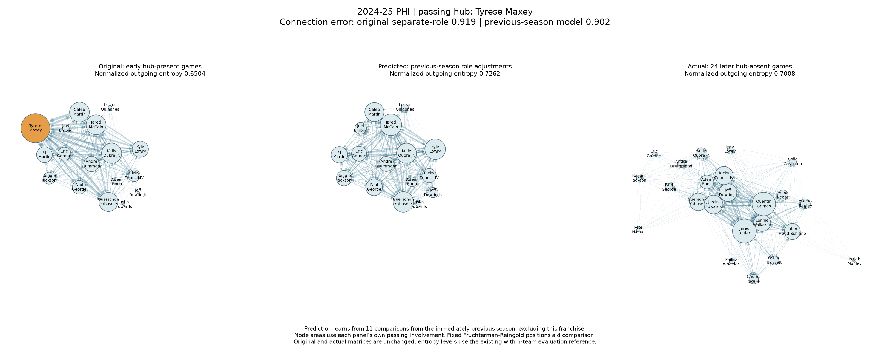

[Original matrix](../../data/nba_passing_output/all_season_hub_redistribution/2024-25/PHI/original_evaluation.csv) | [Predicted matrix](../../prediction_model/2024-25/PHI/predicted_evaluation.csv) | [Actual matrix](../../data/nba_passing_output/all_season_hub_redistribution/2024-25/PHI/actual_evaluation.csv)

## PHX | Tyus Jones

1 later absent games.

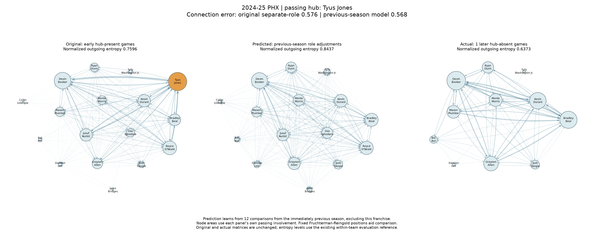

[Original matrix](../../data/nba_passing_output/all_season_hub_redistribution/2024-25/PHX/original_evaluation.csv) | [Predicted matrix](../../prediction_model/2024-25/PHX/predicted_evaluation.csv) | [Actual matrix](../../data/nba_passing_output/all_season_hub_redistribution/2024-25/PHX/actual_evaluation.csv)

## POR | Anfernee Simons

9 later absent games.

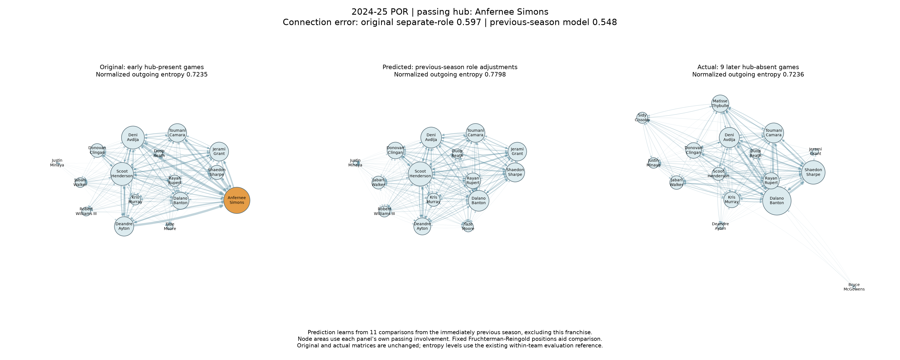

[Original matrix](../../data/nba_passing_output/all_season_hub_redistribution/2024-25/POR/original_evaluation.csv) | [Predicted matrix](../../prediction_model/2024-25/POR/predicted_evaluation.csv) | [Actual matrix](../../data/nba_passing_output/all_season_hub_redistribution/2024-25/POR/actual_evaluation.csv)

## SAC | De'Aaron Fox

3 later absent games.

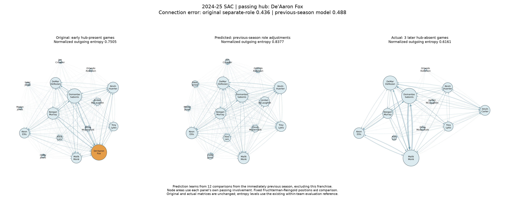

[Original matrix](../../data/nba_passing_output/all_season_hub_redistribution/2024-25/SAC/original_evaluation.csv) | [Predicted matrix](../../prediction_model/2024-25/SAC/predicted_evaluation.csv) | [Actual matrix](../../data/nba_passing_output/all_season_hub_redistribution/2024-25/SAC/actual_evaluation.csv)

## SAS | Chris Paul

0 later absent games.

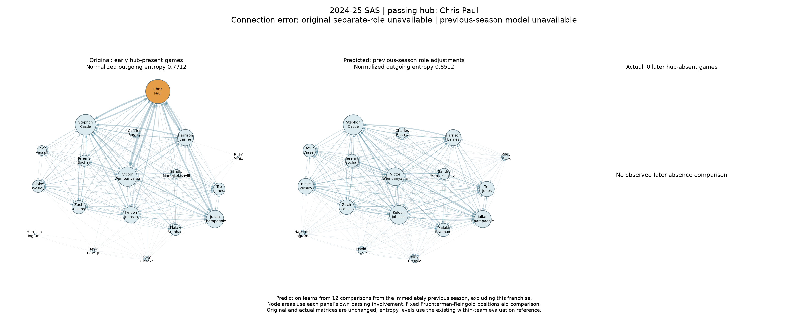

[Original matrix](../../data/nba_passing_output/all_season_hub_redistribution/2024-25/SAS/original_evaluation.csv) | [Predicted matrix](../../prediction_model/2024-25/SAS/predicted_evaluation.csv) | [Actual matrix](../../data/nba_passing_output/all_season_hub_redistribution/2024-25/SAS/actual_evaluation.csv)

## TOR | Davion Mitchell

5 later absent games.

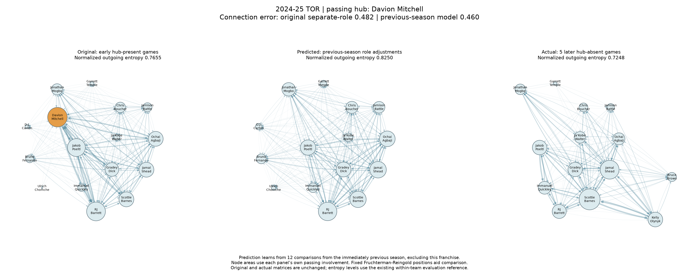

[Original matrix](../../data/nba_passing_output/all_season_hub_redistribution/2024-25/TOR/original_evaluation.csv) | [Predicted matrix](../../prediction_model/2024-25/TOR/predicted_evaluation.csv) | [Actual matrix](../../data/nba_passing_output/all_season_hub_redistribution/2024-25/TOR/actual_evaluation.csv)

## UTA | Keyonte George

14 later absent games.

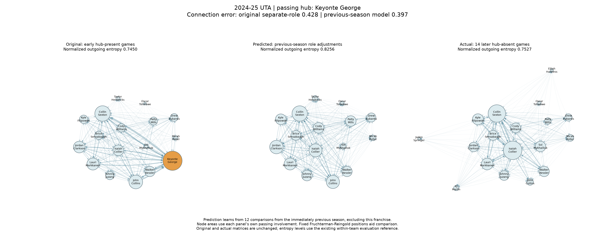

[Original matrix](../../data/nba_passing_output/all_season_hub_redistribution/2024-25/UTA/original_evaluation.csv) | [Predicted matrix](../../prediction_model/2024-25/UTA/predicted_evaluation.csv) | [Actual matrix](../../data/nba_passing_output/all_season_hub_redistribution/2024-25/UTA/actual_evaluation.csv)

## WAS | Bub Carrington

0 later absent games.

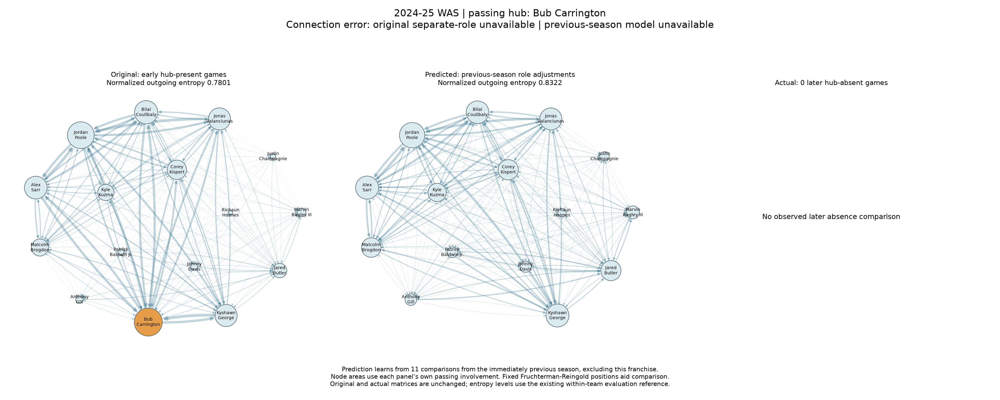

[Original matrix](../../data/nba_passing_output/all_season_hub_redistribution/2024-25/WAS/original_evaluation.csv) | [Predicted matrix](../../prediction_model/2024-25/WAS/predicted_evaluation.csv) | [Actual matrix](../../data/nba_passing_output/all_season_hub_redistribution/2024-25/WAS/actual_evaluation.csv)