# 2025-26: 18 teams with10+ later absences

Panels: original early hub present; final previous-season-only prediction; actual later hub absent. Open an image for full resolution. Node sizes use each panel's own passing involvement.

## BKN | Nic Claxton

13 later absent games.

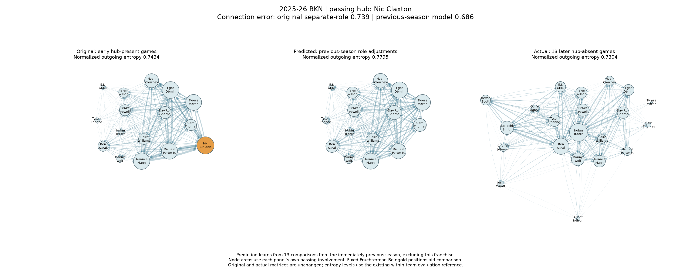

[Original matrix](../../data/nba_passing_output/all_season_hub_redistribution/2025-26/BKN/original_evaluation.csv) | [Predicted matrix](../../prediction_model/2025-26/BKN/predicted_evaluation.csv) | [Actual matrix](../../data/nba_passing_output/all_season_hub_redistribution/2025-26/BKN/actual_evaluation.csv)

## CHI | Josh Giddey

26 later absent games.

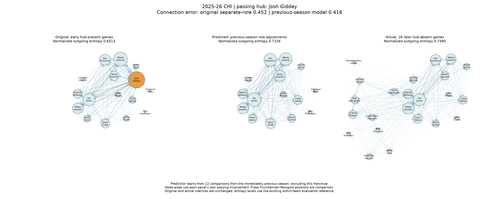

[Original matrix](../../data/nba_passing_output/all_season_hub_redistribution/2025-26/CHI/original_evaluation.csv) | [Predicted matrix](../../prediction_model/2025-26/CHI/predicted_evaluation.csv) | [Actual matrix](../../data/nba_passing_output/all_season_hub_redistribution/2025-26/CHI/actual_evaluation.csv)

## CLE | Donovan Mitchell

10 later absent games.

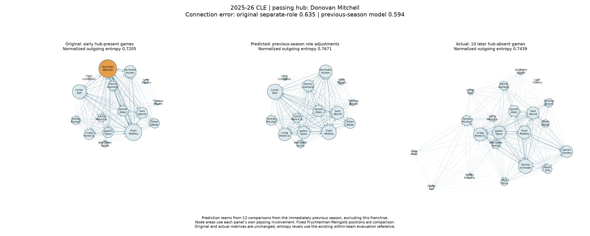

[Original matrix](../../data/nba_passing_output/all_season_hub_redistribution/2025-26/CLE/original_evaluation.csv) | [Predicted matrix](../../prediction_model/2025-26/CLE/predicted_evaluation.csv) | [Actual matrix](../../data/nba_passing_output/all_season_hub_redistribution/2025-26/CLE/actual_evaluation.csv)

## DAL | Cooper Flagg

11 later absent games.

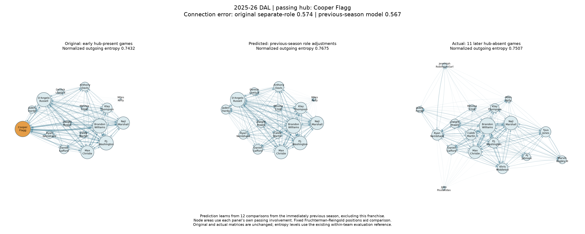

[Original matrix](../../data/nba_passing_output/all_season_hub_redistribution/2025-26/DAL/original_evaluation.csv) | [Predicted matrix](../../prediction_model/2025-26/DAL/predicted_evaluation.csv) | [Actual matrix](../../data/nba_passing_output/all_season_hub_redistribution/2025-26/DAL/actual_evaluation.csv)

## DEN | Nikola Jokić

17 later absent games.

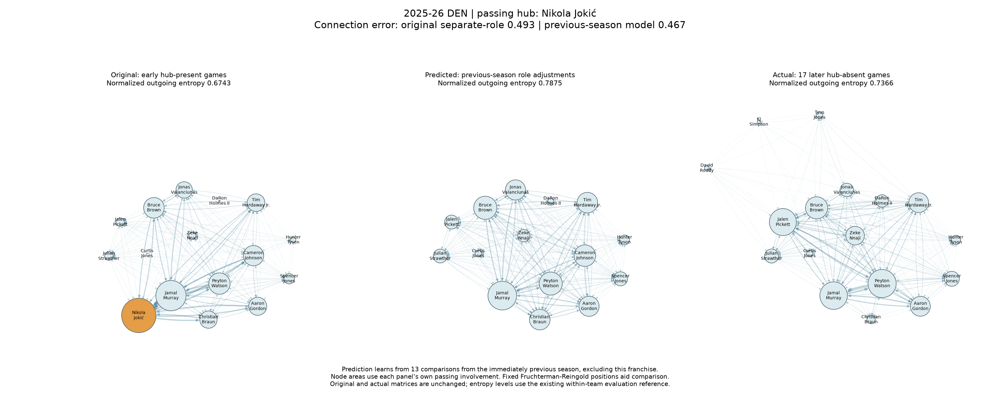

[Original matrix](../../data/nba_passing_output/all_season_hub_redistribution/2025-26/DEN/original_evaluation.csv) | [Predicted matrix](../../prediction_model/2025-26/DEN/predicted_evaluation.csv) | [Actual matrix](../../data/nba_passing_output/all_season_hub_redistribution/2025-26/DEN/actual_evaluation.csv)

## DET | Cade Cunningham

15 later absent games.

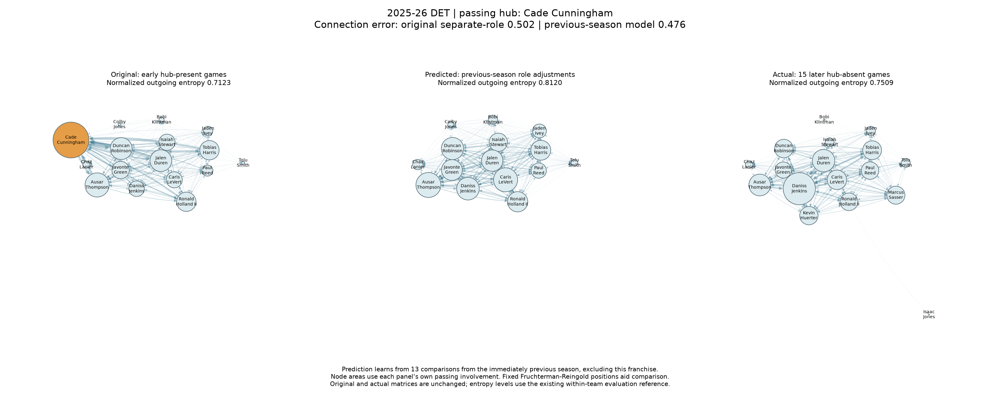

[Original matrix](../../data/nba_passing_output/all_season_hub_redistribution/2025-26/DET/original_evaluation.csv) | [Predicted matrix](../../prediction_model/2025-26/DET/predicted_evaluation.csv) | [Actual matrix](../../data/nba_passing_output/all_season_hub_redistribution/2025-26/DET/actual_evaluation.csv)

## GSW | Draymond Green

11 later absent games.

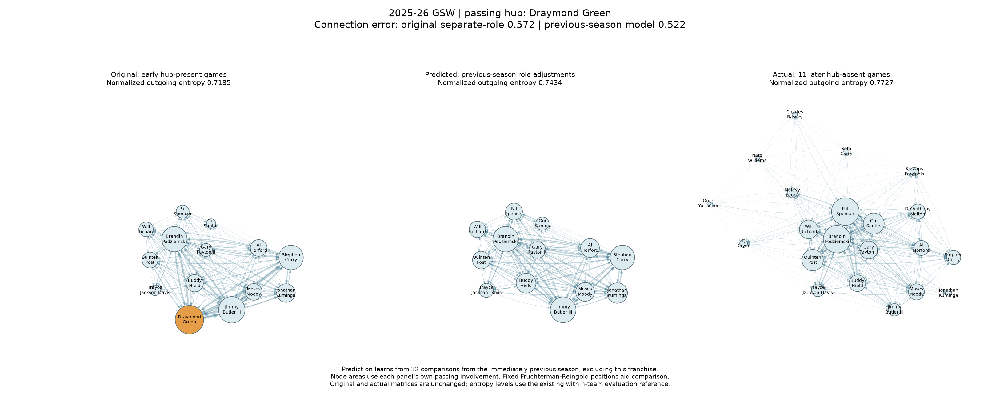

[Original matrix](../../data/nba_passing_output/all_season_hub_redistribution/2025-26/GSW/original_evaluation.csv) | [Predicted matrix](../../prediction_model/2025-26/GSW/predicted_evaluation.csv) | [Actual matrix](../../data/nba_passing_output/all_season_hub_redistribution/2025-26/GSW/actual_evaluation.csv)

## IND | Pascal Siakam

19 later absent games.

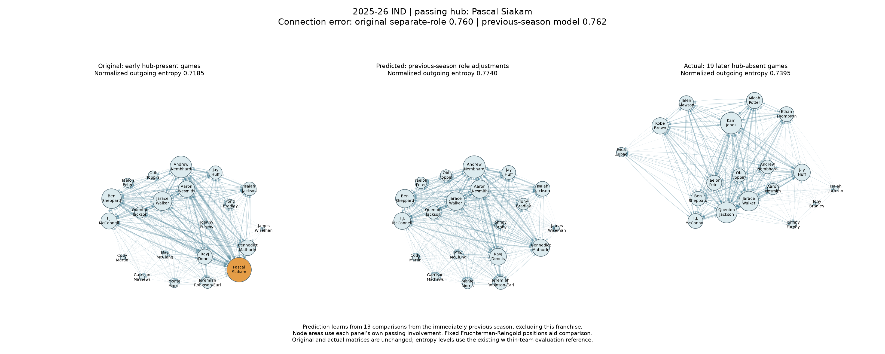

[Original matrix](../../data/nba_passing_output/all_season_hub_redistribution/2025-26/IND/original_evaluation.csv) | [Predicted matrix](../../prediction_model/2025-26/IND/predicted_evaluation.csv) | [Actual matrix](../../data/nba_passing_output/all_season_hub_redistribution/2025-26/IND/actual_evaluation.csv)

## LAL | Luka Dončić

14 later absent games.

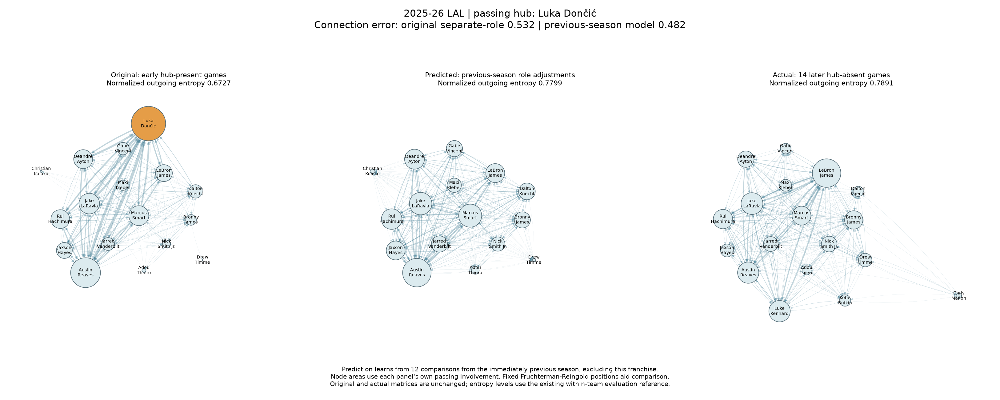

[Original matrix](../../data/nba_passing_output/all_season_hub_redistribution/2025-26/LAL/original_evaluation.csv) | [Predicted matrix](../../prediction_model/2025-26/LAL/predicted_evaluation.csv) | [Actual matrix](../../data/nba_passing_output/all_season_hub_redistribution/2025-26/LAL/actual_evaluation.csv)

## MEM | Cam Spencer

10 later absent games.

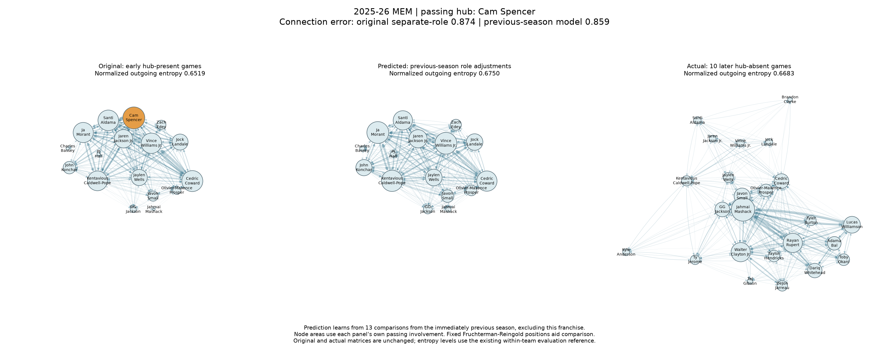

[Original matrix](../../data/nba_passing_output/all_season_hub_redistribution/2025-26/MEM/original_evaluation.csv) | [Predicted matrix](../../prediction_model/2025-26/MEM/predicted_evaluation.csv) | [Actual matrix](../../data/nba_passing_output/all_season_hub_redistribution/2025-26/MEM/actual_evaluation.csv)

## MIA | Davion Mitchell

12 later absent games.

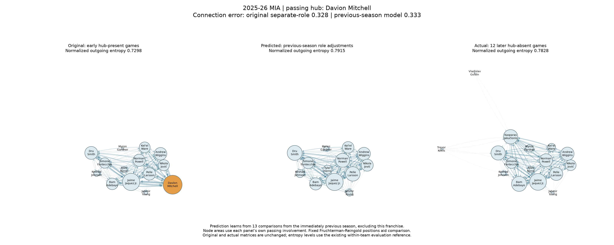

[Original matrix](../../data/nba_passing_output/all_season_hub_redistribution/2025-26/MIA/original_evaluation.csv) | [Predicted matrix](../../prediction_model/2025-26/MIA/predicted_evaluation.csv) | [Actual matrix](../../data/nba_passing_output/all_season_hub_redistribution/2025-26/MIA/actual_evaluation.csv)

## OKC | Shai Gilgeous-Alexander

14 later absent games.

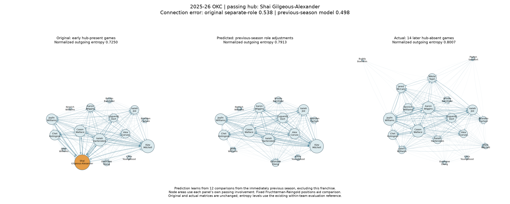

[Original matrix](../../data/nba_passing_output/all_season_hub_redistribution/2025-26/OKC/original_evaluation.csv) | [Predicted matrix](../../prediction_model/2025-26/OKC/predicted_evaluation.csv) | [Actual matrix](../../data/nba_passing_output/all_season_hub_redistribution/2025-26/OKC/actual_evaluation.csv)

## PHI | Tyrese Maxey

12 later absent games.

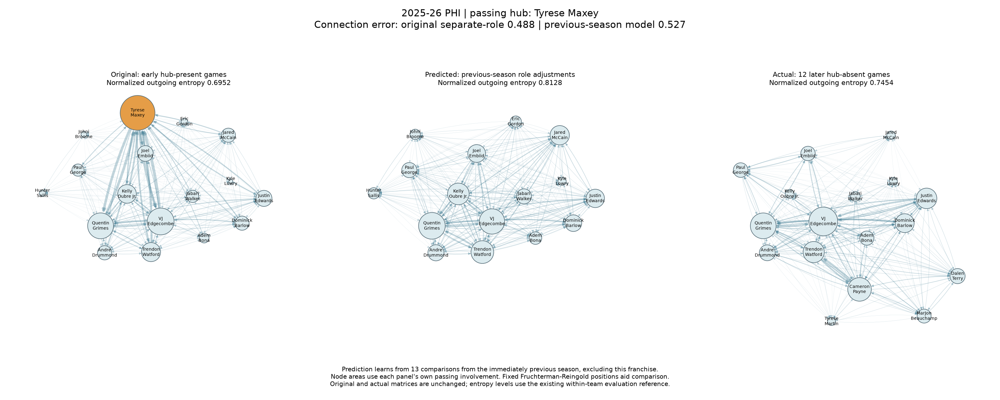

[Original matrix](../../data/nba_passing_output/all_season_hub_redistribution/2025-26/PHI/original_evaluation.csv) | [Predicted matrix](../../prediction_model/2025-26/PHI/predicted_evaluation.csv) | [Actual matrix](../../data/nba_passing_output/all_season_hub_redistribution/2025-26/PHI/actual_evaluation.csv)

## PHX | Devin Booker

18 later absent games.

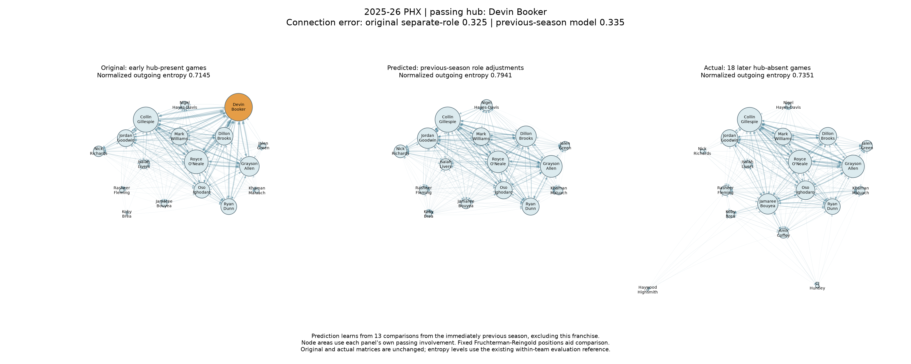

[Original matrix](../../data/nba_passing_output/all_season_hub_redistribution/2025-26/PHX/original_evaluation.csv) | [Predicted matrix](../../prediction_model/2025-26/PHX/predicted_evaluation.csv) | [Actual matrix](../../data/nba_passing_output/all_season_hub_redistribution/2025-26/PHX/actual_evaluation.csv)

## POR | Deni Avdija

16 later absent games.

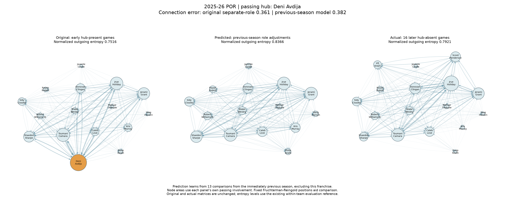

[Original matrix](../../data/nba_passing_output/all_season_hub_redistribution/2025-26/POR/original_evaluation.csv) | [Predicted matrix](../../prediction_model/2025-26/POR/predicted_evaluation.csv) | [Actual matrix](../../data/nba_passing_output/all_season_hub_redistribution/2025-26/POR/actual_evaluation.csv)

## TOR | Immanuel Quickley

12 later absent games.

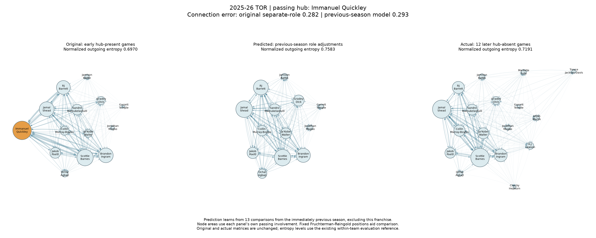

[Original matrix](../../data/nba_passing_output/all_season_hub_redistribution/2025-26/TOR/original_evaluation.csv) | [Predicted matrix](../../prediction_model/2025-26/TOR/predicted_evaluation.csv) | [Actual matrix](../../data/nba_passing_output/all_season_hub_redistribution/2025-26/TOR/actual_evaluation.csv)

## UTA | Keyonte George

28 later absent games.

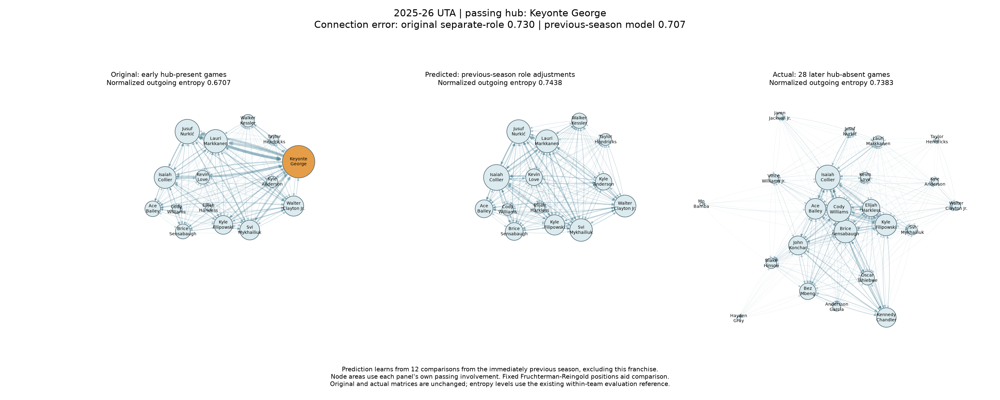

[Original matrix](../../data/nba_passing_output/all_season_hub_redistribution/2025-26/UTA/original_evaluation.csv) | [Predicted matrix](../../prediction_model/2025-26/UTA/predicted_evaluation.csv) | [Actual matrix](../../data/nba_passing_output/all_season_hub_redistribution/2025-26/UTA/actual_evaluation.csv)

## WAS | Kyshawn George

32 later absent games.

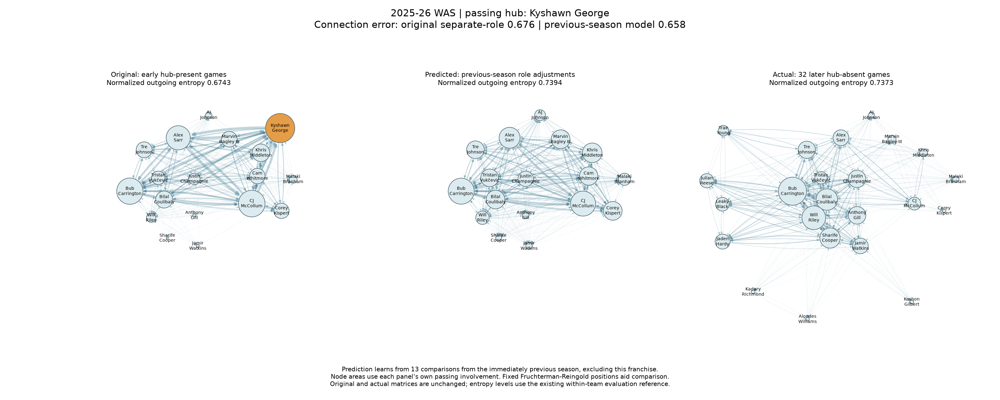

[Original matrix](../../data/nba_passing_output/all_season_hub_redistribution/2025-26/WAS/original_evaluation.csv) | [Predicted matrix](../../prediction_model/2025-26/WAS/predicted_evaluation.csv) | [Actual matrix](../../data/nba_passing_output/all_season_hub_redistribution/2025-26/WAS/actual_evaluation.csv)

[All30 team illustrations](all_teams.md) | [Season PDF](../2025-26_all_30_teams.pdf)